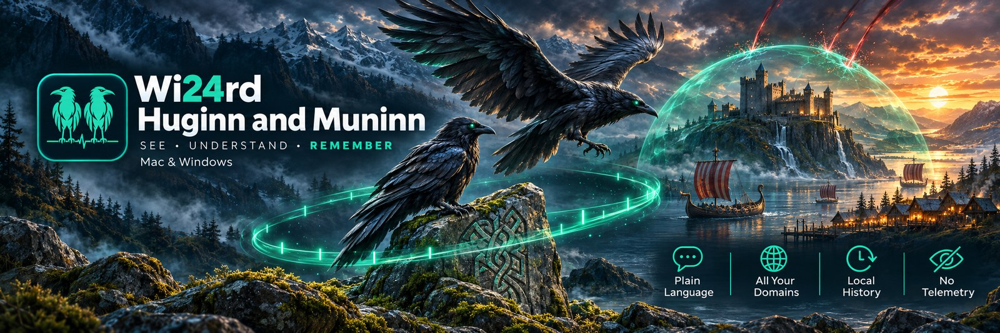
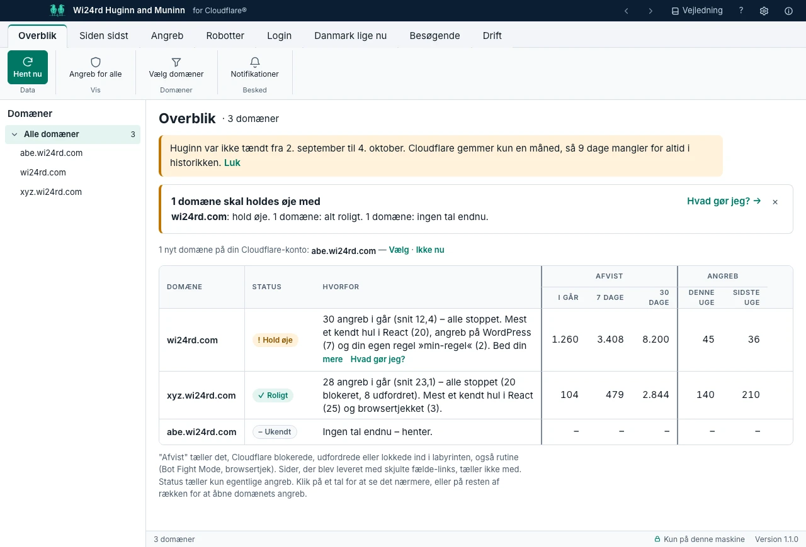
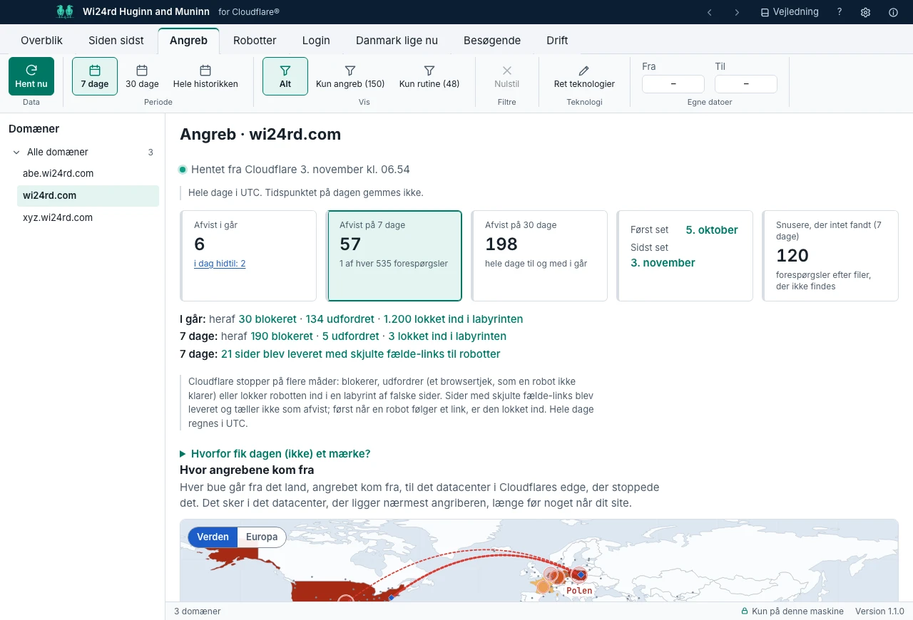
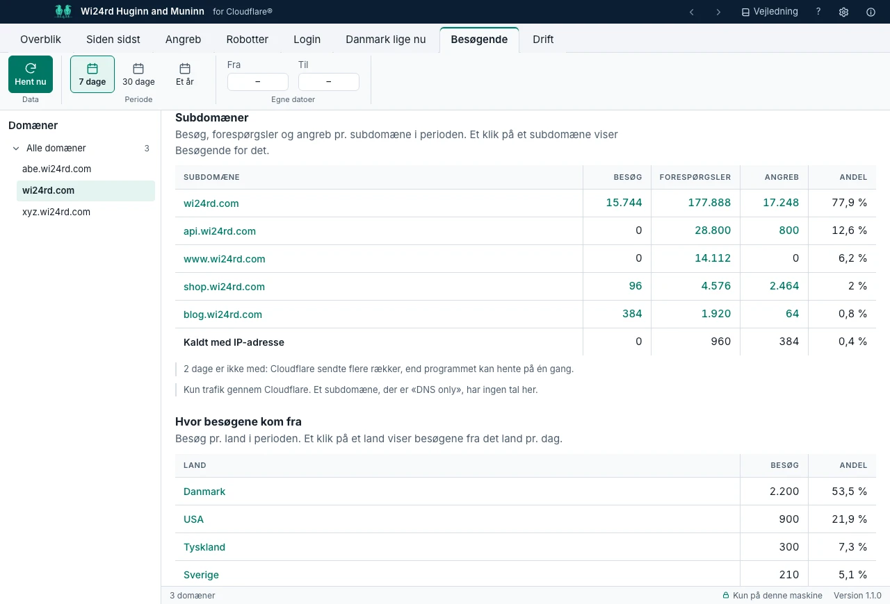
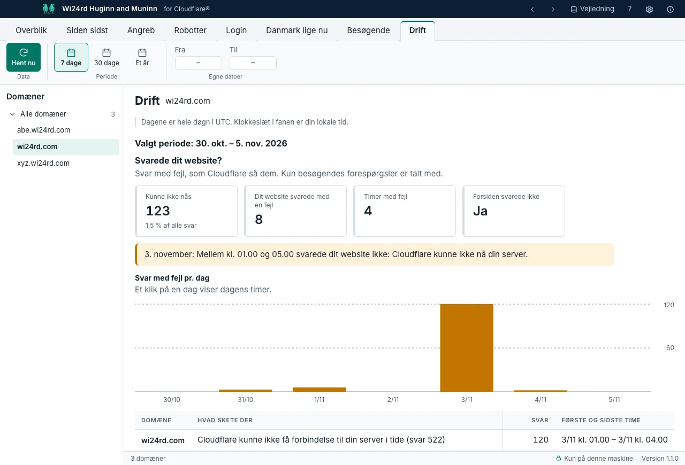

# Wi24rd Huginn and Muninn
<sub>for Cloudflare®</sub>

*Sikkerhed er ikke noget, man køber. Det er noget, man forstår.*

[](https://github.com/wi24rd-com/huginn-muninn/actions/workflows/ci.yml)
[](https://github.com/wi24rd-com/huginn-muninn/releases/latest)
[](LICENSE)


### [⬇ Hent Huginn and Muninn 1.1.0 til macOS](https://github.com/wi24rd-com/huginn-muninn/releases/latest)
Signeret og notariseret af Apple · Apple silicon · macOS 11 eller nyere · åbn zip-filen, og træk programmet til Programmer

**Windows:** ikke udgivet endnu. En Windows-udgave er på vej.

Et skrivebordsprogram (Tauri), der viser, hvad der faktisk sker mod **dine egne** Cloudflare-domæner — i klart sprog, på tværs af alle dine zoner og med en lokal historik, der rækker længere end Cloudflares 31 dage.

- **Huginn (tanke):** det, der sker nu — angrebene, hvad der blev stoppet og hvordan.
- **Muninn (hukommelse):** det, der er sket — hver færdig dag gemmes lokalt.

<picture>
  <source media="(prefers-color-scheme: dark)" srcset="docs/manual/img/readme-overblik--dark-da.webp">
  
</picture>

## Privatliv: hvad programmet sender, og hvorhen
- **Kun til Cloudflare:** programmet laver selv kun netværkskald til én vært, `api.cloudflare.com`, for dine zoner, tallene for dine valgte domæner, Cloudflares egne fund og Cloudflare Radar. Hvert kald har dit API Token og navnet `huginn-muninn/<version>` med.
- **Dit API Token kan kun læse:** giv det kun læserettigheder; vejledningen viser [de to rettigheder, det skal have](docs/manual/da/31-cloudflare.md). Det gemmes i styresystemets nøglering, aldrig i en fil, og sendes kun til Cloudflare. Med flere API Tokens (ét pr. Cloudflare-konto) har hvert sin post i nøgleringen, og hvert sendes kun med kaldene for sin egen kontos domæner.
- **Intet til Wi24rd:** ingen telemetri, ingen fejlrapporter, ingen konto og intet tjek for opdateringer. Programmet leder ikke selv efter nye udgaver.
- **Links åbner i din browser, og kun når du klikker:** et CVE-nummer (cve.org), kildelinjen under Radar-tal (radar.cloudflare.com), **Opret API Token hos Cloudflare** og Cloudflares egne fund (dash.cloudflare.com) og **Vejledning** (wi24rd.com). Programmet henter ikke selv noget fra de sider.
- **På din computer:** tallene ligger i én SQLite-fil i `~/Library/Application Support/com.wi24rd.huginn-muninn/`. Se [Data og historik](docs/manual/da/70-data.md).
- **Tjek det selv:** den eneste adresse i koden står i `src-tauri/src/cf.rs`, og vinduets content security policy i `src-tauri/tauri.conf.json` lader siden tale med programmet selv og intet andet. En netværksovervågning som Little Snitch eller LuLu skal vise `api.cloudflare.com` og intet andet.

## Det kan du se
- **Overblik** (⌘1): én række pr. domæne med status (**Handl**, **Hold øje**, **Roligt**, **Ukendt**), hvorfor, afviste forespørgsler og angreb, under en domslinje som "Intet at gøre". Med **Vælg domæner** vælger du de domæner, Huginn henter og viser.
- **Siden sidst** (⌘2): status for i går på alle dine domæner, én linje hver, og hvad der er nyt, siden du kiggede sidst. Et klik på en notifikation åbner den.
- **Angreb** (⌘3): hvad Cloudflare afviste og hvordan, reglerne og de kendte huller (CVE), et verdenskort over, hvor angrebene kom fra, mails sendt i dit domænes navn og følsomme filer, der svarede 200. Et klik på et tal, et land eller en regel filtrerer siden.
- **Robotter** (⌘4): hvem der læser dit site, i syv grupper fra Cloudflares verificerede kategorier, og hvad der kan ske, hvis du blokerer en gruppe. Blokering laver du selv hos Cloudflare.
- **Login** (⌘5): hvad der skete på de login-stier, du selv slår til pr. domæne, og hvor mange forsøg der brugte et kodeord fra et kendt læk. Kodeord gemmes aldrig.
- **Danmark lige nu** (⌘6; navnet følger dit land): angrebene på dine domæner ved siden af verden fra Cloudflare Radar, og fanen **Verden** med de mest ramte lande og internetforstyrrelser.
- **Besøgende** (⌘7): unikke besøgende et år tilbage, besøg pr. land, kendte robotter og de mest besøgte sider.
- **Drift** (⌘8): om dit website svarede, med fejl pr. dag og pr. time, og hvor meget Cloudflare selv klarede fra sin cache.
- **Flere Cloudflare-konti:** ét API Token pr. konto under **Indstillinger** › **Forbindelse**. Domænerne fra dem alle vises samlet.
- **Subdomæner:** for ét domæne viser Besøgende, Angreb og Drift tallene pr. subdomæne (fx `www` og `shop`). API Tokenet skal ikke have flere rettigheder.

**Angreb:** afviste forespørgsler, hvordan de blev stoppet, og hvor de kom fra.

<picture>
  <source media="(prefers-color-scheme: dark)" srcset="docs/manual/img/readme-angreb--dark-da.webp">
  
</picture>

**Besøgende med subdomæner:** besøg, forespørgsler og angreb pr. subdomæne for ét domæne.

<picture>
  <source media="(prefers-color-scheme: dark)" srcset="docs/manual/img/readme-besoegende-subdomaener--dark-da.webp">
  
</picture>

**Drift:** en nat, hvor websitet ikke svarede.

<picture>
  <source media="(prefers-color-scheme: dark)" srcset="docs/manual/img/readme-drift--dark-da.webp">
  
</picture>

Alle visninger, indstillinger og notifikationer er beskrevet i [brugervejledningen](docs/manual/da/00-index.md).

## Installation og krav
Hent `Huginn-Muninn-1.1.0.zip` under [Releases](https://github.com/wi24rd-com/huginn-muninn/releases/latest), åbn den, og træk **Huginn and Muninn** til din Programmer-mappe.

- **Mac:** macOS 11 eller nyere og en Mac med Apple silicon. Version 1.1.0 er signeret med Developer ID og notariseret af Apple. Windows-udgaven er ikke udgivet endnu, og der findes ingen Linux-udgave.
- **Cloudflare:** en konto med mindst ét domæne, på enhver plan, også Free, og et API Token med de to læserettigheder.

Se [Installation](docs/manual/da/20-installation.md) og [Afinstallation](docs/manual/da/90-afinstallation.md).

## Verificér det, du har hentet
Du kan tjekke, at den fil, du har hentet, er den, der blev udgivet, og at programmet er signeret af udvikleren og notariseret af Apple. Kør kommandoerne i Terminal.

**1. Zip-filens kontrolsum**
```
shasum -a 256 ~/Downloads/Huginn-Muninn-1.1.0.zip
```
Linjen skal begynde med den SHA-256, der står i [udgivelsesteksten](https://github.com/wi24rd-com/huginn-muninn/releases/latest). GitHub viser samme værdi ved filen under **Assets**. For 1.1.0 er den:
```
83587a0e465b86a6b7410a880ff1af7bb2d426980e69ca2844d1efea176e657c
```

**2. Programmets signatur og notarisering**
```
codesign --verify --deep --strict --verbose=2 "/Applications/Huginn and Muninn.app"
spctl -a -vv "/Applications/Huginn and Muninn.app"
```
Den første skal svare `valid on disk` og `satisfies its Designated Requirement`. Den anden skal svare `accepted`, `source=Notarized Developer ID` og `origin=Developer ID Application: Jan Tingsvad (5DAVNFA355)`.

Er kontrolsummen eller udviklerens navn anderledes, så åbn ikke programmet, og meld det gerne (se [SECURITY.md](SECURITY.md)).

## Brugervejledning, hjælp og bidrag
- **Brugervejledning:** [Dansk](docs/manual/da/00-index.md) · [English](docs/manual/en/00-index.md)
- **Hjælp:** [SUPPORT.md](SUPPORT.md). Projektet kommer uden support; brugervejledningen og issues er stederne at kigge.
- **Sikkerhedsproblemer** meldes privat: [SECURITY.md](SECURITY.md).
- **Bidrag og bygning fra kildekoden:** [CONTRIBUTING.md](CONTRIBUTING.md).
- **Sådan laves en udgivelse:** [RELEASING.md](RELEASING.md).

SECURITY.md, SUPPORT.md, CONTRIBUTING.md og RELEASING.md er på engelsk.

## Licens
Apache-2.0 — se [LICENSE](LICENSE) og [NOTICE](NOTICE). Tredjepartskomponenter: [THIRD_PARTY_LICENSES.md](THIRD_PARTY_LICENSES.md).

Cloudflare is a registered trademark of Cloudflare, Inc. Huginn and Muninn er ikke tilknyttet Cloudflare, Inc.

[English](README.md)
