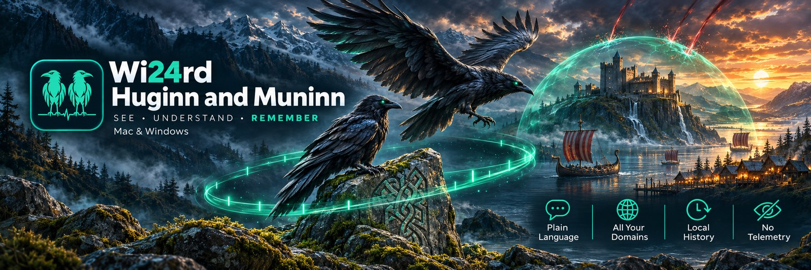
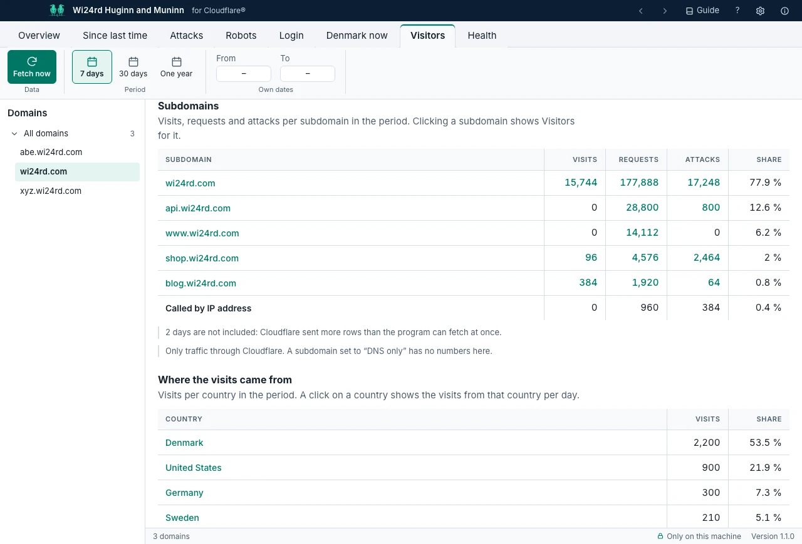
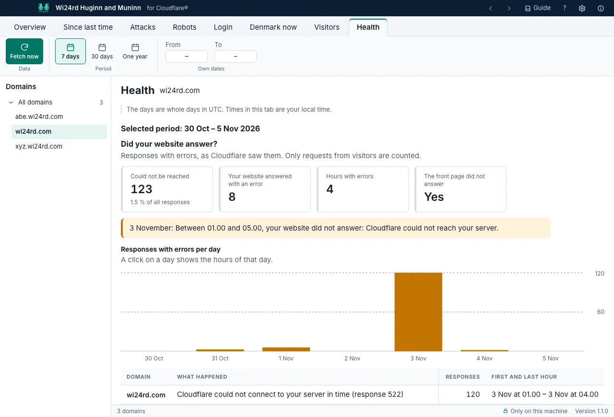

# Wi24rd Huginn and Muninn
<sub>for Cloudflare®</sub>

*Security isn't something you buy. It's something you understand.*

[](https://github.com/wi24rd-com/huginn-muninn/actions/workflows/ci.yml)
[](https://github.com/wi24rd-com/huginn-muninn/releases/latest)
[](LICENSE)


### [⬇ Download Huginn and Muninn 1.1.0 for macOS](https://github.com/wi24rd-com/huginn-muninn/releases/latest)
Signed and notarised by Apple · Apple silicon · macOS 11 or newer · open the zip and drag the app to Applications

**Windows:** not released yet. A Windows version is on its way.

A desktop app (Tauri) that shows you what is actually happening against **your own** Cloudflare domains — in plain language, across all your zones, with a local history that outlives Cloudflare's 31 days.

- **Huginn (thought):** what is happening now — the attacks, what was stopped and how.
- **Muninn (memory):** what has happened — every finished day is kept locally.

<picture>
  <source media="(prefers-color-scheme: dark)" srcset="docs/manual/img/readme-overblik--dark-en.webp">
  
</picture>

## Privacy: what the app sends, and where
- **Only to Cloudflare:** the app itself makes network requests to one host only, `api.cloudflare.com`, for your zones, the figures for your chosen domains, Cloudflare's own findings and Cloudflare Radar. Each request carries your API Token and the name `huginn-muninn/<version>`.
- **Your API Token can only read:** give it read permissions only; the guide shows [the two permissions it needs](docs/manual/en/31-cloudflare.md). It is stored in the operating system's keychain, never in a file, and is sent only to Cloudflare. With several API Tokens (one per Cloudflare account), each has its own entry in the keychain and is sent only with the requests for its own account's domains.
- **Nothing to Wi24rd:** no telemetry, no crash reports, no account and no update check. The app does not look for new versions by itself.
- **Links open in your browser, only when you click:** a CVE number (cve.org), the source line under Radar figures (radar.cloudflare.com), **Create API Token at Cloudflare** and Cloudflare's own findings (dash.cloudflare.com), and **Guide** (wi24rd.com). The app fetches nothing from those sites itself.
- **On your computer:** the figures are kept in one SQLite file in `~/Library/Application Support/com.wi24rd.huginn-muninn/`. See [Data and history](docs/manual/en/70-data.md).
- **Check it yourself:** the only address in the code is in `src-tauri/src/cf.rs`, and the window's content security policy in `src-tauri/tauri.conf.json` lets the page talk to nothing but the app itself. A network monitor such as Little Snitch or LuLu should show `api.cloudflare.com` and nothing else.

## What you can see
- **Overview** (⌘1): one row per domain with status (**Act**, **Watch**, **Calm**, **Unknown**), why, refused requests and attacks, under a verdict line such as "Nothing to do". With **Choose domains** you choose the domains Huginn fetches and shows.
- **Since last time** (⌘2): yesterday's status for all your domains, one line each, with what is new since you last looked. A click on a notification opens it.
- **Attacks** (⌘3): what Cloudflare refused and how, the rules and known holes (CVE), a world map of where the attacks came from, mail sent in your domain's name and sensitive files that answered 200. A click on a figure, a country or a rule filters the page.
- **Robots** (⌘4): who reads your site, in seven groups from Cloudflare's verified categories, and what may happen if you block a group. You do any blocking yourself at Cloudflare.
- **Login** (⌘5): what happened on the login paths you turn on per domain, and how many attempts used a password from a known leak. Passwords are never stored.
- **Denmark now** (⌘6; the name follows your country): the attacks on your domains next to the world from Cloudflare Radar, and the **World** tab with the most targeted countries and internet disruptions.
- **Visitors** (⌘7): unique visitors a year back, visits per country, known robots and the most visited pages.
- **Health** (⌘8): whether your website answered, with errors per day and per hour, and how much Cloudflare handled itself from its cache.
- **Several Cloudflare accounts:** one API Token per account under **Settings** › **Connection**. The domains from all of them are shown together.
- **Subdomains:** for one domain, Visitors, Attacks and Health show the figures per subdomain (e.g. `www` and `shop`). The API Token needs no further permissions.

**Attacks:** refused requests, how they were stopped, and where they came from.

<picture>
  <source media="(prefers-color-scheme: dark)" srcset="docs/manual/img/readme-angreb--dark-en.webp">
  
</picture>

**Visitors with subdomains:** visits, requests and attacks per subdomain for one domain.

<picture>
  <source media="(prefers-color-scheme: dark)" srcset="docs/manual/img/readme-besoegende-subdomaener--dark-en.webp">
  
</picture>

**Health:** a night when the website did not answer.

<picture>
  <source media="(prefers-color-scheme: dark)" srcset="docs/manual/img/readme-drift--dark-en.webp">
  
</picture>

Every view, setting and notification is described in the [user guide](docs/manual/en/00-index.md).

## Install and requirements
Download `Huginn-Muninn-1.1.0.zip` from [Releases](https://github.com/wi24rd-com/huginn-muninn/releases/latest), open it, and drag **Huginn and Muninn** to your Applications folder.

- **Mac:** macOS 11 or newer and a Mac with Apple silicon. Version 1.1.0 is signed with Developer ID and notarised by Apple. The Windows version is not released yet, and there is no Linux version.
- **Cloudflare:** an account with at least one domain, on any plan including Free, and an API Token with the two read permissions.

See [Installation](docs/manual/en/20-installation.md) and [Uninstalling](docs/manual/en/90-afinstallation.md).

## Verify your download
You can check that the file you downloaded is the one that was published, and that the app is signed by the developer and notarised by Apple. Run the commands in Terminal.

**1. The checksum of the zip file**
```
shasum -a 256 ~/Downloads/Huginn-Muninn-1.1.0.zip
```
The line must begin with the SHA-256 stated in the [release notes](https://github.com/wi24rd-com/huginn-muninn/releases/latest). GitHub shows the same value next to the file under **Assets**. For 1.1.0 it is:
```
83587a0e465b86a6b7410a880ff1af7bb2d426980e69ca2844d1efea176e657c
```

**2. The signature and the notarisation of the app**
```
codesign --verify --deep --strict --verbose=2 "/Applications/Huginn and Muninn.app"
spctl -a -vv "/Applications/Huginn and Muninn.app"
```
The first must say `valid on disk` and `satisfies its Designated Requirement`. The second must say `accepted`, `source=Notarized Developer ID` and `origin=Developer ID Application: Jan Tingsvad (5DAVNFA355)`.

If the checksum or the developer's name is different, do not open the app, and please report it (see [SECURITY.md](SECURITY.md)).

## User guide, help and contributing
- **User guide:** [English](docs/manual/en/00-index.md) · [Dansk](docs/manual/da/00-index.md)
- **Help:** [SUPPORT.md](SUPPORT.md). The project comes without support; the user guide and the issues are the places to look.
- **Security problems** are reported privately: [SECURITY.md](SECURITY.md).
- **Contributing and building from source:** [CONTRIBUTING.md](CONTRIBUTING.md).
- **How a release is made:** [RELEASING.md](RELEASING.md).

## Licence
Apache-2.0 — see [LICENSE](LICENSE) and [NOTICE](NOTICE). Third-party components: [THIRD_PARTY_LICENSES.md](THIRD_PARTY_LICENSES.md).

Cloudflare is a registered trademark of Cloudflare, Inc. Huginn and Muninn is not affiliated with Cloudflare, Inc.

[Dansk](README.da.md)
