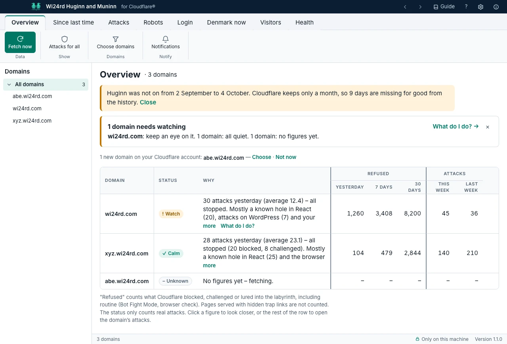
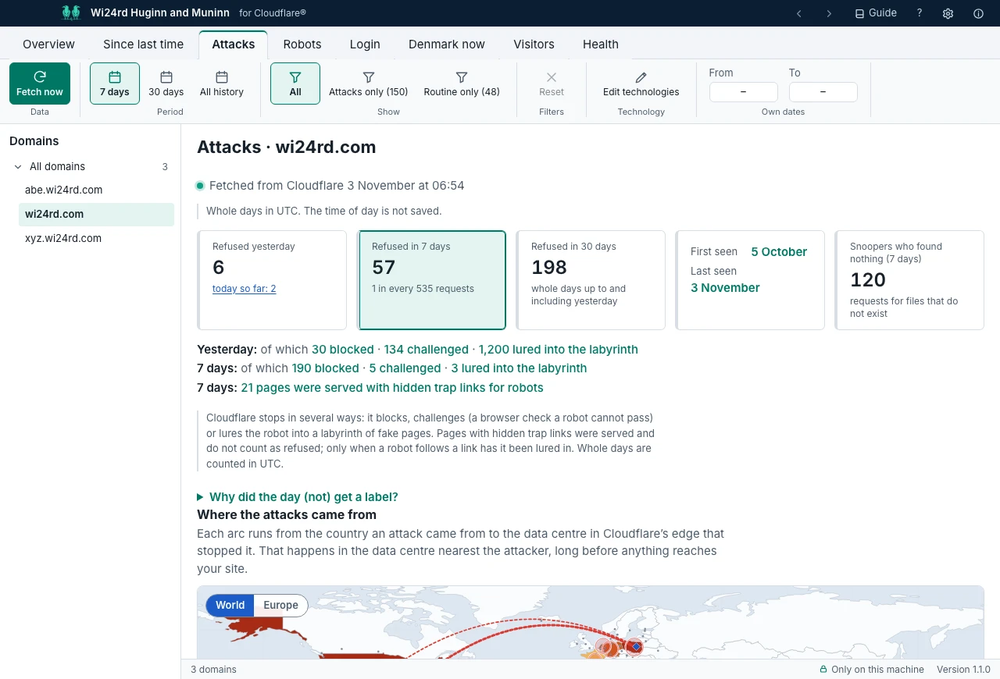

# Wi24rd Huginn and Muninn
<sub>for Cloudflare®</sub>

*Security isn't something you buy. It's something you understand.*

[](https://github.com/wi24rd-com/huginn-muninn/actions/workflows/ci.yml)
[](https://github.com/wi24rd-com/huginn-muninn/releases/latest)
[](LICENSE)


### [⬇ Download Huginn and Muninn 1.1.0 for macOS](https://github.com/wi24rd-com/huginn-muninn/releases/latest)
Signed and notarised by Apple · Apple silicon · macOS 11 or newer · open the zip and drag the app to Applications

**Windows:** not released yet. A Windows version is on its way.

A desktop app (Tauri) that shows you what is actually happening against **your own** Cloudflare domains — in plain language, across all your zones, with a local history that outlives Cloudflare's 31 days.

- **Huginn (thought):** what is happening now — the attacks, what was stopped and how.
- **Muninn (memory):** what has happened — every finished day is kept locally.

<picture>
  <source media="(prefers-color-scheme: dark)" srcset="docs/manual/img/readme-overblik--dark-en.webp">
  
</picture>

**Privacy:** the app talks only to `api.cloudflare.com` with your own read-only API Token (one per Cloudflare account, if you have several), stored in your OS keychain. Nothing is sent to Wi24rd. No telemetry.

**Status:** version 1.1.0 for macOS (Apple silicon), signed with Developer ID and notarised by Apple. Download it from [Releases](https://github.com/wi24rd-com/huginn-muninn/releases/latest). The Windows version is not released yet, and there is no Linux version.

**User guide:** [English](docs/manual/en/00-index.md) · [Dansk](docs/manual/da/00-index.md)

## The app
- **One window:** at the top a title bar with the app's name, back and forward, **Guide**, **?** (help: the explanations for the view and the shortcuts), the gear (**Settings**) and **i** (About). Below it are the tabs and a band with the buttons for the view you are in, with **Fetch now** first. The footer at the bottom shows the status ("Fetching 3 of 7", "Updated 08:01") and the version.
- **The tabs:** **Overview** · **Since last time** · **Attacks** · **Robots** · **Login** · **Denmark now** (the name follows your country) · **Visitors** · **Health**. On the left is the list **Domains**, where you choose one domain or **All domains**. The first time, a guide with four steps opens (Welcome, Your API Token, Your domains, Notifications); without an API Token the tabs cannot be used.
- **Settings** is a window behind the gear (⌘,): Appearance and language, Date and country, Start-up, Notifications, Connection, Data and First start.
- **Several Cloudflare accounts:** under **Settings** › **Connection** you add one API Token per account with **Add API Token…**, side by side. The domains from all of them are shown together. Each connection is named after the account at Cloudflare; you can **Rename…** it, **Change API Token…** on it or **Forget…** it without touching the others. If Cloudflare rejects one API Token, the others keep fetching, and the Overview names the one that was rejected.
- **Domains** are something you choose. After you connect, no domains are chosen, unless the API Token can see exactly one, which is then chosen for you. With **Choose domains** in the band on the Overview you choose the ones Huginn should fetch and show. A domain you clear is no longer fetched, is not shown anywhere and gives no notifications; its figures stay, and if you choose it again, what is missing is fetched, at most the last 30 days. A new domain on your account is not chosen: a discreet line in the Overview offers **Choose** or **Not now**.
- **Overview:** a verdict line at the top ("1 domain needs action" / "Nothing to do") and one row per domain with status (**Act**, **Watch**, **Calm**, **Unknown**), why, refused requests (yesterday, 7 and 30 days) and attacks this week and last week. Click a row (or press Enter) to see the domain's attacks; **Attacks for all** shows them combined.
- **Visitors:** unique visitors a year back (per week when the period is over 90 days), visits per country, known robots and most visited pages (the 404s apart), with blue bars and at most one filter at a time.
- **Subdomains:** Visitors and Attacks show visits, requests and attacks per subdomain (e.g. `www` and `shop`) for one domain, and a click shows the view for that subdomain. Only traffic through Cloudflare, and the API Token needs no further permissions.
- **Health** (⌘8): whether your website answered, with errors per day and per hour ("between 01.00 and 05.00, Cloudflare could not reach your server"), and how much Cloudflare handled itself from its cache. It reads both kinds of website correctly: one with its own server behind Cloudflare, and one hosted at Cloudflare (Workers or Pages). No further permissions are needed.
- **Technology by domain** (**Edit technologies** in the band on Attacks) is a table with a choice per domain and technology: Uses, Does not use or Don't know. Each column and each domain has its actions behind one **⋯** button. You can search, and under **All technologies** you choose what is shown and add technologies in advance.
- **Shortcuts:** macOS ⌘1 Overview · ⌘2 Since last time · ⌘3 Attacks · ⌘4 Robots · ⌘5 Login · ⌘6 Denmark now · ⌘7 Visitors · ⌘8 Health · ⌘, Settings · ⌘R Fetch now (also in the **View** menu). Windows: the same with Ctrl, and F5 = Fetch now.
- **CVE numbers** (e.g. CVE-2025-55182 in Attacks and in "What do I do?") can be clicked: they open the CVE's page on cve.org in your browser. The app itself fetches nothing from there.
- **Light and dark** follow the system, or you choose under **Settings**. The colours and fonts come from Wi24rd UI Kit 2 (`ui/assets/kit2/`).
- **Text size:** Small, Normal or Large under **Settings**, or ⌘+ ⌘− ⌘0 (Windows: Ctrl). The choice is remembered.
- **Reset history** under **Settings** › **Data** deletes all figures on your computer and fetches them again. Cloudflare only has security events for the last month and traffic figures for the last year — anything older is gone for good; the dialog tells you which dates, and how many days are lost.

**Visitors with subdomains:** visits, requests and attacks per subdomain for one domain.

<picture>
  <source media="(prefers-color-scheme: dark)" srcset="docs/manual/img/readme-besoegende-subdomaener--dark-en.webp">
  
</picture>

**Health:** a night when the website did not answer.

<picture>
  <source media="(prefers-color-scheme: dark)" srcset="docs/manual/img/readme-drift--dark-en.webp">
  
</picture>

## Attacks

<picture>
  <source media="(prefers-color-scheme: dark)" srcset="docs/manual/img/readme-angreb--dark-en.webp">
  
</picture>

- **Refused as Cloudflare's estimate:** the number refused is the sum of Cloudflare's sample weight, not the number of rows, so it can be higher than on wi24rd.com.
- **One page per domain:** everything about the attacks is on one page, and the heading says, for example, "Attacks · wi24rd.com". The page shows 7 whole days by default. Choose **30 days**, **All history**, or **From** and **To** in the band.
- **Filters:** clicking a figure, a country, a rule or a path presets the period and the filter on the same page. The filters are chips under the heading: × removes one, and **Reset** in the band removes them all. **Show** switches between **All**, **Attacks only** and **Routine only**. Back and forward go one step at a time.
- **All sections follow the period and the filters.** A section that cannot be filtered that way is left out, and a line says which. With a filter the saved figures are shown, and nothing is fetched from Cloudflare.
- **Traffic on …:** a day with unusually much traffic opens a section at the top of the page with the requests by country, status code and robot.
- **The world map** shows sea and land, and fills each country in five steps by the number of attacks, with the scale under the map. The country is the one Cloudflare saw the attack come from, which may be a VPN or proxy. An arc runs from the country to the data centre that stopped the attack, and Cloudflare's other data centres are faint blue dots. Click a country, ring or arc to see the attacks behind it. The smallest countries have no outline on the map and only get a ring.
- **Mail sent in your domain's name:** Attacks shows, for one domain, how much mail was sent in the domain's name, how much failed DMARC and from which senders. It needs DMARC Management to be turned on at Cloudflare. A new sender that fails, or a markedly larger share, gives Watch. IP addresses are never stored.
- **Sensitive files that answered 200:** for one domain, 39 fixed paths that should never answer 200 (such as `/.env` and `/.git/config`), with the size of the answers. An answer that looks like the file gives Act; one that looks like the site's ordinary page (many sites answer every address with it) changes nothing. No extra call to Cloudflare.
- **Cloudflare's own findings:** for one domain, what Cloudflare's own scan of the setup found (Security Insights), with severity. A click opens it at Cloudflare. It needs one optional extra permission on the API Token, *Account Security Center Insights › Read*, in a new policy for the account (Add new Account policy); without it the rest works. A critical finding gives Watch.
- **Looks like DNS reconnaissance:** a label when someone asks for many names under the domain that do not exist. It follows the notification for "Looks like reconnaissance".
- **Assessment:** for one day you can unfold **Why did the day (not) get a label?** Each of the three labels says yes, no or "yes, preliminary", with each condition and its figure. Limits are whole numbers, and a condition with nothing to compare with gets no ✓ or ✗.

## Your country now and the World
- **Denmark now** (⌘6; the name follows the country you choose) shows the attacks on your domains next to the world from Cloudflare Radar, as an index where 100 is the average of the period. The curves show rises and falls, not numbers.
- Attacks are shown from the target's side, because a source country can be due to a VPN or rented servers. **The largest sources of attacks on Denmark** stand as a share of the attacks on the country next to **Where attacks on your domains came from** for the last 7 days or 4 weeks, and countries that weigh much more for you are marked "Especially you".
- **Denmark as a target** shows the country's share of all attacks Cloudflare saw, as a figure and day by day. It is a measured share, not a number of attacks.
- **A year of traffic:** Huginn fetches a year of daily traffic figures for each chosen domain. **All history** and the date picker in Attacks go that far back for traffic. Cloudflare keeps security events for a month, and it says clearly where they begin.
- **The domain's state:** Overview and notifications say so if a domain is paused, not active, suspected of phishing or in Development Mode.
- **Internet disruptions** shows what Radar has recorded in the country in the last 30 days, and the World tab shows them for the whole world.
- **World** is a tab with the most targeted countries, most attacks from, what stopped them, robot traffic, quantum-safe connections and AI robots by purpose and name.
- The country is taken from your time zone the first time, then from your system language, and you can change it in the band or under Settings. If at least half of your visitors clearly come from another country, Settings offers **Switch to** that country; robots and traffic spikes do not count.
- In the Overview, **Why** can say "Follows the global trend" or "The world was normal yesterday, so the rise is yours" (only when your day is at least three times your average). It compares WAF attacks in general, never a particular rule, and it does not change the status.
- Radar needs no extra permission, and an error at Radar only affects these views. Source: Cloudflare Radar, CC BY-NC 4.0.

## Robots and Login
- **Robots** (⌘4) shows who reads your site, in seven groups from Cloudflare's verified categories: AI training, AI search and assistants, Search engines, Social media and link previews, SEO tools, Monitoring and Unknown. Each group says what may happen if you block it. You do any blocking yourself at Cloudflare: the program only reads.
- You also see the most crawled pages, those in disguise (something calling itself Googlebot, say, without being it), which robots were stopped at the Edge, and which were lured into the labyrinth. The labyrinth does not stop the robot; it shows fake pages.
- **Login** (⌘5) shows what happened on the login paths you turn on per domain, with **Edit paths** in the band. There is a fixed starting list and suggestions from your own data, but the program never guesses what the site runs. A path is suggested only if its name has a login word as a whole word (`login`, `oauth`, `password` and the like) or Cloudflare's check saw a password on it. Paths that merely resemble a login, such as `admin-ajax.php`, do not count by name, and a path in events from a known rule is never suggested.
- **Passwords from known leaks:** Login shows per day and path how many login attempts used a password from a known leak. It gives at least Watch, and Act if your server answered 2xx or 302. Passwords are never stored, and the path is never in a notification. A request without a password stands as "Not a login attempt (no password sent)" and never counts as a leak.
- Login has three figures from separate sources that are never added up: **stopped at the Edge**, **got 404** and **reached your server**. Response 200 or 302 from your server may be a login, but may just as well be an error page. The program sees no IP addresses, and Cloudflare may use samples.
- The figures for Login and "stopped at the Edge" per robot are fetched separately, at a slow pace after the normal fetch, and only for finished days. The first time takes up to an hour for 30 days. If a plan lacks the fields, it says "not available", and the rest works.

## In the menu bar and at login
- **When you close the window, the app keeps running** in the menu bar (Windows: the notification area) and fetches your figures in the background. The Dock icon disappears until the window is opened again.
- **The menu at the raven icon:** Open Huginn · Since last time · Fetch now · a status line ("Fetching 3/16", "Fetched 12 min ago") · Quit.
- **Quit** in the menu (or ⌘Q while the window is open) closes the app completely.
- **Start at login** is turned on the first time a built app starts (not under `npm run tauri dev`). The app then starts without a window, only in the menu bar. Turn it off under **Settings** in the app. The app never turns it back on by itself. If you move the app to another folder, it fixes Start at login and the daily start itself the next time it starts (not when macOS runs it from a temporary copy or from a disk image).
- **Daily start:** while Start at login is on, the app also starts by itself once a day, at 12:00 local time. If the Mac is asleep, it happens when it wakes. If the app is not running, it starts without a window, fetches and closes again, after 30 minutes at most. If it is running, it just fetches. That way the history gets no gaps, even if you have chosen **Quit**. There is no separate switch: Start at login turns both on and off. Windows: a scheduled task, not tested yet.
- **Before you delete the app:** turn Start at login off in Settings. Otherwise the files `~/Library/LaunchAgents/com.wi24rd.huginn-muninn.plist` and `~/Library/LaunchAgents/com.wi24rd.huginn-muninn.dagligt.plist` are left behind (Windows: the value under `HKEY_CURRENT_USER\Software\Microsoft\Windows\CurrentVersion\Run` and the scheduled task `Wi24rd Huginn and Muninn dagligt`), pointing to an app that no longer exists. They can also be deleted by hand.
- The app only runs once at a time; starting it again shows the window that is already there.

## "Since last time" and notifications
- **Since last time** is a view: yesterday's status for all your domains (Act, Watch, Calm) in one line each, with what is new since you last looked. It opens by itself from the menu bar (**Since last time**) or when you click a notification.
- **Notifications come from your own computer** (the system's local notification service), never from a server, e-mail or webhook. Choose under **Settings** (and when you connect the API Token): **Calm** (at most one message a day, only when a domain needs action), **Standard** (a message when a domain needs action, the default) or **Everything** (also for Watch). Each domain can also be set (**Notifications**, the bell in the band on the Overview) to Follow default, Serious and watch, Serious only or Never, and **Notify me when a domain needs action** can be turned off.
- **Looks targeted, Looks like reconnaissance and Looks like DNS reconnaissance** are labels on top of the status: they say something about the pattern, not the amount, and always as "looks", never as a certain verdict. "Looks targeted" notifies you by default; "Looks like reconnaissance", and with it the DNS label, can be turned on under **Settings** › **Notifications**. In the Overview the two are shown short as **Recon** and **DNS recon**. "Looks targeted" compares only with your chosen domains, needs at least 3, and notifies you only once the day after is fetched. Until then it stands as preliminary.
- **Date format** is chosen under **Settings**: Follow the language, Follow the system or ISO. It applies to all dates, including the notifications.
- Act means unusually many attacks yesterday compared with the week before. Cloudflare's routine (the labyrinth, Bot Fight Mode, the browser check) and old figures never notify you, and each domain is reported at most once a day.
- macOS asks for permission the first time a notification is shown. **To turn them off completely:** System Settings → Notifications → Huginn and Muninn.

## Install
Download `Huginn-Muninn-1.1.0.zip` from [Releases](https://github.com/wi24rd-com/huginn-muninn/releases/latest), open it, and drag **Huginn and Muninn** to your Applications folder. Requires macOS 11 or newer and a Mac with Apple silicon. See [Installation](docs/manual/en/20-installation.md) and [Uninstalling](docs/manual/en/90-afinstallation.md).


## What the app sends, and where
- **To Cloudflare, and nowhere else:** the app itself makes network requests to one host only, `api.cloudflare.com`. That covers your zones, the figures for your chosen domains, Cloudflare's own findings and Cloudflare Radar. Each request carries your API Token and the name `huginn-muninn/<version>`.
- **Your API Token** is stored in the operating system's keychain, never in a file, and is sent only to Cloudflare. With several API Tokens, each has its own entry in the keychain, and each is sent only with the requests for its own account's domains. Give it read permissions only; the guide shows [the two permissions it needs](docs/manual/en/31-cloudflare.md).
- **Nothing to Wi24rd:** no telemetry, no crash reports, no account and no update check. The app does not look for new versions by itself.
- **Links open in your browser, only when you click:** a CVE number (cve.org), the source line under Radar figures (radar.cloudflare.com), **Create API Token at Cloudflare** and Cloudflare's own findings (dash.cloudflare.com), and **Guide** (wi24rd.com). The app fetches nothing from those sites itself.
- **On your computer:** the figures are kept in one SQLite file in `~/Library/Application Support/com.wi24rd.huginn-muninn/`. See [Data and history](docs/manual/en/70-data.md).
- **Check it yourself:** the only address in the code is in `src-tauri/src/cf.rs`, and the window's content security policy in `src-tauri/tauri.conf.json` lets the page talk to nothing but the app itself. A network monitor such as Little Snitch or LuLu should show `api.cloudflare.com` and nothing else.

## Verify your download
You can check that the file you downloaded is the one that was published, and that the app is signed by the developer and notarised by Apple. Run the commands in Terminal.

**1. The checksum of the zip file**
```
shasum -a 256 ~/Downloads/Huginn-Muninn-1.1.0.zip
```
The line must begin with the SHA-256 stated in the [release notes](https://github.com/wi24rd-com/huginn-muninn/releases/latest). GitHub shows the same value next to the file under **Assets**. For 1.1.0 it is:
```
83587a0e465b86a6b7410a880ff1af7bb2d426980e69ca2844d1efea176e657c
```

**2. The signature and the notarisation of the app**
```
codesign --verify --deep --strict --verbose=2 "/Applications/Huginn and Muninn.app"
spctl -a -vv "/Applications/Huginn and Muninn.app"
```
The first must say `valid on disk` and `satisfies its Designated Requirement`. The second must say `accepted`, `source=Notarized Developer ID` and `origin=Developer ID Application: Jan Tingsvad (5DAVNFA355)`.

If the checksum or the developer's name is different, do not open the app, and please report it (see [SECURITY.md](SECURITY.md)).

## Build (development)
```
npm install
npm run tauri dev
(cd src-tauri && cargo test)  # the Rust tests
npm run test:ui              # the UI smoke test (jsdom)
npm run kit:tjek             # the copies in ui/assets/kit2/ match the Wi24rd UI Kit 2 package
npm run test:signer          # the signing script tested with stubs (macOS; signs nothing)
sh tools/signer.sh proeve    # macOS: debug build signed with your own Developer ID, no notarisation
```
Requires Rust (rustup) and Node 20+.


## Help, security and contributing
- **Help:** [SUPPORT.md](SUPPORT.md). The project comes without support; the user guide and the issues are the places to look.
- **Security problems** are reported privately: [SECURITY.md](SECURITY.md).
- **Contributing:** [CONTRIBUTING.md](CONTRIBUTING.md). How a release is made: [RELEASING.md](RELEASING.md).

## Licence
Apache-2.0 — see [LICENSE](LICENSE) and [NOTICE](NOTICE). Third-party components: [THIRD_PARTY_LICENSES.md](THIRD_PARTY_LICENSES.md).

Cloudflare is a registered trademark of Cloudflare, Inc. Huginn and Muninn is not affiliated with Cloudflare, Inc.

[Dansk](README.da.md)
