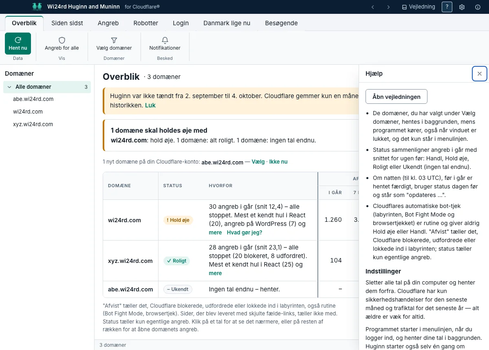

# Wi24rd Huginn and Muninn – brugervejledning

*for Cloudflare®*

Huginn and Muninn er et program til din egen computer, der viser, hvad der faktisk sker mod **dine egne** Cloudflare-domæner: angreb, robotter og login-forsøg, samlet på én skærm og forklaret i klart sprog. Programmet taler kun med Cloudflare med et API Token, der kun kan læse, og gemmer tallene på din computer, så historikken rækker længere end Cloudflares måned.

- **Huginn (tanke)** er det, der sker nu: angrebene, hvad der blev stoppet og hvordan.
- **Muninn (hukommelse)** er det, der er sket: hver færdig dag gemmes lokalt.

> **Status:** version 1.1.0 til macOS (Apple silicon). Programmet er signeret med Developer ID og notariseret af Apple. Denne vejledning følger den udgave.

## Sådan er vejledningen bygget op

| Kapitel | Læs det, når du … |
|---|---|
| [Før du starter](10-foer-du-starter.md) | vil vide, hvad programmet gør, ikke gør, og hvad det kræver |
| [Installation](20-installation.md) | skal have programmet på din computer |
| [Opsætning](30-opsaetning.md) | skal forbinde programmet med Cloudflare og vælge domæner |
| [Opret API Token hos Cloudflare](31-cloudflare.md) | vil se trin for trin med skærmbilleder, hvad du gør i Cloudflares dashboard |
| [Visningerne](40-visninger/overblik.md) | bruger programmet i hverdagen: Overblik, Siden sidst, Angreb, Robotter, Login, dit land, Besøgende, Drift, Teknologi |
| [Indstillinger](50-indstillinger.md) | vil ændre sprog, udseende, notifikationer eller API Token, eller vælge domæner |
| [Notifikationer og baggrund](60-notifikationer.md) | vil forstå, hvornår programmet siger til, og hvad der sker, når vinduet er lukket |
| [Data og historik](70-data.md) | vil vide, hvor tallene ligger, hvor længe, og hvordan du nulstiller |
| [Fejlfinding](80-fejlfinding.md) | ser en fejltekst i programmet |
| [Opdatering](85-opdatering.md) | vil have en nyere udgave |
| [Afinstallation](90-afinstallation.md) | vil fjerne programmet helt, uden rester |
| [Tastaturgenveje](95-genveje.md) | vil styre programmet fra tastaturet |
| [Ordliste](99-ordliste.md) | støder på et ord, du ikke kender |

## Den korte version

1. Installér programmet, og åbn det. En guide med fire trin åbner af sig selv.
2. Opret et API Token hos Cloudflare med de to læse-rettigheder, programmet beder om, og indsæt det i guidens trin 2.
3. Vælg i trin 3, hvilke domæner Huginn skal hente og vise. Senere ændrer du det på **Overblik** med knappen **Vælg domæner**.
4. Luk vinduet. Programmet bliver i menulinjen, henter i baggrunden og siger til, når et domæne kræver handling.

Resten er for dig, der vil forstå mere. Alt i programmet, der har tal bag sig, kan klikkes, så du kan se, hvad tallet består af.

*Knappen **?** øverst til højre åbner hjælpen til den visning, du står i, og viser genvejene. **Åbn vejledningen** øverst i hjælpen åbner denne vejledning på wi24rd.com i din browser. Esc lukker den igen.*

## Licens og varemærke

Programmet er open source under Apache-2.0-licensen. Cloudflare® er et registreret varemærke tilhørende Cloudflare, Inc. Wi24rd Huginn and Muninn er ikke tilknyttet Cloudflare, Inc.
