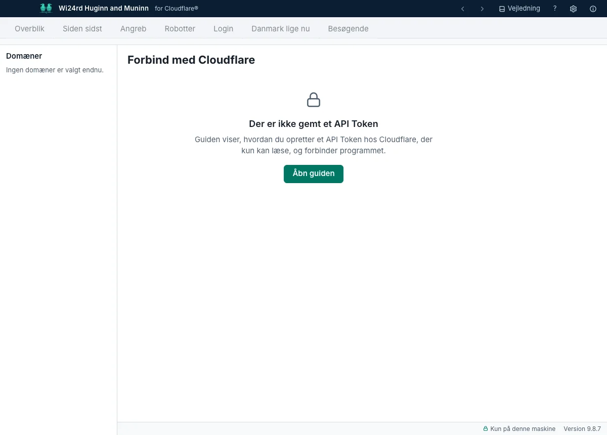
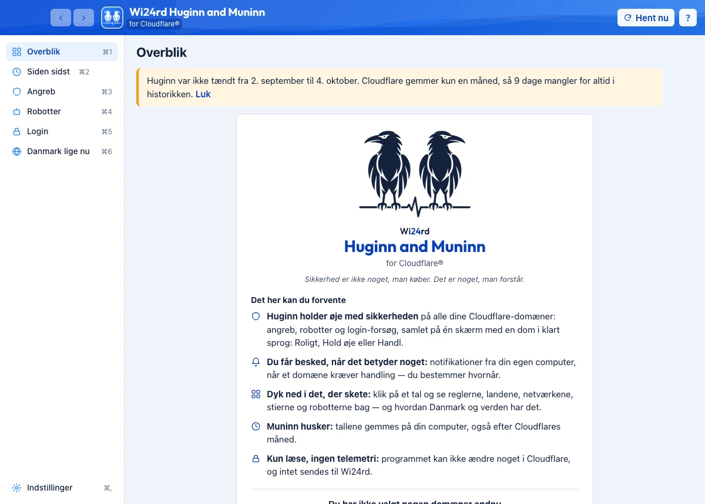

# Opsætning

Opsætningen har tre trin: opret et API Token hos Cloudflare, indsæt det i programmet, og vælg de domæner, Huginn skal holde øje med. Det tager få minutter.

*Opsætningen vises i vinduet, indtil du har indsat et API Token. Knappen **Opret API Token hos Cloudflare** åbner Cloudflares side med navn og rettigheder udfyldt på forhånd.*

## Trin 1 – Opret et API Token hos Cloudflare

Et **API Token** er en nøgle, du opretter i din Cloudflare-konto, og som giver et program lov til at gøre bestemte ting. Programmet beder om præcis to rettigheder, og begge kan kun læse:

- `Zone › Analytics › Read` – må læse tallene (angreb, trafik, robotter).
- `Zone › Zone › Read` – må se, hvilke domæner (zoner) kontoen har.

Det er alt. Uden skriverettigheder kan programmet ikke ændre noget hos Cloudflare, uanset hvad der sker med din computer.

Sådan gør du:

1. Klik på **Opret API Token hos Cloudflare** i programmet. Det åbner Cloudflares side **My Profile › API Tokens** i din browser med navn og de to rettigheder udfyldt. Tjek dem. (Er du ikke logget ind, logger du ind først.)
2. Vil du oprette det i hånden i stedet: vælg **Create Token**, og derefter **Get started** ud for **Create Custom Token**.
3. Skriv et navn under **Token name**, fx *Huginn and Muninn*.
4. Vælg under **Permissions**: **Zone › Analytics › Read** og **Zone › Zone › Read**. Giv det ingen skriverettigheder.
5. Vælg under **Zone Resources**: **Include › All zones**, hvis Huginn skal kunne se alle dine domæner, eller **Include › Specific zone** og ét domæne, hvis det kun skal se dét.
6. Vælg **Continue to summary**, og derefter **Create Token**.
7. Kopiér API Tokenet. Cloudflare viser det kun én gang.

Samme trin står i programmet under **Sådan opretter du et API Token**, både i opsætningen og under **Indstillinger → Forbindelse**.

**Har du fået et API Token af dit IT-firma?** Så springer du trin 1 over og indsætter det, du har fået. Et API Token, der kun ser ét domæne, giver et program, der kun viser det domæne.

## Trin 2 – Indsæt API Tokenet

1. Indsæt API Tokenet i feltet **API Token (kun læsning)**. Feltet skjuler tegnene.
2. Vælg under **Notifikationer**, hvornår du vil have besked. Forvalgt er **Ved alvorligt (anbefalet)**. Du kan ændre det senere under Indstillinger; se [Notifikationer og baggrund](60-notifikationer.md).
3. Klik på **Gem og forbind**.

Programmet tjekker API Tokenet hos Cloudflare og gemmer det i din computers nøglering (macOS Nøglering eller Windows Credential Manager). Det forlader aldrig programmets Rust-del, og vinduet kan ikke hente det tilbage.

Får du en fejltekst, står den forklaret i [Fejlfinding](80-fejlfinding.md). De mest almindelige er, at API Tokenet mangler en af de to rettigheder, eller at domænet ikke står under **Zone Resources**.

## Trin 3 – Vælg domæner

Når du har forbundet, er **ingen domæner valgt** endnu. Der er én undtagelse: kan API Tokenet se præcis ét domæne, vælges det for dig.

1. Åbn **Indstillinger → Domæner**.
2. Slå de domæner til, som Huginn skal hente og vise. **Vælg alle** og **Fravælg alle** gør det på én gang.
3. Gå tilbage til **Overblik**. Programmet begynder at hente med det samme; statuspillen i det blå bånd viser fx "Henter 2 af 3".

*Så længe ingen domæner er valgt, viser Overblik velkomsten og en henvisning til Indstillinger.*

Et domæne, du fravælger, hentes ikke længere, vises ingen steder og giver ingen notifikationer. Dets tal bliver liggende, og vælger du det igen, hentes det, der mangler, højst de seneste 30 dage.

Kommer der senere et nyt domæne på din Cloudflare-konto, er det ikke valgt af sig selv. Overblik viser en diskret linje: "1 nyt domæne på din Cloudflare-konto: … – **Vælg** · **Ikke nu**". Der kommer ingen notifikation om det.

## Første hentning

Første gang henter programmet de seneste 30 dages sikkerhedshændelser og et års daglige trafiktal for hvert valgt domæne. Dagene gemmes, efterhånden som de kommer. Tallene til **Login** og "stoppet ved Edge" pr. robot hentes bagefter i langsomt tempo; første gang kan det tage op til en time for 30 dage.

Programmet spørger om i dag og i går én dag ad gangen, højst to kald ad gangen og mindst 1,1 sekund imellem, for alle domæner tilsammen. Beder Cloudflare det vente, holder det pause og prøver igen.

## Dit land

Landet i **… lige nu** (⌘6) tages første gang fra din tidszone, derefter fra systemets sprog. Du kan skifte det i det blå bånd eller under **Indstillinger → Generelt → Land**. Kommer mindst halvdelen af dine besøgende tydeligt fra et andet land, tilbyder Indstillinger **Skift til** det land.
