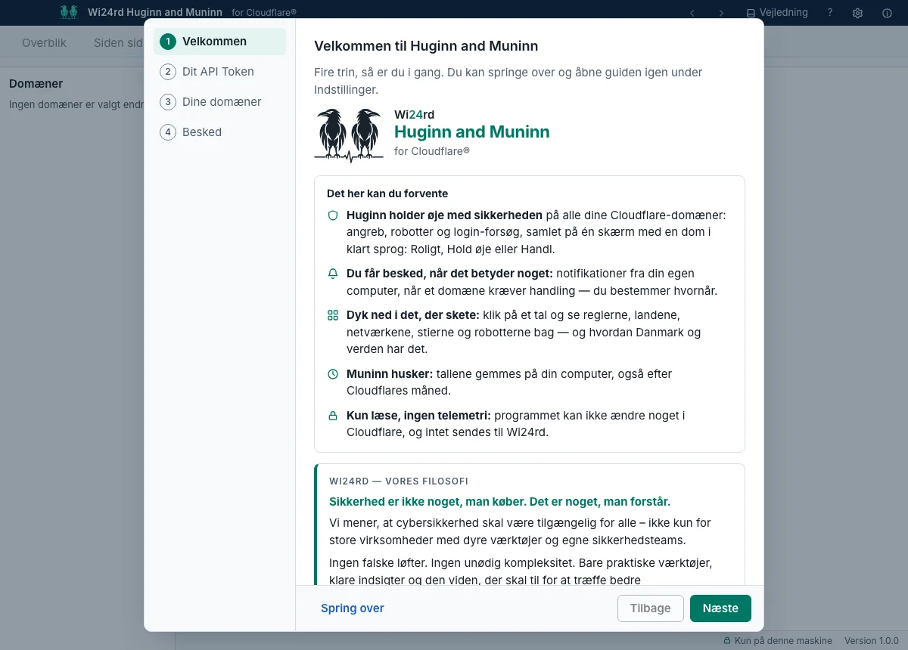
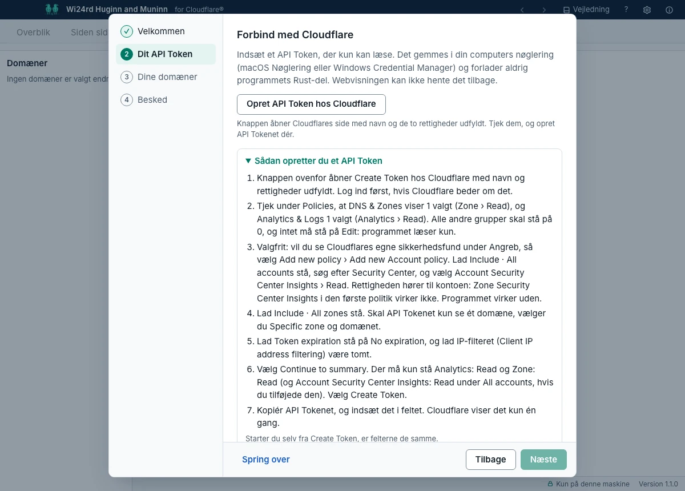
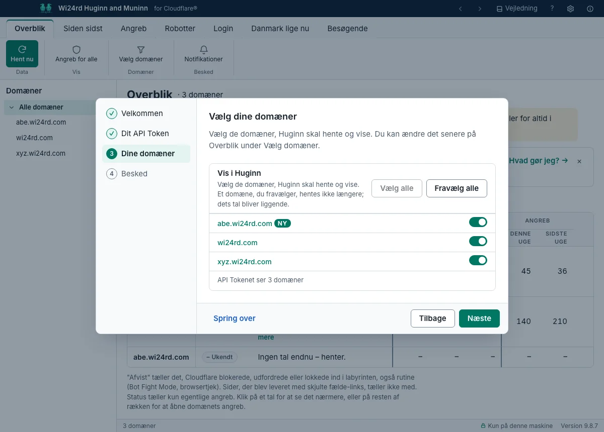
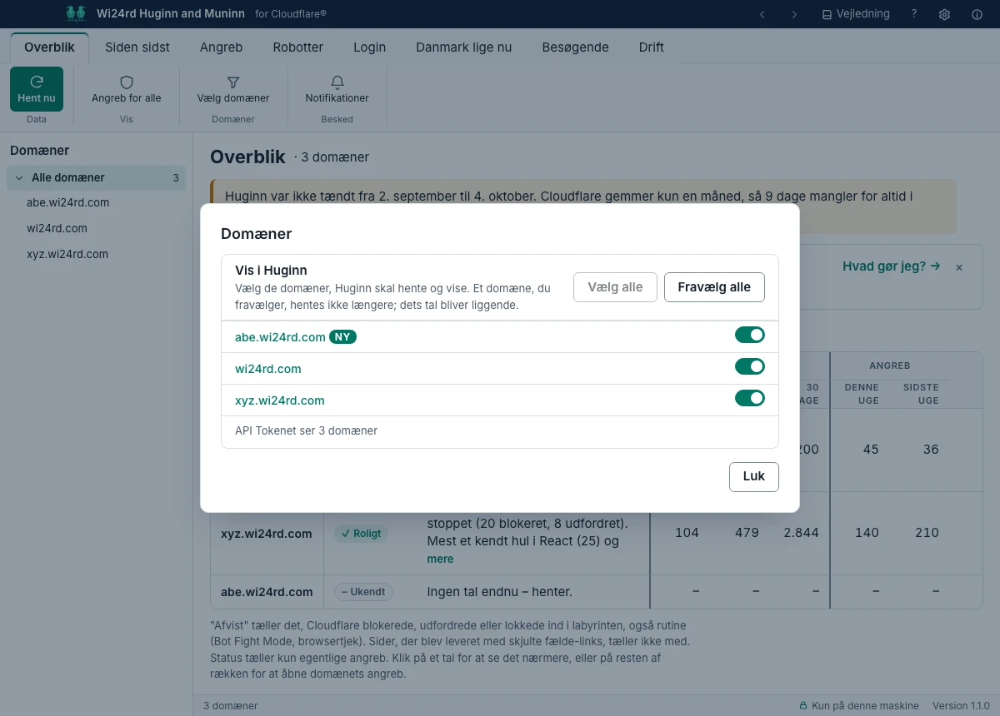
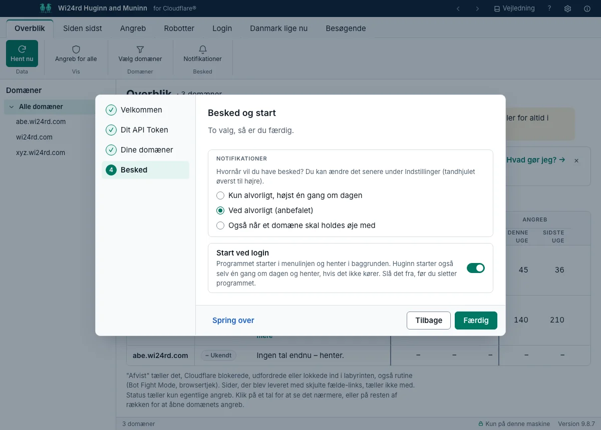

# Opsætning

Første gang du åbner programmet, åbner en guide med fire trin: **Velkommen**, **Dit API Token**, **Dine domæner** og **Besked**. Det tager få minutter. Trinene står til venstre i guiden, og nederst står **Spring over**, **Tilbage** og **Næste**.

*Trin 1 fortæller, hvad du kan forvente. Klik på **Næste**.*

Springer du guiden over, står der en rolig side i vinduet med overskriften **Forbind med Cloudflare** og knappen **Åbn guiden**. Du kan også altid åbne guiden igen under **Indstillinger** (tandhjulet øverst til højre) i gruppen **Første start** med **Vis guiden igen**.

*Sådan ser vinduet ud, når guiden er sprunget over, og der ikke er gemt et API Token. Fanerne kan ikke bruges endnu.*

## Trin 1 – Opret et API Token hos Cloudflare

Et **API Token** er en nøgle, du opretter i din Cloudflare-konto, og som giver et program lov til at gøre bestemte ting. Programmet beder om præcis to rettigheder, og begge kan kun læse:

- **Analytics › Read** (under *Analytics & Logs*) – må læse tallene (angreb, trafik, robotter).
- **Zone › Read** (under *DNS & Zones*) – må se, hvilke domæner (zoner) kontoen har.

Det er alt. Uden skriverettigheder kan programmet ikke ændre noget hos Cloudflare, uanset hvad der sker med din computer.

**Valgfrit:** vil du se Cloudflares egne sikkerhedsfund under Angreb, tilføjer du én rettighed mere: **Account Security Center Insights › Read** i en ny politik for kontoen (**Add new policy** › **Add new Account policy**), ikke zone-udgaven. Den kan også kun læse. Programmet virker uden. Se [Opret API Token hos Cloudflare](31-cloudflare.md).

Sådan gør du:

1. Klik på **Opret API Token hos Cloudflare** i programmet. Det åbner Cloudflares side **Create Token** i din browser med navnet *Huginn and Muninn* og de to rettigheder udfyldt. (Er du ikke logget ind, logger du ind først.)
2. Tjek under **Policies**, at **DNS & Zones** viser 1 valgt (**Zone › Read**) og **Analytics & Logs** viser 1 valgt (**Analytics › Read**), og at alle andre grupper står på 0. Giv det ingen **Edit**-rettigheder.
3. Lad **Include · All zones** stå, hvis Huginn skal kunne se alle dine domæner. Skal API Tokenet kun se ét domæne, vælger du **Specific zone** og domænet.
4. Lad **Token expiration** stå på **No expiration**, og lad **Client IP address filtering** være tomt.
5. Klik **Continue to summary**, tjek, at der kun står **Analytics: Read** og **Zone: Read** (og **Account Security Center Insights: Read**, hvis du tilføjede den), og klik **Create Token**.
6. Kopiér API Tokenet. Cloudflare viser det kun én gang.

Hvert trin er vist med skærmbilleder i [Opret API Token hos Cloudflare – trin for trin](31-cloudflare.md).

**Har du fået et API Token af dit IT-firma?** Så springer du trin 1 over og indsætter det, du har fået. Et API Token, der kun ser ét domæne, giver et program, der kun viser det domæne.

## Trin 2 – Indsæt API Tokenet

*Trin 2 med knappen til Cloudflare og vejledningen foldet ud. Feltet til API Tokenet står under vejledningen; rul ned.*

1. Indsæt API Tokenet i feltet **API Token (kun læsning)** i guidens trin 2. Feltet skjuler tegnene.
2. Klik på **Gem og forbind**.
3. Klik på **Næste**. Knappen er grå, og der står "Gem et API Token, der virker, før du går videre.", indtil API Tokenet er gemt og virker.

Programmet tjekker API Tokenet hos Cloudflare og gemmer det i din computers nøglering (macOS Nøglering eller Windows Credential Manager). Det forlader aldrig programmets Rust-del, og vinduet kan ikke hente det tilbage.

Får du en fejltekst, står den forklaret i [Fejlfinding](80-fejlfinding.md). De mest almindelige er, at API Tokenet mangler en af de to rettigheder, eller at domænet ikke er med under **Include** (**All zones** eller **Specific zone**).

## Trin 3 – Vælg domæner

Når du har forbundet, er **ingen domæner valgt** endnu. Der er én undtagelse: kan API Tokenet se præcis ét domæne, vælges det for dig.

*Trin 3: én kontakt pr. domæne. Et domæne, der er nyt på kontoen, er mærket **NY**.*

1. Slå de domæner til, som Huginn skal hente og vise. **Vælg alle** og **Fravælg alle** gør det på én gang.
2. Klik på **Næste**.

Senere ændrer du valget på **Overblik** med knappen **Vælg domæner** i båndet. Den åbner den samme liste i dialogen **Domæner**.

*Overblik › **Vælg domæner**: samme liste som i guiden.*

*Så længe ingen domæner er valgt, viser Overblik velkomsten og knappen **Vælg domæner**.*

Et domæne, du fravælger, hentes ikke længere, vises ingen steder og giver ingen notifikationer. Dets tal bliver liggende, og vælger du det igen, hentes det, der mangler, højst de seneste 30 dage.

Kommer der senere et nyt domæne på din Cloudflare-konto, er det ikke valgt af sig selv. Overblik viser en diskret linje: "1 nyt domæne på din Cloudflare-konto: … – **Vælg** · **Ikke nu**". Der kommer ingen notifikation om det.

## Trin 4 – Besked og start

*Trin 4: hvornår du vil have besked, og om programmet skal starte ved login.*

1. Vælg under **Notifikationer**, hvornår du vil have besked. Forvalgt er **Ved alvorligt (anbefalet)**. Se [Notifikationer og baggrund](60-notifikationer.md).
2. Lad **Start ved login** være slået til, hvis programmet skal hente i baggrunden.
3. Klik på **Færdig**. Guiden lukker, og Overblik åbner. Programmet begynder at hente med det samme; fodlinjen nederst i vinduet viser fx "Henter 2 af 3".

Begge valg kan ændres senere under **Indstillinger**.

## Første hentning

Første gang henter programmet de seneste 30 dages sikkerhedshændelser og et års daglige trafiktal for hvert valgt domæne. Dagene gemmes, efterhånden som de kommer. Tallene til **Login** og "stoppet ved Edge" pr. robot hentes bagefter i langsomt tempo; første gang kan det tage op til en time for 30 dage.

Programmet spørger om i dag og i går én dag ad gangen, højst to kald ad gangen og mindst 1,1 sekund imellem, for alle domæner tilsammen. Beder Cloudflare det vente, holder det pause og prøver igen.

## Dit land

Landet i **… lige nu** (⌘6) tages første gang fra din tidszone, derefter fra systemets sprog. Du kan skifte det i båndet på fanen **… lige nu** (gruppen **Land**) eller under **Indstillinger** i gruppen **Dato og land**. Kommer mindst halvdelen af dine besøgende tydeligt fra et andet land, tilbyder Indstillinger **Skift til** det land.
