# Opret API Token hos Cloudflare – trin for trin

Dette kapitel viser med skærmbilleder, hvordan du opretter det API Token, programmet skal bruge. Billederne er fra Cloudflares dashboard i november 2026 på en konto med tre eksempel-domæner (`wi24rd.com`, `abe.wi24rd.com` og `xyz.wi24rd.com`). Cloudflare ændrer sit dashboard af og til, så knapperne kan have flyttet sig lidt, men felterne er de samme.

**Det, du skal ende med:** et API Token med navnet *Huginn and Muninn*, præcis to rettigheder (**Zone › Read** og **Analytics › Read**) og adgang til de domæner, Huginn skal se. Intet andet.

## Trin 1 – Åbn Cloudflares side med felterne udfyldt

Klik på **Opret API Token hos Cloudflare** i programmet (i guidens trin 2 eller under **Indstillinger** › **Forbindelse**). Det åbner Cloudflares side **My Profile › API Tokens** i din browser med navn og de to rettigheder udfyldt på forhånd. Er du ikke logget ind hos Cloudflare, logger du ind først; siden åbner bagefter.

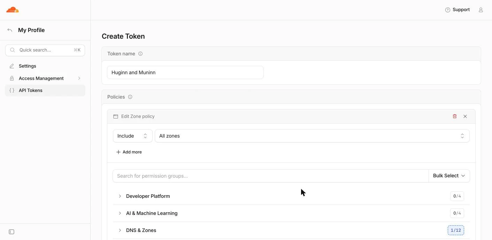
*Siden **Create Token**. Navnet står under **Token name**, og under **Policies** står én zone-politik med **Include · All zones**. Tallene til højre viser, at der er valgt 1 rettighed under DNS & Zones og 1 under Analytics & Logs.*

Starter du i stedet selv fra knappen **Create Token** på siden **API Tokens**, skal du udfylde navn og rettigheder i hånden. Felterne er de samme som på billederne.

## Trin 2 – Tjek de to rettigheder

Fold **DNS & Zones** ud. Her skal **Zone** have hak i **Read** og intet andet.

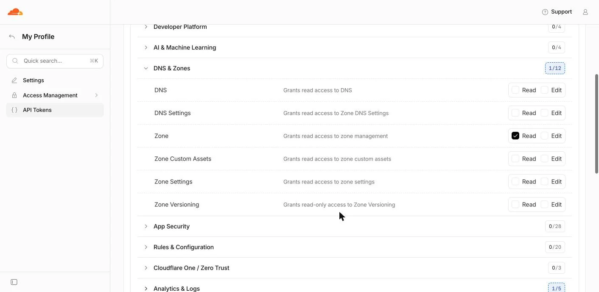
*Under **DNS & Zones** er kun **Zone › Read** valgt. Det giver programmet lov til at se, hvilke domæner kontoen har, og intet mere.*

Fold **Analytics & Logs** ud. Her skal **Analytics** have hak i **Read**.

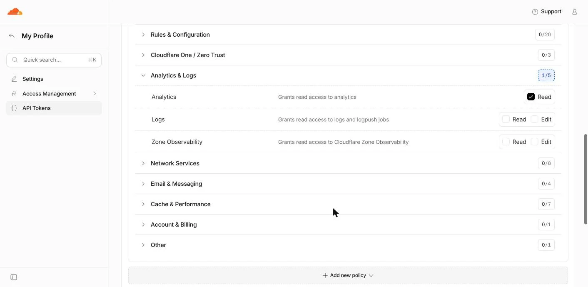
*Under **Analytics & Logs** er kun **Analytics › Read** valgt. Det giver programmet lov til at læse tallene.*

Alle andre grupper skal stå på **0** (undtagen den valgfri rettighed nedenfor, hvis du vil have den). Giv aldrig **Edit** til noget: programmet læser kun, og et API Token uden skriverettigheder kan ikke ændre noget hos Cloudflare, uanset hvad der sker med din computer.

### Valgfrit: Cloudflares egne fund

Vil du se Cloudflares egne sikkerhedsfund (Security Insights) under Angreb, giver du tokenet én rettighed mere: **Account Security Center Insights › Read**. Den hører til kontoen, ikke til domænerne, så den skal i en ny politik for kontoen. Den kan kun læse. Uden den virker programmet som før, og afsnittet **Cloudflares egne fund** siger, at rettigheden kan tilføjes.

1. Klik på **Add new policy** under politikken med de to rettigheder, og vælg **Add new Account policy**.

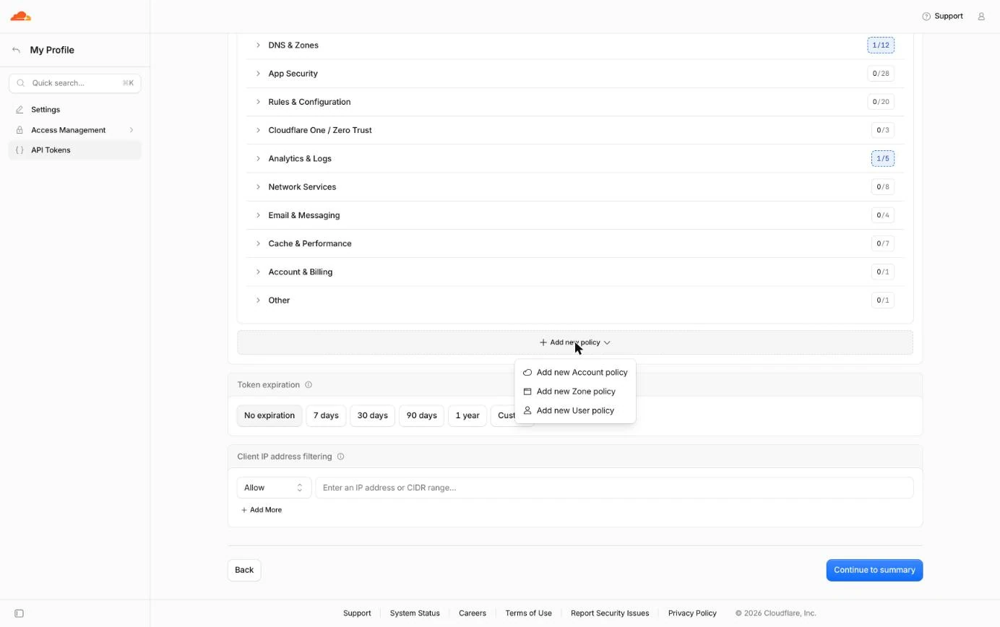
*Menuen under **Add new policy**: vælg **Add new Account policy**, ikke **Add new Zone policy**.*

2. Lad **Include** og **All accounts** stå. Skriv `Security Center` i søgefeltet, og sæt hak i **Read** ud for **Account Security Center Insights**.

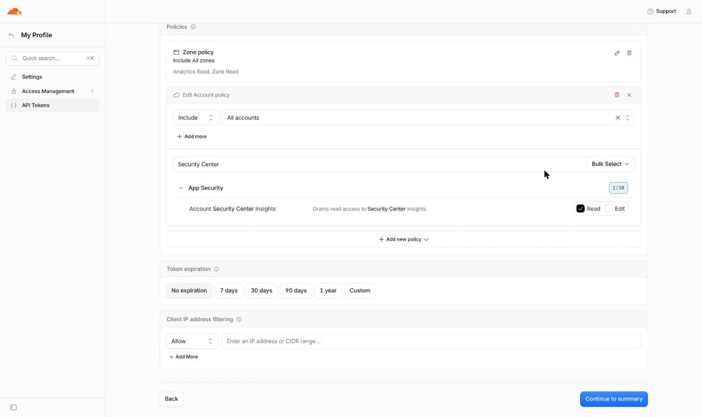
*Den nye kontopolitik med **Account Security Center Insights › Read**. Den første politik står foldet sammen ovenover med **Analytics Read, Zone Read**.*

Søger du efter `Security Center` i den første politik, finder du **Zone Security Center Insights**. Den virker ikke med programmet: Cloudflare svarer kun på kontoens fund. Brug **Account Security Center Insights**.

## Trin 3 – Vælg, hvilke domæner API Tokenet må se

Øverst i politikken står **Include** og **All zones**. Klik på **All zones** for at se valgene.

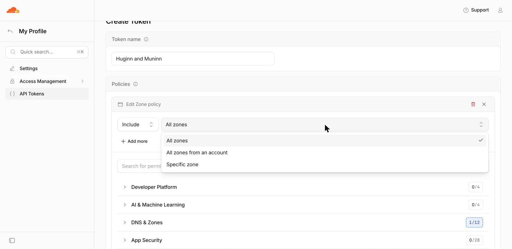
*Tre valg: **All zones** (alle domæner på alle dine konti), **All zones from an account** (alle domæner på én konto) og **Specific zone** (ét bestemt domæne).*

- Skal Huginn kunne se **alle** dine domæner, lader du **All zones** stå. Du vælger alligevel først i programmet, hvilke af dem der skal hentes.
- Skal API Tokenet kun se **ét** domæne, fx fordi du laver det til en kunde, vælger du **Specific zone** og derefter domænet i listen, der dukker op.

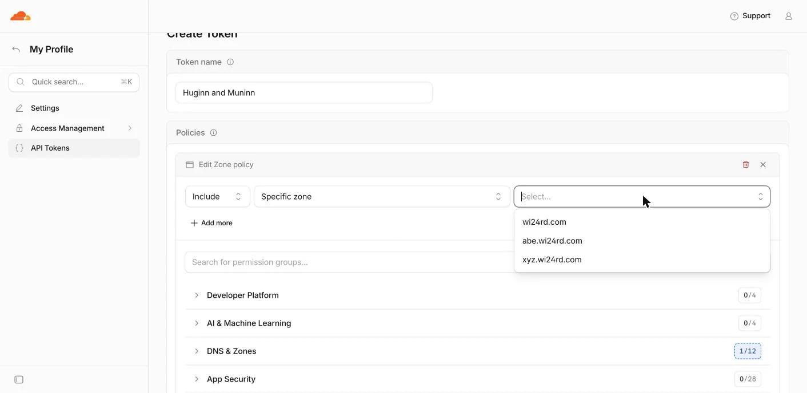
*Med **Specific zone** valgt dukker et tredje felt op med kontoens domæner.*

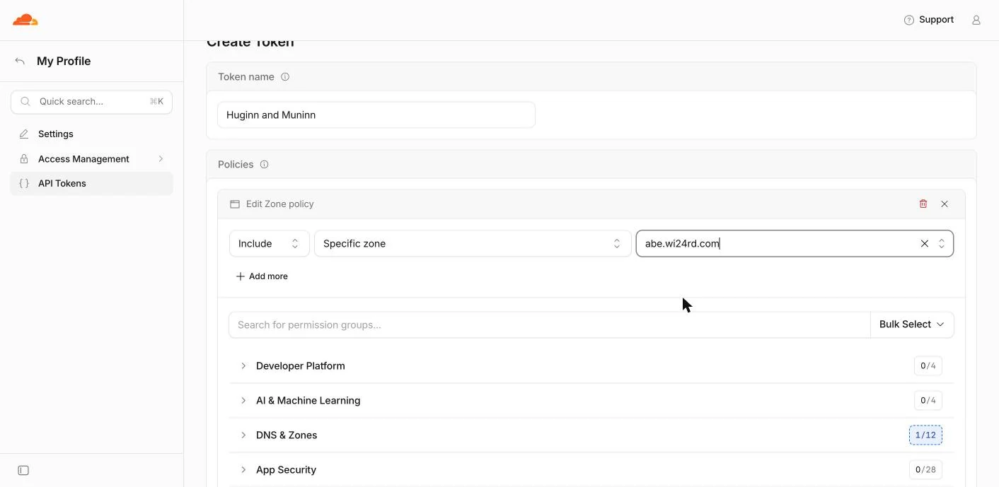
*Her er `abe.wi24rd.com` valgt. Et program med dette API Token ser kun det domæne.*

Vil du give adgang til flere bestemte domæner, klikker du på **Add more** og tilføjer en linje pr. domæne.

## Trin 4 – Udløb og IP-filter

Rul ned. **Token expiration** står på **No expiration**. Vælger du et udløb, holder programmet op med at hente den dag, og du skal oprette et nyt API Token. **Client IP address filtering** lader du stå tomt; din computers adresse skifter, og et filter ville låse programmet ude.

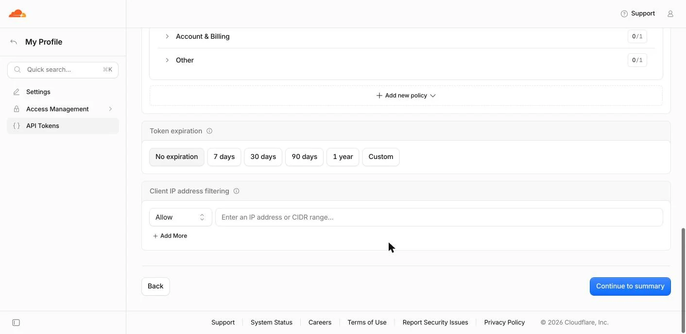
*Nederst på siden: udløb, IP-filter og knappen **Continue to summary**.*

Klik på **Continue to summary**.

## Trin 5 – Tjek opsummeringen

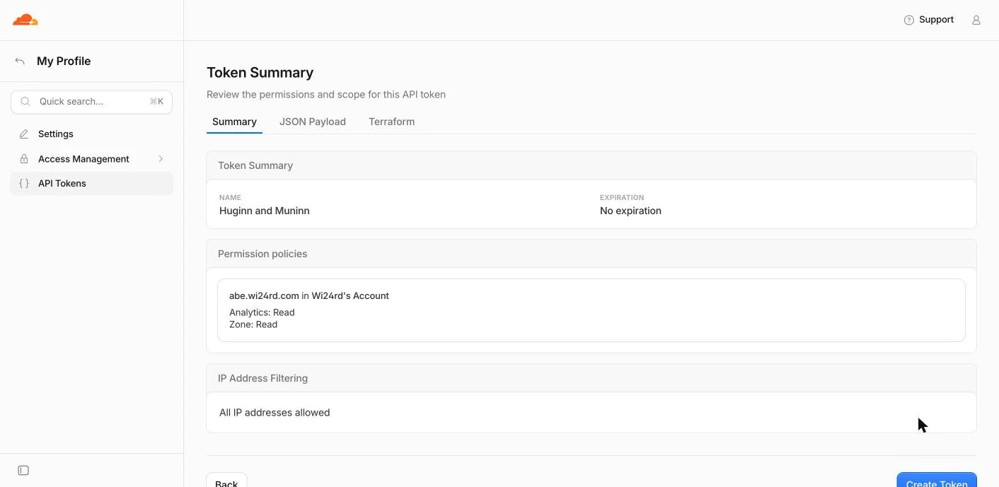
*Opsummeringen viser navnet, udløbet, hvilke domæner tokenet gælder for, og de to rettigheder **Analytics: Read** og **Zone: Read**.*

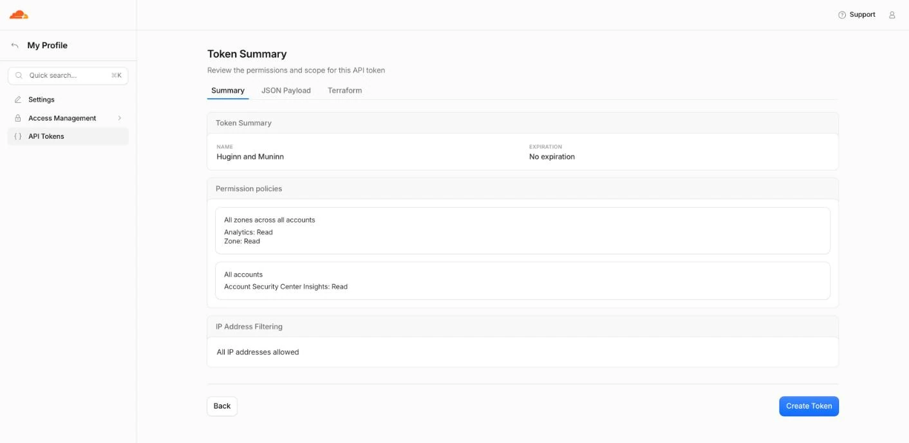
*Med den valgfri rettighed står der en politik mere: **All accounts** med **Account Security Center Insights: Read**.*

Står der andet end **Analytics: Read** og **Zone: Read** (og **Account Security Center Insights: Read**, hvis du tilføjede den) under **Permission policies**, så klik **Back** og ret det. Ellers klik **Create Token**.

## Trin 6 – Kopiér API Tokenet

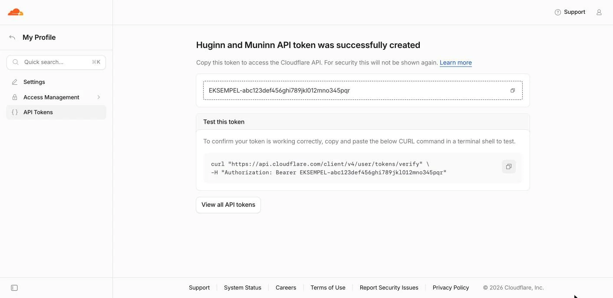
*Cloudflare viser API Tokenet præcis én gang. Tokenet på billedet er et eksempel og virker ikke.*

1. Klik på kopiér-ikonet til højre for tokenet, eller markér hele teksten og kopiér den.
2. Gå tilbage til programmet, indsæt det i feltet **API Token (kun læsning)**, og klik **Gem og forbind**.
3. Luk browserfanen. Du kan ikke se tokenet igen; mister du det, opretter du bare et nyt.

Kommandoen under **Test this token** er til folk, der vil prøve tokenet i en terminal. Du behøver ikke bruge den.

## Bagefter: tokenet i listen

Under **My Profile › API Tokens** står tokenet nu i listen med de to rettigheder.

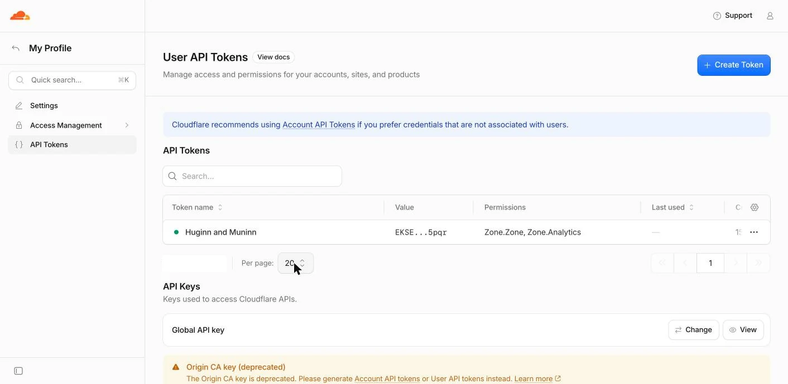
*Listen viser navnet, de første og sidste tegn af tokenet, rettighederne og hvornår det sidst blev brugt.*

## Hvis du vil tilbagekalde tokenet

Sletter du programmet, eller vil du af andre grunde lukke adgangen, sletter du tokenet her. Så kan det ikke bruges af nogen, uanset hvad.

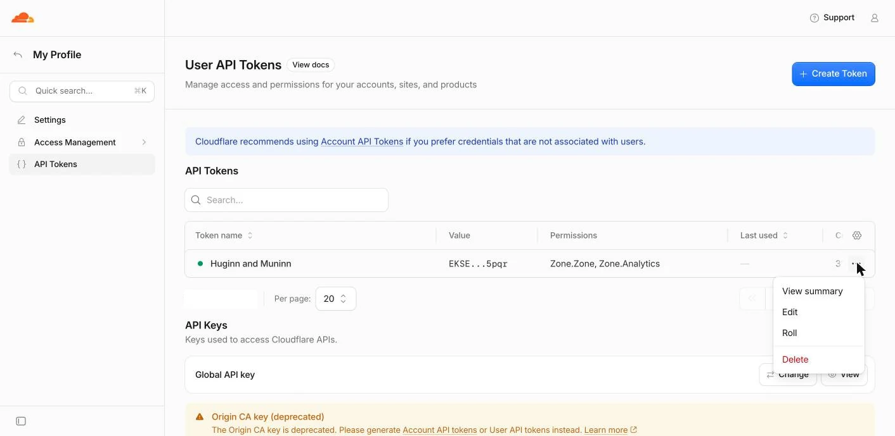
*Klik på **⋯** yderst til højre i tokenets række, og vælg **Delete**. **Roll** giver et nyt token med samme rettigheder, hvis du har brug for at skifte det.*

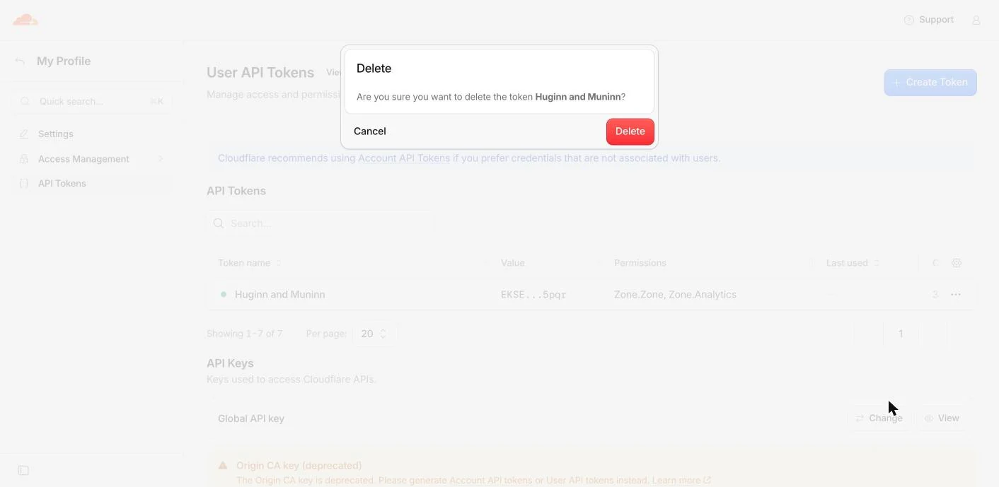
*Cloudflare spørger, om du er sikker. **Delete** fjerner tokenet med det samme; programmet vil derefter sige, at Cloudflare afviste API Tokenet.*

## Flere konti

Programmet tager ét API Token pr. Cloudflare-konto. Har du domæner på flere konti, opretter du et API Token for hver konto efter trin 1–6. Det første indsætter du i guiden. De andre tilføjer du under **Indstillinger** › **Forbindelse** med **Tilføj API Token…**. Domænerne fra alle konti vises samlet.

Hvert API Token bliver en forbindelse i programmet. Navnet, programmet viser, er kontoens navn hos Cloudflare. Det bruges, som det er, også når det er en mailadresse, fx "…'s Account". Kan ét API Token se flere konti, står der fx "… + 1 anden". Kender programmet endnu ikke noget navn, står der fx "Forbindelse 2".

Du kan give forbindelsen dit eget navn med **Omdøb…** i programmet. Navnet hos Cloudflare ændres ikke. Se [Indstillinger](50-indstillinger.md#forbindelse).

## Til IT-firmaet: ét token pr. kunde

Administrerer du kunders domæner, laver du ét API Token pr. kunde med **Specific zone** og kundens domæne (trin 3), giver kunden tokenet, og kunden indsætter det i sit eget program. Kunden ser så kun sit eget domæne, og du kan tilbagekalde adgangen igen uden at røre noget andet.
