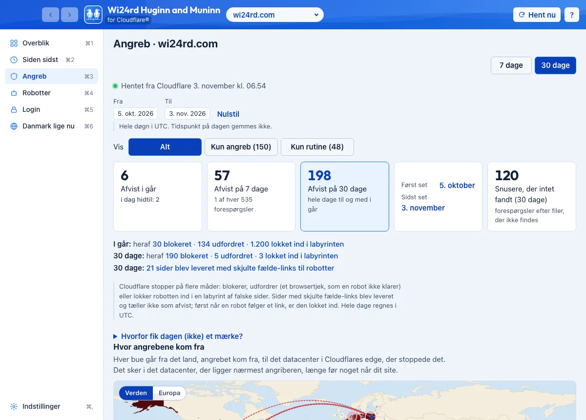
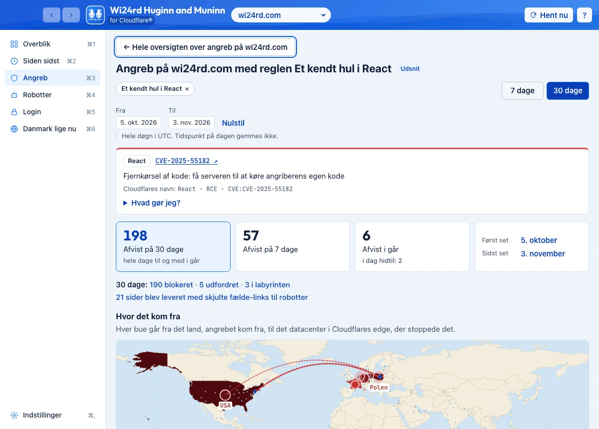
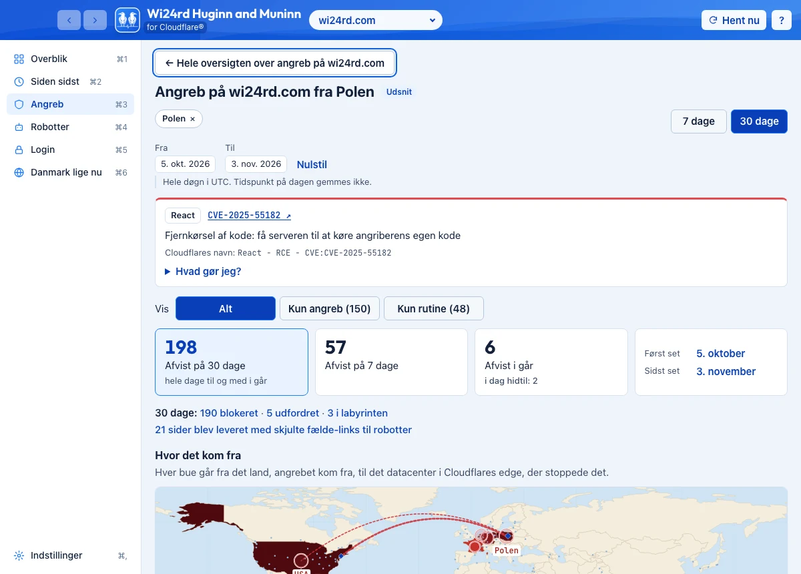
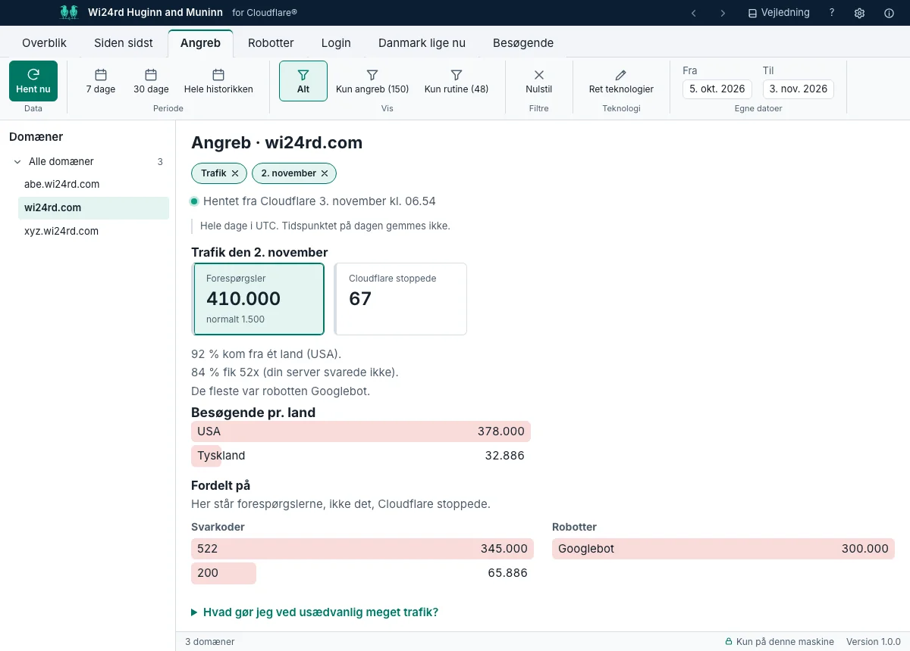

# Dyk

Et dyk har ingen egen plads i sidebjælken. Du kommer dertil ved at klikke på et tal, et land, en regel, en robot eller en sti i de andre visninger.

## Hvad viser den?

Et dyk viser de gemte tal for netop det, du klikkede på: pr. dag, fordelt på lande, netværk, stier, datacentre og regler, og hvordan det ser ud på dine andre domæner. Intet hentes fra Cloudflare for at vise det; alt kommer fra tallene på din computer, så det er hurtigt og virker uden forbindelse.

*Øverst knappen tilbage til hele oversigten, datovælgeren og perioden. Fliserne viser kun det, der passer til filtrene.*

Øverst står:

- **← Hele oversigten over angreb på …**: tilbage til [Angreb](vaernet.md).
- **Udsnit**: et mærke, der siger, at du ser en del af tallene, ikke det hele.
- **Filtrene** som chips, fx "Et kendt hul i React ×". Hvert klik på en værdi lægger ét filter mere oven i; × fjerner det igen. Der kan højst være ét filter pr. slags (ét land, én regel, én sti …).
- **7 dage** / **30 dage** og datovælgeren **Fra** – **Til** med **Nulstil** til hele historikken. Trafiktal rækker et år tilbage; sikkerhedshændelser begynder, hvor Cloudflare begynder, og det står tydeligt.
- **Vis**: **Alt**, **Kun angreb** eller **Kun rutine**, så du kan se egentlige angreb uden Cloudflares rutine, eller omvendt.

*Et dyk i én regel: regelkortet øverst forklarer hullet i klart sprog, med Cloudflares eget navn nedenunder og et råd bag **Hvad gør jeg?**.*

Derunder kommer fliserne (afvist på 30 dage, 7 dage, i går, og hvornår det først og sidst blev set), fordelingen på blokeret, udfordret og labyrinten, kortet og listerne.

*Et dyk i ét land: hvad angrebene fra landet gik efter, og hvilke datacentre der stoppede dem.*

## Trafik-dyk

Klikker du på en dag med **usædvanlig meget trafik** (fra Overblik eller en notifikation), åbner et trafik-dyk: forespørgslerne den dag, ikke det, Cloudflare stoppede. Du ser antal forespørgsler mod det normale, hvor mange Cloudflare stoppede, hvor de kom fra, hvilke svarkoder din server gav, og hvilke robotter der stod bag. **Hvad gør jeg ved usædvanlig meget trafik?** giver rådet.

*Et døgn med 410.000 forespørgsler mod normalt 1.500: 92 % fra ét land, og de fleste fik svar 522, fordi serveren ikke svarede.*

## Hvad skal jeg gøre, når …

- **… du vil vide, om det er rettet mod dig?** Se, hvordan det ser ud på dine andre domæner. Mærket **Ligner målrettet** sættes netop, når angrebene steg her, men ikke på dine andre domæner, og en stor del kom fra ét netværk.
- **… en sti dukker op igen og igen?** Klik på stien. Er det `wp-login.php` eller lignende, er det rutine fra scannere; se også [Login](login.md).
- **… en dag skiller sig ud?** Vælg dagen i datovælgeren eller klik på søjlen, og fold **Hvorfor fik dagen (ikke) et mærke?** ud.

## Klik videre

Hver værdi i en liste, hver søjle, hvert land og hver ring på kortet lægger ét filter mere på. Filtrene står øverst, hvor × fjerner dem. Tilbage og frem i det blå bånd (⌘[ og ⌘]) går ét trin ad gangen, også gennem filtre. Regelkortets CVE-nummer åbner cve.org i din browser. **Ret teknologier** åbner [Teknologi pr. domæne](teknologi.md).

## Tal og begreber

- Alle perioder er hele dage i **UTC**; i dag står for sig, indtil dagen er slut.
- Stier står uden forespørgselsdel, og lange koder er skjult. IP-adresser findes ikke i programmet.
- Tal over lange perioder kan være samplet af Cloudflare og er derfor omtrentlige.
