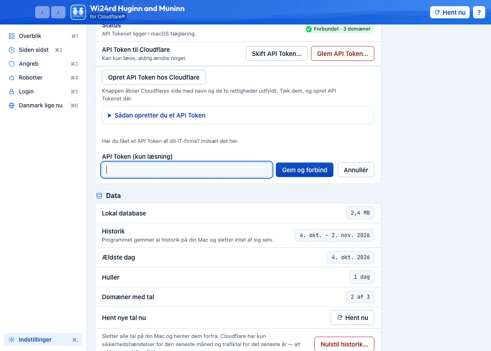
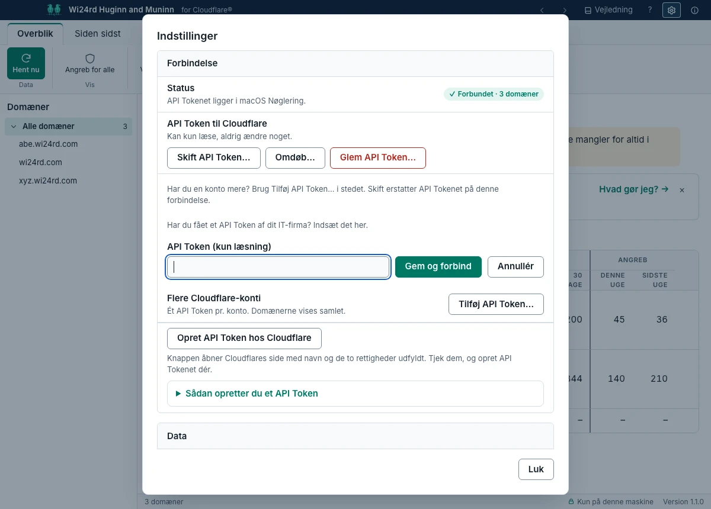

# Indstillinger (visningen)

Genvej: ⌘, (Windows: Ctrl+,)

Indstillinger er den eneste visning, der kan åbnes, før du har forbundet med Cloudflare. Den har seks afsnit: **Generelt**, **Domæner**, **Notifikationer**, **Forbindelse**, **Data** og **Om**.

Hvert felt og hver kontakt er beskrevet i [Indstillinger](../50-indstillinger.md).

*Øverst: Generelt og Domæner.*

*Længere nede: Forbindelse og Data.*
