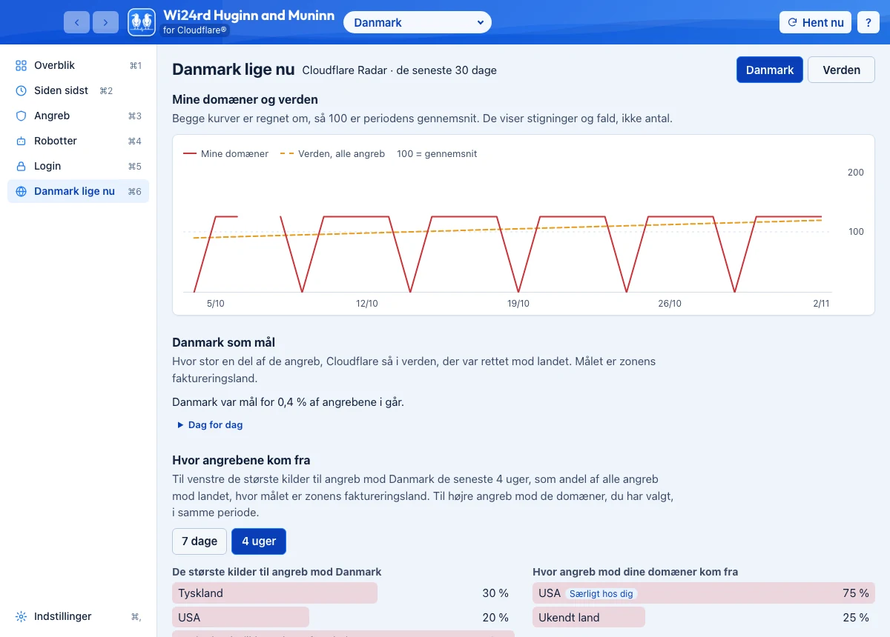
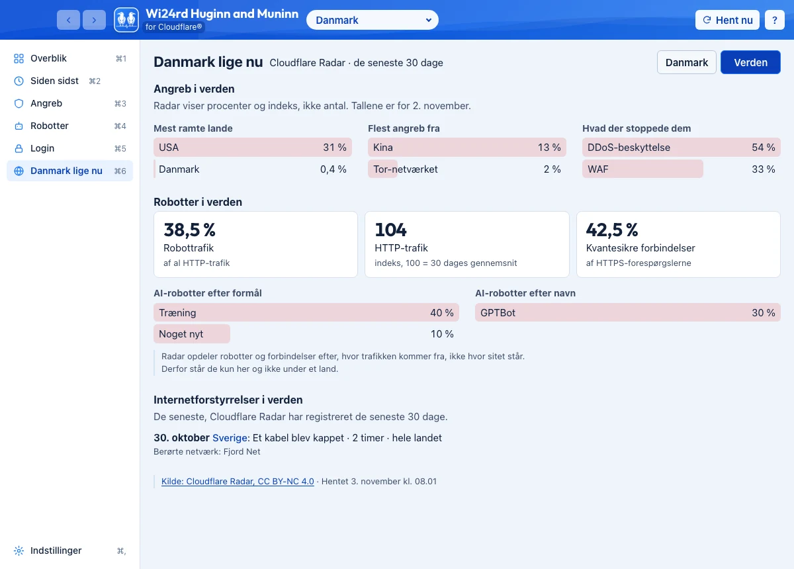

# Dit land lige nu og Verden

Genvej: ⌘6 (Windows: Ctrl+6). Navnet i sidebjælken følger det land, du har valgt, fx **Danmark lige nu**.

## Hvad viser den?

Her står dine egne angreb ved siden af resten af dit land og verden, med tal fra **Cloudflare Radar** for de seneste 30 dage. Radar viser procenter og indeks, ikke antal, så kurverne siger noget om stigninger og fald.

*Kurven for dine domæner ved siden af verdens, begge regnet om, så 100 er periodens gennemsnit. Nedenunder landets andel som mål, og hvor angrebene kom fra.*

Fanen **Danmark** (dit land):

- **Dine domæner og hele verden**: to kurver, begge regnet om, så 100 er periodens gennemsnit. De viser stigninger og fald, ikke antal. Kurven afhænger ikke af det valgte land.
- **Danmark som mål**: hvor stor en del af alle de angreb, Cloudflare så i verden, der var rettet mod landet. Det er en målt andel, ikke et antal. **Dag for dag** folder kurven ud.
- **Hvor angrebene kom fra**: til venstre de største kilder til angreb mod landet som andel af angrebene mod det, til højre hvor angreb mod dine domæner kom fra i samme periode (**7 dage** eller **4 uger**), uanset land (**alle lande**). Et land, der fylder meget mere hos dig end i landet som helhed, er mærket **Særligt hos dig**.
- **Internetforstyrrelser i Danmark**: det, Radar har registreret i landet de seneste 30 dage, fx et kappet kabel eller et strømsvigt, med dato, varighed og de ramte netværk.

*Fanen Verden: de mest ramte lande, flest angreb fra, hvad der stoppede dem, robottrafik, kvantesikre forbindelser, AI-robotter og internetforstyrrelser i hele verden.*

Fanen **Verden**:

- **Angreb i verden**: mest ramte lande, flest angreb fra, og hvad der stoppede dem (DDoS-beskyttelse, WAF …).
- **Robotter i verden**: robottrafik som andel af al HTTP-trafik, HTTP-trafik som indeks, og andelen af kvantesikre forbindelser.
- **AI-robotter efter formål og efter navn**.
- **Internetforstyrrelser i verden**.

## Hvorfor vises angreb fra målsiden?

Et kildeland alene kan ikke stoles på: angrebet kan komme gennem en VPN eller lejede servere. Derfor viser programmet, hvor angreb *mod* landet kom fra, ved siden af hvor angreb mod dine domæner kom fra. Så kan du sammenligne dit eget mønster med landets, og det er det, der siger noget.

## Hvad skal jeg gøre, når …

- **… din kurve stiger, men verdens gør ikke?** Så er stigningen din egen. Overblik siger det samme i Hvorfor ("Verden var normal i går, så stigningen er din egen"). Se [Angreb](vaernet.md) for, hvad der skete.
- **… din kurve følger verdens?** Så følger du en global tendens. Det ændrer ikke status, men det forklarer tallet.
- **… et land er mærket "Særligt hos dig"?** Landet fylder meget mere hos dig end i landet som helhed. Klik på det for at se angrebene i Angreb.
- **… der står "Tallene fra Cloudflare Radar er ikke opdateret"?** Radar svarer ikke lige nu. Dine egne tal virker stadig, og programmet prøver igen.

## Skift land

Vælgeren i det blå bånd og **Indstillinger → Generelt → Land** gemmer dit valg. Begge viser kun lande, Cloudflare Radar har haft tal for som mål de seneste 30 dage, og kun lande, der har været blandt de 100 mest ramte på mindst 15 af de 30 dage: for et land med kun et par spredte dage ville siden næsten intet vise. Der er ingen undtagelser, heller ikke for et land, du har valgt før. Forslaget **Skift til** gælder også kun lande med tal. Listen følger de Radar-tal, programmet allerede henter. Landet tages første gang fra din tidszone, derefter fra systemets sprog. Kommer mindst halvdelen af dine besøgende tydeligt fra et andet land, tilbyder Indstillinger **Skift til** det land; robotter og trafikspring tæller ikke med. Peger en anden visning på et land, viser overskriften **Tilbage til …**, og dit gemte land ændres ikke.

## Klik videre

Et land i listen over, hvor angreb mod dine domæner kom fra, åbner [Angreb](vaernet.md) med landet som filter. **Dag for dag** folder kurven ud. **7 dage** / **4 uger** skifter perioden i sammenligningen (Radar kender ikke 30 dage her). **Danmark** / **Verden** skifter fane. Et land i **Mest ramte lande** åbner et kig på det land.

## Tal og begreber

- Radar kræver ingen ekstra rettighed i API Tokenet, og en fejl hos Radar rammer kun disse visninger.
- Verdenstallene for angreb er WAF-angreb generelt, aldrig en bestemt regel.
- Kilde: Cloudflare Radar, CC BY-NC 4.0. Tallene fra Radar hentes, når de er mere end en time gamle; første gang tager det op til et minut.
