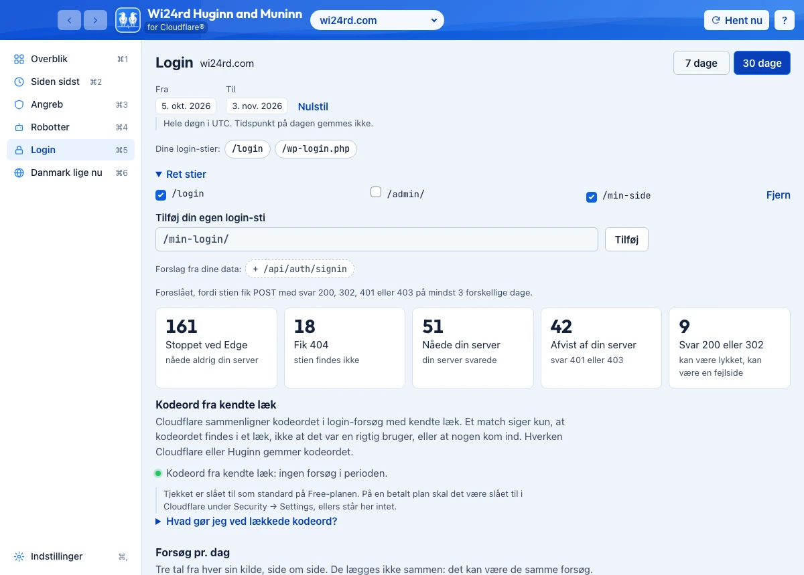

# Login

Genvej: ⌘5 (Windows: Ctrl+5)

## Hvad viser den?

Login viser, hvad der skete på dit sites login-sider: hvor mange forsøg Cloudflare stoppede ved Edge, hvor mange der ramte en side, der ikke findes, og hvor mange der nåede din server. Programmet gætter aldrig på, hvad dit site kører; du slår selv de stier til, der er login på netop dit site.

*Dine login-stier øverst, **Ret stier** med startlisten og dine egne stier, forslag fra dine egne data, og de tre tal, der aldrig lægges sammen.*

De tre tal kommer fra hver sin kilde og lægges aldrig sammen, heller ikke i tegningen:

| Tal | Betyder |
|---|---|
| **Stoppet ved Edge** | Forsøg, Cloudflare afviste eller udfordrede, før de nåede din server. |
| **Fik 404** | Forsøg på en sti, der ikke findes på dit site. Typisk scannere, der leder efter WordPress på et site uden WordPress. |
| **Nåede din server** | Forsøg, din server selv svarede på. Svar 401 eller 403 er afvist. Svar 200 eller 302 *kan* være et login, men kan lige så godt være en fejlside. |

**Kodeord fra kendte læk**: Cloudflare sammenligner kodeordet i login-forsøg med kendte læk. Programmet viser pr. dag og sti, hvor mange forsøg der brugte et lækket kodeord, og hvor mange der nåede serveren. Et match siger kun, at kodeordet findes i et læk, ikke at det var en rigtig bruger, eller at nogen kom ind. Hverken Cloudflare eller programmet gemmer kodeordet. En forespørgsel uden kodeord står som "Ikke et login-forsøg (intet kodeord sendt)" og tæller aldrig som læk.

## Login-stier

- **Startlisten** kan slås til med ét klik: `/wp-login.php`, `/wp-admin/`, `/xmlrpc.php`, `/admin/`, `/administrator/`, `/user/login`, `/login` og `/signin`.
- **Egne stier**: skriv stien under **Tilføj din egen login-sti**, fx `/min-side/`. Højst 20 egne stier pr. domæne.
- **Forslag fra dine data**: en sti foreslås kun, hvis dens navn har et login-ord som helt ord (`login`, `oauth`, `password` og lignende), eller Cloudflares tjek har set et kodeord på den, og den har fået POST med svar 200, 302, 401 eller 403 på mindst 3 forskellige dage. Stier, der bare ligner et login, fx `admin-ajax.php`, foreslås ikke, og en sti fra en kendt regels hændelser foreslås aldrig.

Stierne kan også rettes under **Indstillinger → Notifikationer → Login-stier pr. domæne**.

## Hvad skal jeg gøre, når …

- **… mange forsøg nåede serveren med svar 200 eller 302?** Tjek, om det var dig selv eller dine kolleger. Var det ikke, så sørg for, at login-siden kræver stærke kodeord og helst to trin (2FA), og overvej en regel hos Cloudflare, der udfordrer login-siden.
- **… der står lækkede kodeord, der nåede serveren?** Det giver mindst **Hold øje**, og **Handl**, hvis din server svarede 2xx eller 302. Skift kodeordet på den konto, det kan dreje sig om, og slå to trin til.
- **… der er mange "Fik 404"?** Det er rutine: scannere, der prøver kendte login-sider. Bruger dit site dem ikke, sker der intet.
- **… der står "ikke tilgængelig"?** Din Cloudflare-plan har ikke felterne, der skal til. Resten af programmet virker.

## Klik videre

Et klik på et tal, en sti, et land eller et netværk bliver i Login med et filter mere. Kun en sti, som Edge har stoppet noget på, åbner et [dyk](dyk.md), for dyk kender kun det, Edge stoppede. **Vis kun …** under lækkede kodeord filtrerer på en dag eller en sti. **Ret stier** åbner listen over stier.

## Tal og begreber

- Programmet ser ingen IP-adresser, og Cloudflare kan bruge stikprøver.
- Tallene til Login hentes særskilt, i langsomt tempo efter den normale hentning og kun for færdige dage. Første gang tager det op til en time for 30 dage.
- Stien står aldrig i en notifikation.
