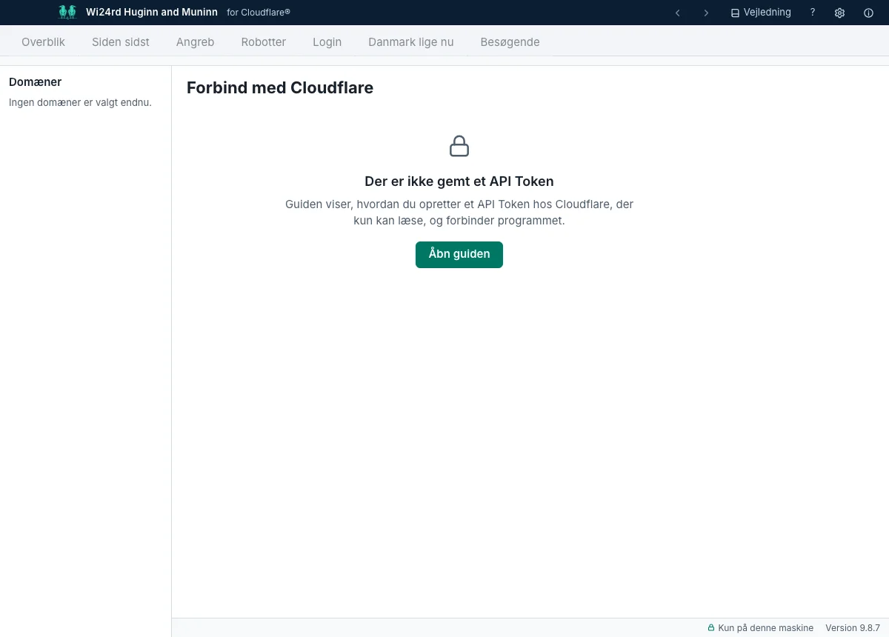

# Forbind med Cloudflare (opsætningen)

Opsætningen er den visning, programmet viser, så længe der ikke er gemt noget API Token. Den har ingen genvej: den står i vinduet af sig selv, og kun **Indstillinger** kan åbnes i sidebjælken, indtil du har forbundet.

Visningen indeholder:

- Knappen **Opret API Token hos Cloudflare**, der åbner Cloudflares side med navn og de to rettigheder udfyldt.
- **Sådan opretter du et API Token**: de ni trin, foldet sammen.
- Feltet **API Token (kun læsning)** og knappen **Gem og forbind**.
- **Notifikationer**: dit første valg af, hvornår du vil have besked (kan ændres senere).
- **Det her kan du forvente**: fem linjer om, hvad programmet gør.
- **Wi24rd – vores filosofi**.

Hele vejledningen til opsætningen står i [Opsætning](../30-opsaetning.md).

*Opsætningen, som den ser ud ved første start.*
