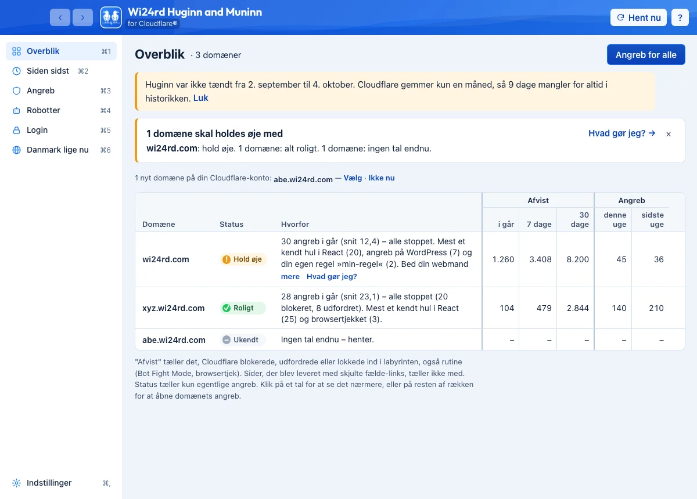

# Overblik

Genvej: ⌘1 (Windows: Ctrl+1)

## Hvad viser den?

Overblik er programmets forside: én række pr. valgt domæne med en status, en forklaring og tallene for de seneste dage. Øverst står en **domslinje**, der samler det hele i én sætning, fx "1 domæne skal holdes øje med" eller "Intet at gøre".

*Domslinjen øverst, én række pr. domæne, og kolonnerne Afvist og Angreb. Den gule linje over tabellen fortæller om et hul i historikken.*

Kolonnerne:

| Kolonne | Betyder |
|---|---|
| **Domæne** | Domænets navn. |
| **Status** | **Handl**, **Hold øje**, **Roligt** eller **Ukendt** (ingen tal endnu). Status sammenligner angreb i går med snittet for ugen før. |
| **Hvorfor** | Forklaringen i klart sprog: hvor mange angreb, hvad de gik efter, og om de blev stoppet. **mere** folder resten ud, og **Hvad gør jeg?** åbner et råd. |
| **Afvist** – i går · 7 dage · 30 dage | Det, Cloudflare blokerede, udfordrede eller lokkede ind i labyrinten, også rutine (Bot Fight Mode, browsertjek). |
| **Angreb** – denne uge · sidste uge | Egentlige angreb, uden rutinen. |

**Afvist** og **Angreb** er ikke det samme tal: Afvist tæller alt, Cloudflare stoppede, mens status og Angreb kun tæller egentlige angreb. Cloudflares automatiske bot-tjek (labyrinten, Bot Fight Mode og browsertjekket) er rutine og giver aldrig Hold øje eller Handl. Sider, der blev leveret med skjulte fælde-links, tæller ikke med.

## Hvad skal jeg gøre, når …

- **… status er Roligt?** Ingenting. Cloudflare håndterer det, der kommer.
- **… status er Hold øje?** Læs forklaringen under Hvorfor. Typisk er alt stoppet, men mønsteret er usædvanligt. Klik på **Hvad gør jeg?** for et råd, fx "bed din webmand tjekke, at sitet er opdateret".
- **… status er Handl?** Der var usædvanligt mange angreb i går i forhold til ugen før, eller noget slap igennem. Klik på rækken for at se angrebene, og følg rådet under **Hvad gør jeg?**.
- **… status er Ukendt?** Programmet har ingen tal for domænet endnu, typisk fordi det lige er valgt. Vent på hentningen; fodlinjen nederst i vinduet viser, hvor langt den er.
- **… der står "opdateres …" ved status?** Om natten (til kl. 03 UTC), før i går er hentet færdigt, bruger status dagen før.

## Mærker oven på status

Nogle domæner får et mærke ved siden af status: **Ligner målrettet**, **Ligner rekognoscering** eller **Ligner DNS-rekognoscering**. Mærkerne siger noget om mønsteret, ikke om mængden, og altid som "ligner", aldrig som en sikker dom. I oversigten står de to sidste kort som **Recon** og **DNS-recon**; andre steder står navnet fuldt ud. Hvad de betyder, står i [Ordlisten](../99-ordliste.md) og i rådet bag **Hvad betyder det? →**.

Overblik kan også fortælle, at et domæne er sat på pause hos Cloudflare, ikke er aktivt, er mistænkt for phishing eller står i udviklertilstand, og at din server ikke svarer: en stor del af svarene i går var fejl, fordi Cloudflare ikke kunne nå eller finde din server (fejl 520–527 og 530). Havde tre eller flere timer i træk fejl, nævner forklaringen tidsrummet i din lokale tid, fx "mellem kl. 01.00 og 05.00". Over tabellen står så en gul linje, **Din server svarer ikke:**, med domænet; et klik på domænet åbner [Drift](drift.md) for domænet og dagen, hvor timerne står. I Hvorfor kan der stå "Følger den globale tendens" eller "Verden var normal i går, så stigningen er din egen" (kun når dit døgn er mindst tre gange dit snit); det sammenligner med hele verden og ændrer ikke status.

## Huller i historikken

Har programmet ikke været tændt i en periode, står der en gul linje øverst: "Huginn var ikke tændt fra … til …". Cloudflare gemmer kun en måned, så dage, der er ældre end det, kan ikke hentes bagefter og mangler for altid. Linjen siger, hvor mange. **Luk** skjuler den. Var hullet kortere end en måned, henter programmet dagene selv, og linjen siger, at intet mangler.

## Nye domæner

Kommer der et nyt domæne på din Cloudflare-konto, viser Overblik en diskret linje med **Vælg** og **Ikke nu**. Det hentes ikke, før du vælger det.

## Klik videre

| Klik på | Åbner |
|---|---|
| Resten af en række (eller Enter på rækken) | [Angreb](vaernet.md) for domænet |
| Et tal under Afvist eller Angreb | [Angreb](vaernet.md) med netop det tal som filter |
| **Angreb for alle** (i båndet) | [Angreb](vaernet.md) for alle valgte domæner samlet |
| **Vælg domæner** (i båndet) | Dialogen **Domæner**; se [Indstillinger](../50-indstillinger.md) |
| **Notifikationer** (klokken i båndet) | Dialogen **Notifikationer pr. domæne** |
| **Hvad gør jeg?** / **Hvad betyder det? →** | Et råd i klart sprog til netop den situation |
| Domænet i linjen **Din server svarer ikke:** | [Drift](drift.md) for domænet og dagen |
| **mere** | Resten af forklaringen |
| Et CVE-nummer i forklaringen | CVE'ens side på cve.org i din browser |
| Linjen nederst om fravalgte domæner | Dialogen **Domæner** |

Intet uden tal bag sig ser klikbart ud.

## Tal og begreber

- Alle dage er hele døgn i **UTC**. "I går" er derfor gårsdagen i UTC, ikke i dansk tid.
- Antallet af afviste er **Cloudflares estimat** ud fra en stikprøve: Cloudflare gemmer ikke hver hændelse, men oplyser for hver, hvor mange den står for, og programmet lægger det sammen. Se [Sampling](../99-ordliste.md).
- **Hent nu** i båndet (⌘R) henter nye tal med det samme. Ellers henter programmet selv i baggrunden.
