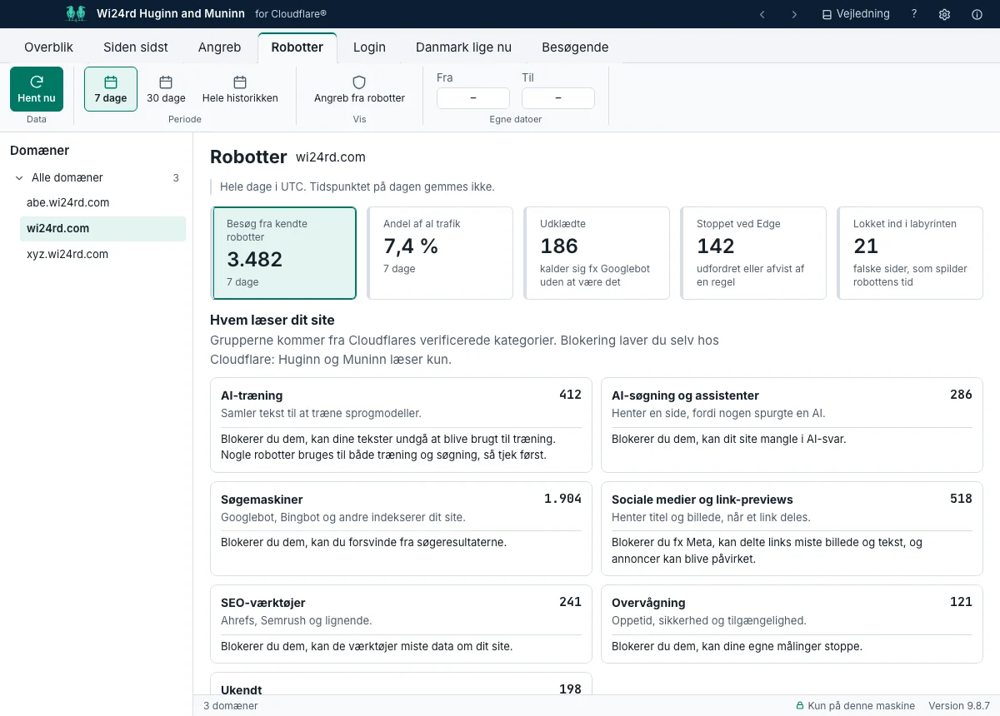

# Robotter

Genvej: ⌘4 (Windows: Ctrl+4)

## Hvad viser den?

Robotter viser, hvem der læser dit site, når det ikke er mennesker: søgemaskiner, AI-robotter, sociale medier, SEO-værktøjer og overvågning. Grupperne er Cloudflares verificerede kategorier. Du ser ét domæne ad gangen eller alle samlet, for 7 dage, 30 dage eller en periode, du selv vælger.

*Fliserne øverst og de syv grupper. Hver gruppe siger, hvad den gør, og hvad der kan ske, hvis du blokerer den.*

Fliserne:

| Flise | Betyder |
|---|---|
| **Besøg fra kendte robotter** | Forespørgsler fra robotter, Cloudflare har verificeret, i perioden. |
| **Andel af al trafik** | Hvor stor en del af alle forespørgsler robotterne stod for. |
| **Udklædte** | Noget, der kalder sig fx Googlebot uden at være det. |
| **Stoppet ved Edge** | Robotter, der blev udfordret eller afvist af en regel. |
| **Lokket ind i labyrinten** | Robotter, der fik falske sider, som spilder deres tid. |

**Hvem læser dit site** viser de syv grupper med antal:

- **AI-træning**: samler tekst til at træne sprogmodeller. Blokerer du dem, kan dine tekster undgå at blive brugt til træning; nogle robotter bruges til både træning og søgning, så tjek først.
- **AI-søgning og assistenter**: henter en side, fordi nogen spurgte en AI. Blokerer du dem, kan dit site mangle i AI-svar.
- **Søgemaskiner**: Googlebot, Bingbot og andre. Blokerer du dem, kan du forsvinde fra søgeresultaterne.
- **Sociale medier og link-previews**: henter titel og billede, når et link deles. Blokerer du fx Meta, kan delte links miste billede og tekst, og annoncer kan blive påvirket.
- **SEO-værktøjer**: Ahrefs, Semrush og lignende.
- **Overvågning**: oppetid, sikkerhed og tilgængelighed. Blokerer du dem, kan dine egne målinger stoppe.
- **Ukendt**: robotter, Cloudflare ikke har sat i en gruppe, og dem, der ikke er verificeret.

Derunder: de mest læste sider, de udklædte, hvilke robotter der blev stoppet ved Edge, og hvilke der blev lokket ind i labyrinten.

## Hvad skal jeg gøre, når …

- **… en AI-robot læser mange sider?** Beslut, om du vil have det. Programmet blokerer intet; det gør du selv hos Cloudflare (fx AI Crawl Control eller en regel). Noten under gruppen siger, hvad der kan ske.
- **… der står en udklædt robot?** Noget udgiver sig for at være en kendt robot. Cloudflare kender forskel, og det er typisk allerede stoppet eller udfordret. Klik på den for at se, hvad den gik efter.
- **… Siden sidst nævner en ny AI-robot?** Det er første gang, den robot er set på domænet. Her ser du, hvilken gruppe den hører til.

## Klik videre

Hver gruppe, hver robot og hver side åbner de samme tal i et [dyk](dyk.md), hvor du kan lægge flere filtre på. Robotter kan kombineres med en sti, men ikke med andre filtre. **7 dage** / **30 dage** og datovælgeren skifter perioden.

## Tal og begreber

- Grupperne er Cloudflares verificerede kategorier. Noterne om, hvad en blokering kan betyde, er programmets egne og siger "kan".
- Labyrinten stopper ikke robotten; Cloudflare regner den ikke for en blokering, og det gør programmet heller ikke.
- Tallene for "stoppet ved Edge" pr. robot hentes særskilt og langsomt efter den normale hentning, kun for færdige dage. Første gang tager det op til en time for 30 dage. Har din plan ikke felterne, står der "ikke tilgængelig".
- Brugeragenter gemmes kun som robotnavn, aldrig i fuld længde.
