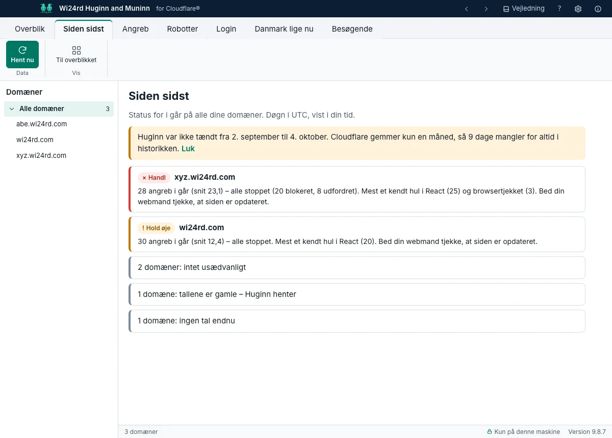

# Siden sidst

Genvej: ⌘2 (Windows: Ctrl+2)

## Hvad viser den?

Siden sidst er status for i går på alle dine domæner, én linje hver, med det vigtigste øverst: domæner, der kræver handling (**Handl**), derefter dem, der skal holdes øje med (**Hold øje**), og til sidst en samlet linje for dem, hvor alt er roligt. Visningen siger også, hvornår du kiggede her sidst, så du kan se, hvad der er nyt siden da.

*Ét kort pr. domæne, der kræver opmærksomhed, med forklaringen i klart sprog. Domæner, hvor alt er roligt, samles i én linje.*

Visningen åbner af sig selv, når du klikker på en notifikation eller vælger **Siden sidst** i menuen ved ravne-ikonet i menulinjen. Tallet på fanen **Siden sidst** viser, hvor mange domæner der står med Handl.

Om natten (til kl. 03 UTC), før i går er hentet færdigt, viser den status for i forgårs og siger det.

## Hvad skal jeg gøre, når …

- **… et domæne står med Handl?** Læs linjen, og klik på domænet for at se angrebene. Rådet bag **Hvad gør jeg?** i Overblik gælder også her.
- **… et domæne står med Hold øje?** Læs forklaringen. Oftest er alt stoppet; linjen siger, hvad der var usædvanligt.
- **… der kun står "Alt er roligt"?** Ingenting. Klik på **Til overblikket**, hvis du vil se tallene alligevel.
- **… der står en linje om en ny AI-robot?** En robot, programmet ikke har set på domænet før, har læst dit site. Se [Robotter](robotter.md) for, hvad det betyder, og hvad der kan ske, hvis du blokerer den.

## Klik videre

| Klik på | Åbner |
|---|---|
| Et domænekort | [Angreb](vaernet.md) for domænet |
| Chippen med status eller mærke ("Handl", "Ligner …") | Guiden: hvad det betyder, og hvad du gør |
| En samlelinje ("2 domæner: alt roligt") | [Overblik](overblik.md) |
| **Din server svarede ikke: se timerne i Drift** (på et domæne, hvor serveren ikke svarede) | [Drift](drift.md) for domænet og dagen |
| Linjen om en ny AI-robot | Robotten i [Angreb](vaernet.md) |
| **Til overblikket** | [Overblik](overblik.md) |

## Tal og begreber

- Status sammenligner angreb i går med snittet for ugen før. Hele dage i UTC.
- Hvert domæne meldes højst én gang om dagen i notifikationerne, men Siden sidst viser altid den aktuelle status, uanset om du fik besked.
