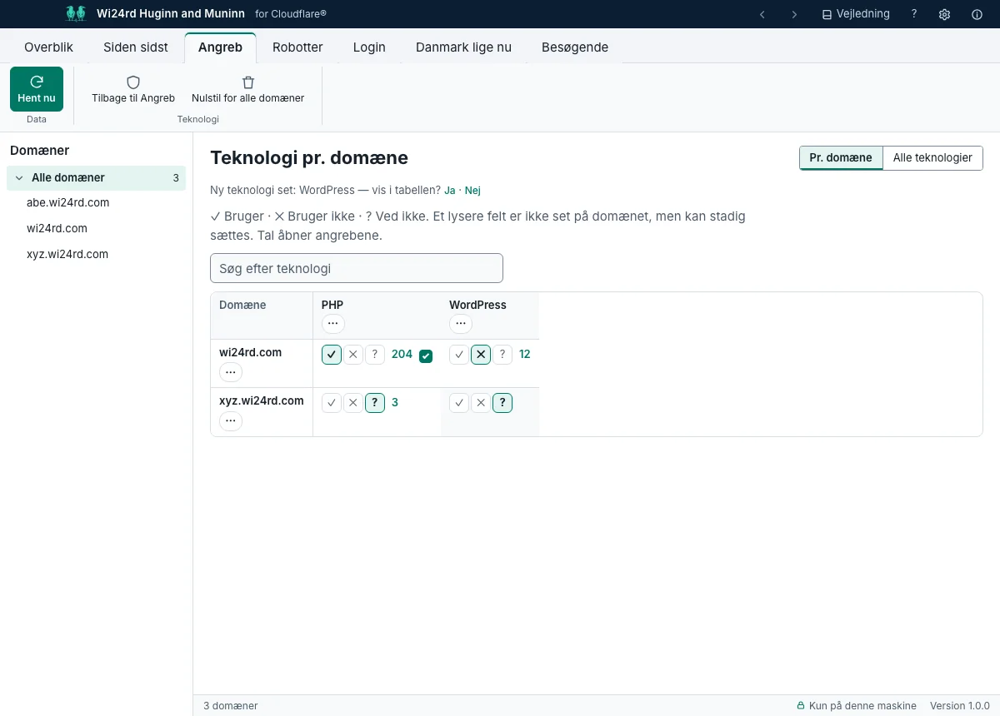

# Teknologi pr. domæne

Ingen genvej og ingen fane. Du kommer dertil med **Ret teknologier** i båndet på **Angreb**. **Tilbage til Angreb** i båndet fører tilbage.

## Hvad viser den?

Angreb går ofte efter bestemte teknologier: WordPress, PHP, React og så videre. Programmet ved ikke, hvad dit site kører, og gætter ikke. Her fortæller du det, og så kan status skelne mellem et angreb på noget, du bruger, og et angreb på noget, du ikke har.

*Én række pr. valgt domæne, én kolonne pr. teknologi. Tallet i cellen er antal angreb mod den teknologi på domænet og åbner angrebene.*

Fanen **Pr. domæne**: rækker er dine valgte domæner, kolonner er de teknologier, der er krydset af under **Vis i tabellen**. Hver celle har tre valg:

| Valg | Betyder |
|---|---|
| ✓ **Bruger** | Sitet bruger teknologien. Angreb mod den vægter i status. |
| ✗ **Bruger ikke** | Sitet bruger den ikke. Angreb mod den er støj fra scannere. |
| ? **Ved ikke** | Ikke taget stilling. Et lysere felt er ikke sat på domænet, men kan stadig sættes. |

Tallet i cellen er antal angreb mod teknologien på domænet. Hver kolonne og hvert domæne har sine handlinger bag én knap **⋯**. Du kan søge efter en teknologi.

**Giv mig besked** på en teknologi giver en notifikation, når der er flere angreb på den end normalt, uanset niveauet for notifikationer. Et domæne, der står på **Aldrig** under Notifikationer, forbliver dog tavst.

Ser programmet en ny teknologi i angrebene, står der øverst "Ny teknologi set: … – vis i tabellen? **Ja** · **Nej**".

Fanen **Alle teknologier**: kataloget i grupper med søgning og antal angreb på kontoen. Her vælger du, hvad der vises i tabellen, og kan tilføje teknologier på forhånd. At skjule en kolonne ændrer ikke dine valg: de gælder stadig i status, og angrebene står stadig i tal, lister og på kortet.

## Hvad skal jeg gøre, når …

- **… du ikke ved, hvad sitet kører?** Lad **Ved ikke** stå, eller spørg din webmand. Programmet gætter ikke for dig.
- **… status siger Hold øje på grund af et hul i noget, du ikke bruger?** Sæt **Bruger ikke**. Så fylder det mindre i status fremover.
- **… du vil nulstille alt?** **Nulstil for alle domæner** i båndet. Programmet spørger først: **Nulstil teknologi-valg?**

## Klik videre

Tallet i en celle åbner angrebene mod teknologien på domænet i [Angreb](vaernet.md). **⋯** viser kolonnens eller domænets handlinger.

Tastatur: tabellen er ét Tab-stop. Piletasterne flytter mellem cellerne, mellemrum skifter valg, og Enter går ind i gruppen, hvor piletasterne vælger, til Esc.

## Tal og begreber

- Teknologierne kommer fra Cloudflares regelnavne (fx "React – RCE – CVE-2025-55182"). Programmet oversætter dem til klart sprog og viser Cloudflares eget navn nedenunder.
- Valgene gemmes på din computer sammen med resten af dine indstillinger og slettes, hvis du glemmer API Tokenet.
