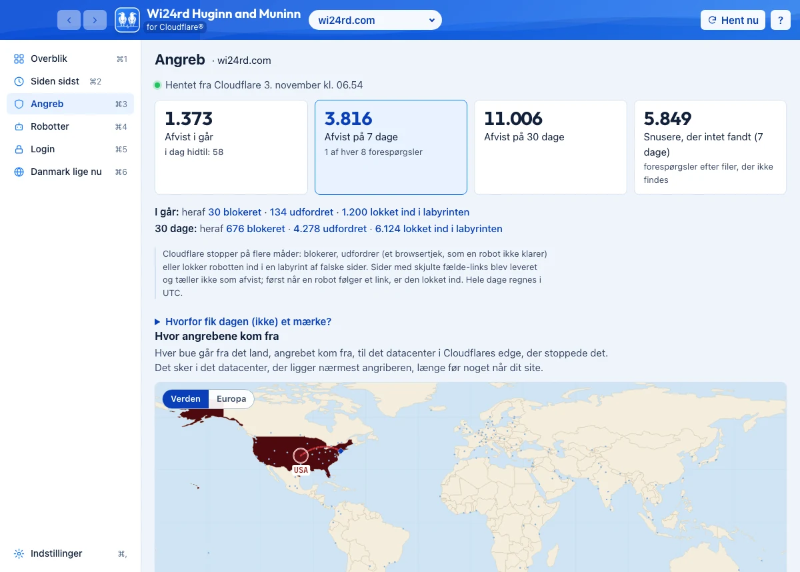
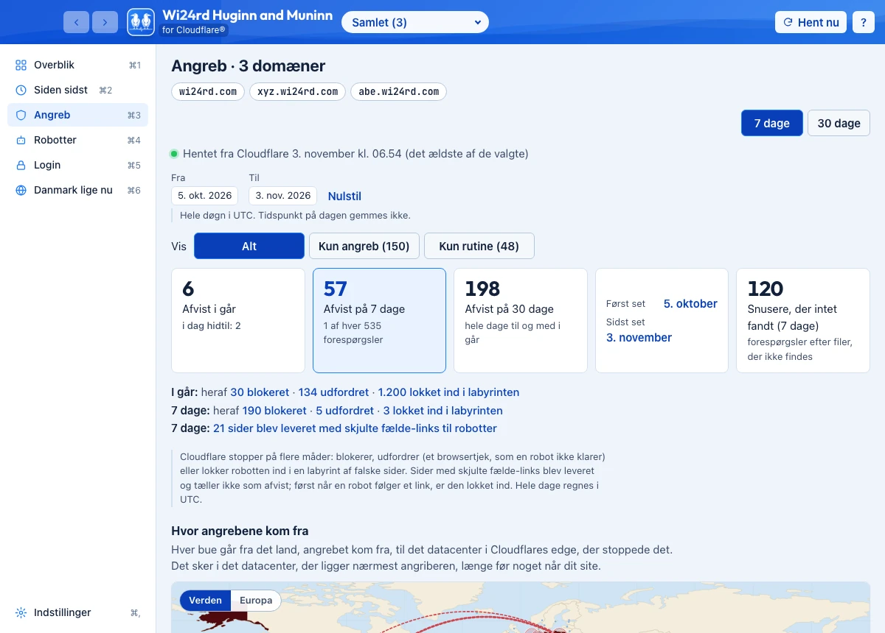

# Angreb

Genvej: ⌘3 (Windows: Ctrl+3)

## Hvad viser den?

Angreb viser, hvad Cloudflares **Edge – første forsvarslinje** holdt ude fra dit domæne: hvor meget der blev afvist i går, på 7 dage og på 30 dage, hvordan det blev stoppet, hvilke regler og huller angrebene gik efter, og hvor i verden de kom fra. Du ser ét domæne ad gangen (domænevælgeren i det blå bånd skifter) eller alle valgte domæner samlet (**Angreb for alle** i Overblik, eller **Samlet** i vælgeren).

*De fire fliser øverst, fordelingen på blokeret, udfordret og labyrinten, og verdenskortet med buer fra angriberens land til det datacenter, der stoppede angrebet.*

*Samlet: de valgte domæner står som chips under overskriften, og tallene er lagt sammen. Den grønne prik viser det ældste hentetidspunkt blandt de valgte.*

Fliserne øverst:

| Flise | Betyder |
|---|---|
| **Afvist i går** | Alt, Cloudflare stoppede i går (hele UTC-døgnet), og "i dag hidtil" som en lille linje. |
| **Afvist på 7 dage** | Samme for de seneste 7 hele dage, med andelen af alle forespørgsler. |
| **Afvist på 30 dage** | Samme for 30 hele dage. |
| **Snusere, der intet fandt (7 dage)** | Forespørgsler efter filer, der ikke findes: scannere, der leder efter kendte huller. |

Under fliserne står fordelingen: **blokeret**, **udfordret** (et browsertjek, som en robot ikke klarer) og **lokket ind i labyrinten** (falske sider, der spilder robottens tid). Sider, der blev leveret med skjulte fælde-links, står på deres egen linje og tæller ikke som afvist.

Længere nede på siden:

- **Hvor angrebene kom fra**: verdenskortet. Landene fyldes i fem trin efter antal angreb, med skalaen under kortet. En bue går fra landet til det datacenter i Cloudflares edge, der stoppede angrebet; de øvrige datacentre er svage blå prikker. **Verden** og **Europa** zoomer. Landet er det, Cloudflare så angrebet komme fra, og det kan være en VPN eller proxy.
- **Hvad angrebene var rettet mod**: regler og kendte huller (CVE-numre) med antal, og hvilke af dem, der rammer teknologi, dit site bruger.
- **Dit sites teknologi** (kun for ét domæne): hvad du har fortalt programmet, at sitet bruger, med **Ret teknologier**. Se [Teknologi pr. domæne](teknologi.md).
- **Mails sendt i dit domænes navn** (kun for ét domæne): hvor mange mails der blev sendt i domænets navn de seneste 30 dage, hvor mange der fejlede DMARC, og fra hvilke afsendere. Kræver DMARC Management hos Cloudflare.
- **Hvorfor fik dagen (ikke) et mærke?** kan foldes ud og viser for hvert af de tre mærker (Ligner målrettet, Ligner rekognoscering, Ligner DNS-rekognoscering) ja, nej eller "ja, foreløbigt" med hver betingelse og tallet.
- **De seneste**: de seneste afviste forespørgsler, renset for IP-adresser og forespørgselsdel.

Den grønne prik øverst ("Hentet fra Cloudflare …") siger, hvornår tallene sidst blev hentet. Dage, der ikke er hentet, tegnes ikke som 0: summer siger "N af M dage".

## Hvad skal jeg gøre, når …

- **… tallene er store, men alt er stoppet?** Ingenting. Det er det, Cloudflare er til for. Rutine (Bot Fight Mode, browsertjek, labyrinten) fylder ofte mest.
- **… der står et kendt hul (CVE) under "Hvad angrebene var rettet mod"?** Klik på det. Kortet forklarer hullet i klart sprog, og **Hvad gør jeg?** giver et råd, typisk at bede din webmand tjekke, at netop den teknologi er opdateret. Bruger dit site ikke teknologien, kan du sige det under **Ret teknologier**, så fylder det mindre i status.
- **… det meste kommer fra ét land?** Klik på landet eller buen for at se angrebene bag. Husk, at kildelandet kan være en VPN.
- **… din egen regel har mange hits?** Så virker den. Klik på reglen for at se, hvad den stoppede.

## Klik videre

Alt med data bag sig åbner et [dyk](dyk.md) i netop det tal: fliserne, fordelingen (blokeret, udfordret, labyrinten), lande, ringe og buer på kortet, søjler, lister, regelkortene, "Hvad de ledte efter" og "De seneste". Et klik på et CVE-nummer åbner CVE'ens side på cve.org i din browser; programmet henter intet derfra. **Ret teknologier** åbner [Teknologi pr. domæne](teknologi.md).

Tastatur: kortet er ét Tab-stop; piletasterne flytter mellem landene og ringene, og Enter eller mellemrum åbner det valgte.

## Tal og begreber

- Alle tal er hele døgn i **UTC**. I går, 7 og 30 dage er hele dage til og med i går.
- Edge er Cloudflares netværk af datacentre. Dit site svarer fra dem alle, så et angreb stoppes i det datacenter, der ligger nærmest angriberen, længe før det når din server. Det gælder kun DNS-poster med orange sky. Kender en angriber serverens egen IP-adresse, kan den gå uden om edge, medmindre serveren kun tager imod trafik fra Cloudflare.
- Labyrinten stopper ikke robotten; den viser falske sider. Cloudflare regner den ikke for en blokering, og det gør programmet heller ikke.
- Tallene kommer fra Cloudflares GraphQL Analytics API og kan være samplet over lange perioder.
