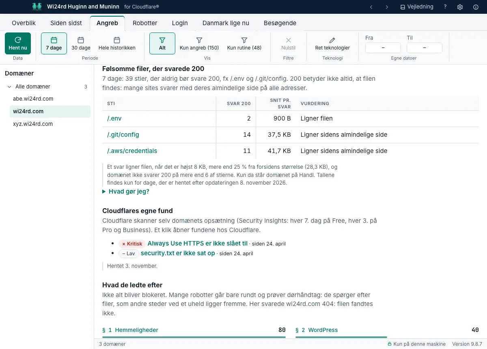
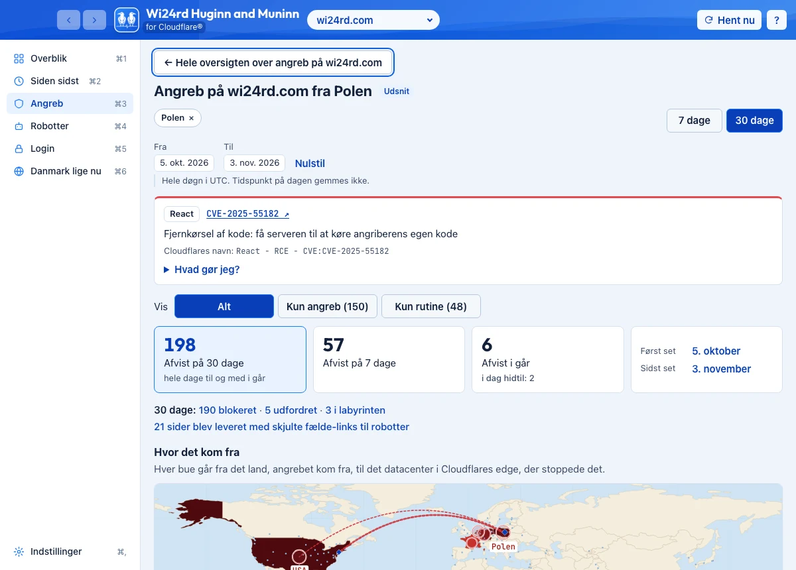
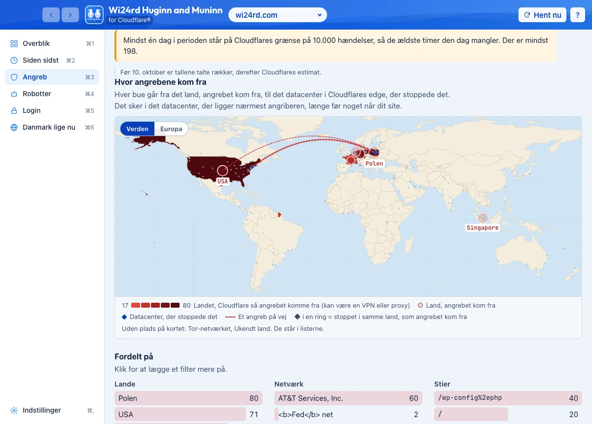

# Angreb

Genvej: ⌘3 (Windows: Ctrl+3)

## Hvad viser den?

Angreb viser på én side, hvad Cloudflares **Edge – første forsvarslinje** holdt ude fra dit domæne: hvor meget der blev afvist, hvordan det blev stoppet, hvilke regler og huller angrebene gik efter, og hvor i verden de kom fra. Overskriften siger, hvad du ser, fx **Angreb · wi24rd.com**. Du ser ét domæne ad gangen (listen **Domæner** til venstre skifter) eller alle valgte domæner samlet (**Angreb for alle** i Overblik, eller **Alle domæner** i listen).

*Båndet med Periode, Vis, Filtre, Teknologi og Egne datoer, listen Domæner til venstre og fliserne. Under dem står fordelingen, og længere nede verdenskortet.*

*Samlet: de valgte domæner står som chips under overskriften, og tallene er lagt sammen. Den grønne prik viser det ældste hentetidspunkt blandt de valgte.*

Fliserne øverst:

| Flise | Betyder |
|---|---|
| **Afvist i går** | Alt, Cloudflare stoppede i går (hele UTC-døgnet), og "i dag hidtil" som en lille linje. |
| **Afvist på 7 dage** | Samme for de seneste 7 hele dage, med andelen af alle forespørgsler. |
| **Afvist på 30 dage** | Samme for 30 hele dage. |
| **Først set** og **Sidst set** | De dage, der først og sidst er tal for. |
| **Forespørgsler i alt** | Alle forespørgsler i perioden. Klik åbner **Trafik den …**. |
| **Snusere, der intet fandt** | Forespørgsler efter filer, der ikke findes, i den valgte periode: scannere, der leder efter kendte huller. |

Under fliserne står fordelingen: **blokeret**, **udfordret** (et browsertjek, som en robot ikke klarer) og **lokket ind i labyrinten** (falske sider, der spilder robottens tid). Sider, der blev leveret med skjulte fælde-links, står på deres egen linje og tæller ikke som afvist.

Længere nede på siden:

- **Hvorfor fik dagen (ikke) et mærke?** kan foldes ud og viser for hvert af de tre mærker (Ligner målrettet, Ligner rekognoscering, Ligner DNS-rekognoscering) ja, nej eller "ja, foreløbigt" med hver betingelse og tallet. Den gælder i går eller den dag, du har valgt.
- **Hvor angrebene kom fra**: verdenskortet. Landene fyldes i fem trin efter antal angreb, med skalaen under kortet. En bue går fra landet til det datacenter i Cloudflares edge, der stoppede angrebet; de øvrige datacentre er svage blå prikker. **Verden** og **Europa** zoomer. Landet er det, Cloudflare så angrebet komme fra, og det kan være en VPN eller proxy.
- **Fordelt på**: lande, netværk, stier, datacentre, metoder og handling, de fem største fremme og resten bag **Vis top 20**.
- **Edge**: søjlerne pr. dag, og **Vis tallene** med tabellen. Går perioden længere tilbage end sikkerhedshændelserne, står trafikken for sig.
- **Reglerne, der slog til**: regler og kendte huller (CVE-numre) med antal.
- **Dit sites teknologi** (kun for ét domæne): hvad du har fortalt programmet, at sitet bruger, med **Ret teknologier**. Se [Teknologi pr. domæne](teknologi.md).
- **Hvad angrebene var rettet mod**: teknologierne, angrebene gik efter, og om dit site bruger dem.
- **Mails sendt i dit domænes navn** (kun for ét domæne): hvor mange mails der blev sendt i domænets navn i perioden, hvor mange der fejlede DMARC, og fra hvilke afsendere. Kræver DMARC Management hos Cloudflare.
- **Følsomme filer, der svarede 200** (kun for ét domæne): 39 faste stier, der aldrig bør svare 200, fx `/.env`, `/.git/config` og `/.aws/credentials`, med antal svar, svarenes gennemsnitlige størrelse og en vurdering. Et klik på en sti viser angrebene på den. **Ligner filen** betyder, at svaret er højst 8 KB, mere end 25 % fra forsidens størrelse, og at domænet ikke svarer 200 på mere end 6 af stierne; kun da står domænet på **Handl**. **Ligner sidens almindelige side** betyder, at sitet svarer med sin almindelige side på adresser, der ikke findes (mange sites gør det), og ændrer ikke status. Tallene findes for dage, der er hentet efter opdateringen 8. november 2026.
- **Cloudflares egne fund** (kun for ét domæne): det, Cloudflares egen skanning af domænets opsætning har fundet (Security Insights), med alvor, titel og dato. Et klik åbner Security Insights hos Cloudflare i din browser. Kræver én valgfri rettighed mere på API Tokenet, se [Opret API Token hos Cloudflare](../31-cloudflare.md). Uden den står der, at den kan tilføjes, og resten virker. Cloudflare skanner hver 7. dag på Free og hver 3. dag på Pro og Business. Et kritisk fund giver **Hold øje**.
- **Hvad de ledte efter**: de stier, scannerne spurgte efter, sorteret i kategorier.
- **På dine andre domæner**: det samme på dine andre valgte domæner.
- **De seneste**: de seneste afviste forespørgsler, renset for IP-adresser og forespørgselsdel. Er der flere sider, skifter **Forrige** og **Næste** kun tabellen: siden bliver stående, hvor du er, og et sideskift er ikke et trin i tilbage og frem.

*Kun `/.env` ligner filen; de to andre stier svarer med sitets almindelige side. Under **Cloudflares egne fund** er det kritiske fund, at Always Use HTTPS ikke er slået til.*

Den grønne prik øverst ("Hentet fra Cloudflare …") siger, hvornår tallene sidst blev hentet. Dage, der ikke er hentet, tegnes ikke som 0: summer siger "N af M dage".

## Periode og filtre

Båndet øverst har altid de samme valg:

- **Periode**: **7 dage** (standard), **30 dage** og **Hele historikken**.
- **Egne datoer**: **Fra** og **Til**. Trafiktal rækker et år tilbage; sikkerhedshændelser begynder, hvor Cloudflare begynder, og det står tydeligt.
- **Vis**: **Alt**, **Kun angreb** eller **Kun rutine**, så du kan se egentlige angreb uden Cloudflares rutine, eller omvendt.
- **Filtre**: **Nulstil** fjerner de filtre, du har lagt på. Er der ingen, er knappen grå.
- **Teknologi**: **Ret teknologier** åbner [Teknologi pr. domæne](teknologi.md).

Et klik på et tal, et land, en regel eller en sti lægger et filter på samme side. Filtrene står som chips under overskriften, fx "Et kendt hul i React ×": × fjerner ét, og **Nulstil** ved siden af fjerner alle filtre og perioden. Der kan højst være ét filter pr. slags (ét land, én regel, én sti …).

*Med en regel som filter forklarer kortet øverst hullet i klart sprog, med Cloudflares eget navn nedenunder og et råd bag **Hvad gør jeg?**.*

*Med et land som filter viser fliserne og kortet kun angrebene derfra.*

Alle afsnit følger perioden og filtrene. Et afsnit, der ikke kan følge filtret, står ikke, og en linje nederst på siden siger hvilke. Det gælder fx **Dit sites teknologi**, **Mails sendt i dit domænes navn**, **Følsomme filer, der svarede 200**, **Cloudflares egne fund** og **Hvad de ledte efter**, for de tal har hverken land eller regel. Med et filter eller en valgt periode viser siden de gemte tal og henter intet fra Cloudflare.

## Subdomæner

Har domænet tal på mindst to navne i perioden, fx `wi24rd.com` og `shop.wi24rd.com`, står afsnittet **Subdomæner** efter søjlerne. Det står kun for ét domæne og kun uden filtre; et domæne uden subdomæner ser ud som før. Tabellen er den samme som i [Besøgende](besoegende.md): **Subdomæne**, **Besøg**, **Forespørgsler**, **Angreb** og **Andel** (andelen af forespørgslerne), med **Andre (n)** efter de 20 største, rækkerne **Kaldt med IP-adresse**, **Andet navn** og **Ugyldigt navn**, noten **Pr. subdomæne fra {dato}.**, når perioden går længere tilbage end tallene pr. subdomæne, og noten om «DNS only». **Angreb** tælles som resten af siden: uden Cloudflares rutine.

Klik på et subdomæne, og Angreb viser kun det, med chippen **Subdomæne: shop.wi24rd.com** under overskriften. Så står fliserne **Angreb på …** og **Afviste på …** for perioden, og søjlerne viser angreb og afviste pr. dag. Et klik på en dag viser dagen for samme subdomæne. Reglerne, lande, stier, **De seneste** og **Cloudflares egne fund** findes ikke pr. subdomæne. De står ikke, aldrig med hele domænets tal. En linje under chippen siger det: **Regler, lande og stier vises for hele wi24rd.com, ikke pr. subdomæne.** Et klik på **hele wi24rd.com** fjerner filteret, ligesom **×** på chippen. Filteret kan ikke stå sammen med andre filtre, det står i adressen (tilbage og frem virker), og det nulstilles, når du vælger et andet domæne.

I tabellen åbner navnet og tallet under **Angreb** Angreb for subdomænet. **Besøg** og **Forespørgsler** åbner [Besøgende](besoegende.md) for subdomænet med samme periode (**Hele historikken** bliver **Et år**, og én dag bliver **Fra** og **Til** samme dag). Et tal, der er 0, kan ikke klikkes. Stod Cloudflares svar på loftet for nogle dage i perioden, står fx **2 dage er ikke med: Cloudflare sendte flere rækker, end programmet kan hente på én gang.** under tabellen.

Afviste Cloudflare forespørgslen pr. subdomæne for domænet, står **Cloudflare svarede ikke på subdomænerne for dette domæne.** i stedet for tabellen. Domænets egne tal er de samme som før.

## Trafik den …

Klikker du på en dag med **usædvanlig meget trafik** (fra Overblik, en notifikation eller flisen **Forespørgsler i alt**), står afsnittet **Trafik den …** øverst på siden. Det viser forespørgslerne den dag, ikke det, Cloudflare stoppede: antal mod det normale, hvor mange Cloudflare stoppede, hvor de kom fra, svarkoderne og robotterne. Tallene kan sige, hvor trafikken kom fra, men ikke hvad den var. **Trafik** står som chip, og × fjerner afsnittet.

*Et døgn med 410.000 forespørgsler mod normalt 1.500: 92 % fra ét land, og de fleste fik svar 522, fordi serveren ikke svarede.*

## Hvad skal jeg gøre, når …

- **… tallene er store, men alt er stoppet?** Ingenting. Det er det, Cloudflare er til for. Rutine (Bot Fight Mode, browsertjek, labyrinten) fylder ofte mest.
- **… der står et kendt hul (CVE) under "Reglerne, der slog til"?** Klik på det. Kortet forklarer hullet i klart sprog, og **Hvad gør jeg?** giver et råd, typisk at bede din webmand tjekke, at netop den teknologi er opdateret. Bruger dit site ikke teknologien, kan du sige det under **Ret teknologier**, så fylder det mindre i status.
- **… det meste kommer fra ét land?** Klik på landet eller buen for at se angrebene bag. Husk, at kildelandet kan være en VPN.
- **… din egen regel har mange hits?** Så virker den. Klik på reglen for at se, hvad den stoppede.
- **… du vil vide, om det er rettet mod dig?** Se **På dine andre domæner**. Mærket **Ligner målrettet** sættes netop, når angrebene steg her, men ikke på dine andre domæner, og en stor del kom fra ét netværk.
- **… en sti dukker op igen og igen?** Klik på stien. Er det `wp-login.php` eller lignende, er det rutine fra scannere; se også [Login](login.md).
- **… en følsom fil svarede 200?** Se afsnittet **Følsomme filer, der svarede 200**. Står der **Ligner filen**, så åbn adressen i din browser og se, hvad der kommer; **Hvad gør jeg?** giver rådene. Står der **Ligner sidens almindelige side**, svarer sitet med forsiden på alle adresser, og der er ikke noget at gøre.
- **… Cloudflare har et kritisk fund?** Klik på fundet under **Cloudflares egne fund**. Cloudflare forklarer det i Security Insights; de fleste fund er råd om indstillinger.
- **… ét subdomæne får de fleste angreb?** Klik på det under **Subdomæner** for at se dagene. Reglerne og stierne bag findes kun for hele domænet; fjern chippen og se dem der.
- **… en dag skiller sig ud?** Vælg dagen i datovælgeren eller klik på søjlen, og fold **Hvorfor fik dagen (ikke) et mærke?** ud.

## Klik videre

Alt med data bag sig lægger et filter eller en periode på samme side: fliserne, fordelingen, lande, ringe og buer på kortet, søjler, lister, regelkortene, "Hvad de ledte efter" og "De seneste". Tilbage og frem øverst til højre (⌘[ og ⌘]) går ét trin ad gangen, også gennem filtre. Et klik på et CVE-nummer åbner CVE'ens side på cve.org i din browser; programmet henter intet derfra. **Ret teknologier** åbner [Teknologi pr. domæne](teknologi.md). Et subdomæne under **Subdomæner** (navnet eller tallet under **Angreb**) viser Angreb for det subdomæne; **Besøg** og **Forespørgsler** viser Besøgende for det. **hele {domæne}** i linjen under chippen fjerner filteret pr. subdomæne. **Andel**, **Andre (n)**, et tal, der er 0, rækkerne uden et navn og noterne under tabellen fører ingen steder hen.

Tastatur: kortet er ét Tab-stop; piletasterne flytter mellem landene og ringene, og Enter eller mellemrum åbner det valgte.

## Tal og begreber

- Alle tal er hele døgn i **UTC**. I går, 7 og 30 dage er hele dage til og med i går; i dag står for sig, indtil dagen er slut.
- Edge er Cloudflares netværk af datacentre. Dit site svarer fra dem alle, så et angreb stoppes i det datacenter, der ligger nærmest angriberen, længe før det når din server. Det gælder kun DNS-poster med orange sky. Kender en angriber serverens egen IP-adresse, kan den gå uden om edge, medmindre serveren kun tager imod trafik fra Cloudflare.
- Labyrinten stopper ikke robotten; den viser falske sider. Cloudflare regner den ikke for en blokering, og det gør programmet heller ikke.
- Stier står uden forespørgselsdel, og lange koder er skjult. IP-adresser findes ikke i programmet.
- Tallene kommer fra Cloudflares GraphQL Analytics API. Antallet af afviste er Cloudflares estimat ud fra en stikprøve, så det kan være højere end antallet af enkelte hændelser. Dage, som Cloudflare ikke længere havde, da programmet første gang hentede efter opdateringen, er talte rækker. Går perioden over grænsen, siger en note det, fx "Før 10. oktober er tallene talte rækker, derefter Cloudflares estimat."
- Står en dag på Cloudflares grænse på 10.000 hændelser, mangler dagens ældste timer, og siden siger "Der er mindst …".

*Den gule boks siger, at mindst én dag står på Cloudflares grænse. Noten under den siger, fra hvilken dag tallene er Cloudflares estimat.*
