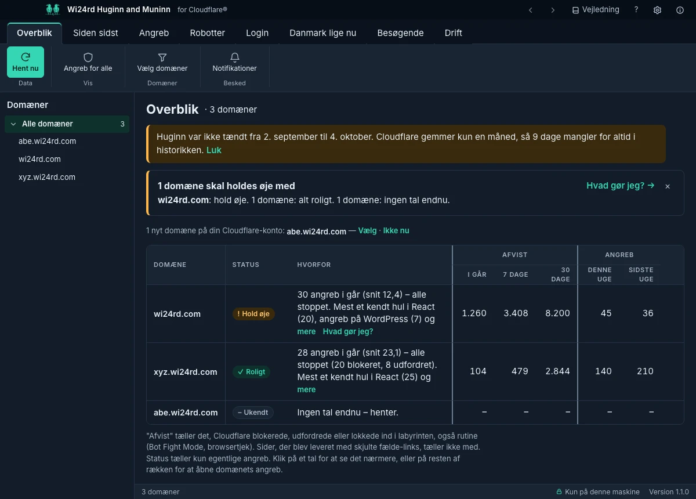
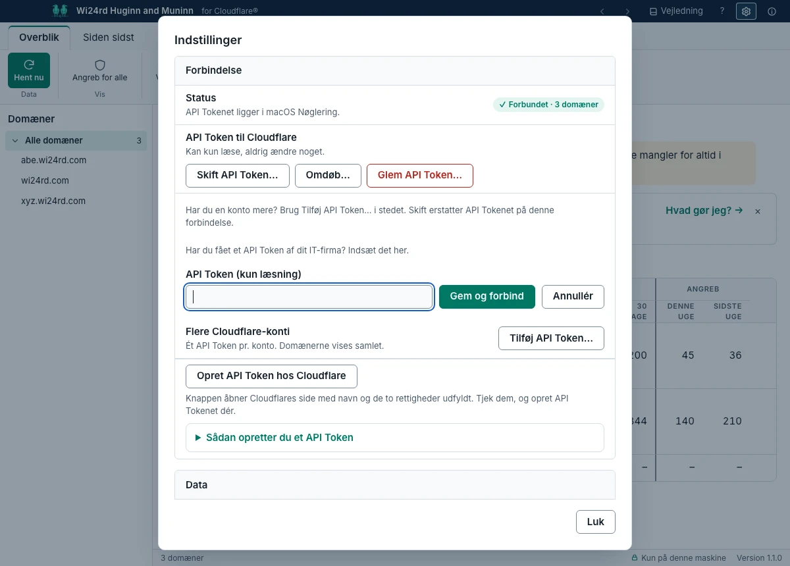
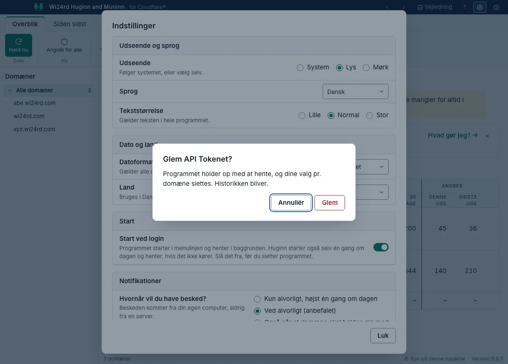
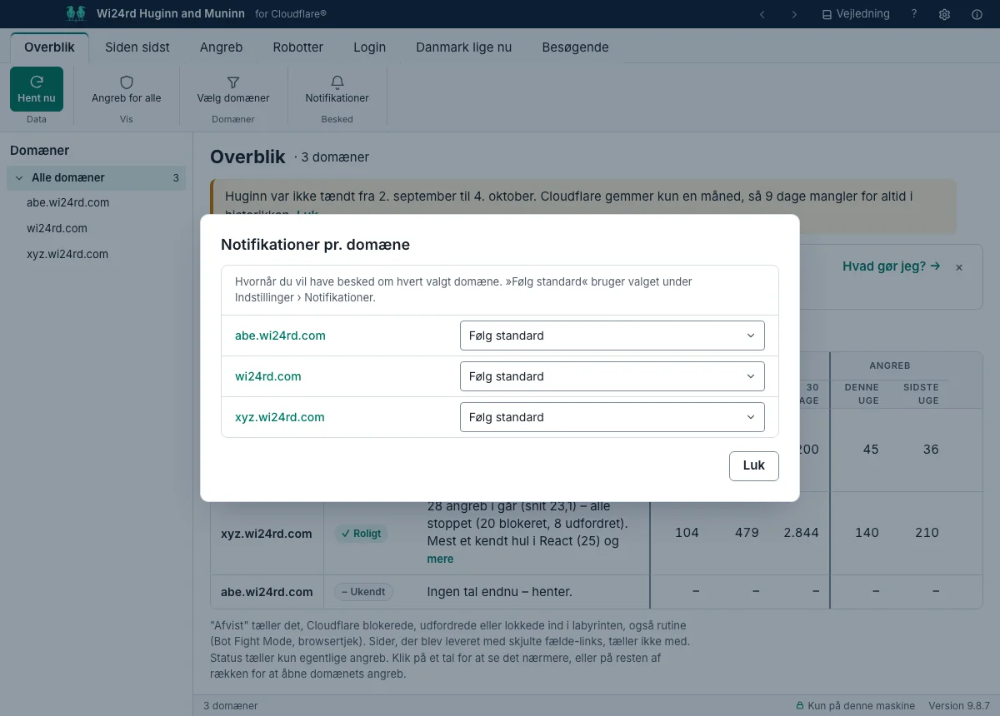
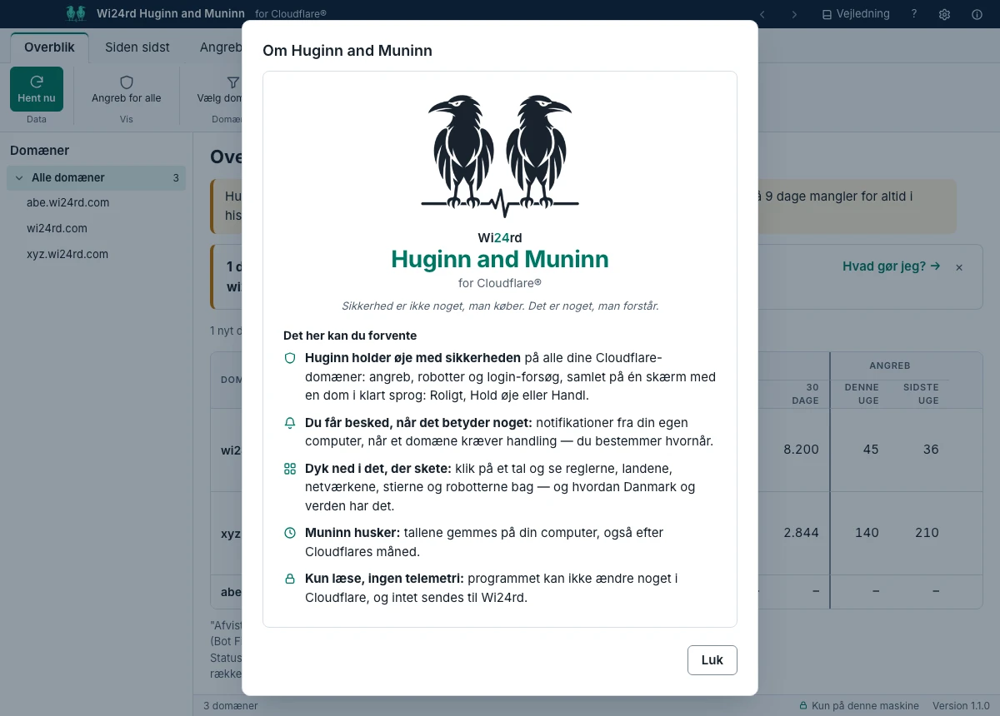

# Indstillinger

Åbn Indstillinger med tandhjulet øverst til højre eller med ⌘, (Windows: Ctrl+,). Indstillinger er et vindue oven på den visning, du står i, og kan også åbnes, før du har forbundet med Cloudflare. **Luk** står fast nederst; Esc lukker også.

Alle valg gemmes med det samme på din computer. Der er ingen Gem-knap, bortset fra ved API Tokenet og navnet på en forbindelse.

Vinduet har syv grupper: **Udseende og sprog**, **Dato og land**, **Start**, **Notifikationer**, **Forbindelse** (**Forbindelser**, når der er flere), **Data** og **Første start**. Tre ting ligger ikke her, men hvor du bruger dem: [Domæner](#domæner), [Notifikationer pr. domæne](#notifikationer-pr-domæne) og [Om](#om).

## Udseende og sprog, Dato og land, Start

| Felt | Valg | Standard | Hvad det gør |
|---|---|---|---|
| **Sprog** | Systemets sprog · Dansk · English | Systemets sprog | Sproget i hele programmet, i menuen ved ravne-ikonet og i notifikationerne. |
| **Datoformat** | Følg sproget · Følg systemet · ISO (2026-11-04) | Følg sproget | Gælder alle datoer i programmet og notifikationerne. |
| **Land** | Liste over lande, og evt. knappen **Skift til …** | Fra din tidszone, derefter systemets sprog | Bruges i **… lige nu**. **Skift til …** vises, når mindst halvdelen af dine besøgende tydeligt kommer fra et andet land. |
| **Udseende** | System · Lys · Mørk | System | Følger systemet, eller vælg selv. Farver og skrifter kommer fra Wi24rd UI Kit 2. |
| **Tekststørrelse** | Lille · Normal · Stor | Normal | Gælder teksten i hele programmet. Også ⌘+ ⌘− ⌘0 (Windows: Ctrl). |
| **Start ved login** | Kontakt | Til (slås til første gang en færdigbygget udgave starter) | Programmet starter i menulinjen, når du logger ind, og henter i baggrunden. Huginn starter også selv én gang om dagen og henter, hvis det ikke kører. Kontakten slår begge dele til og fra. Slå det fra, før du sletter programmet. |

Er **Start ved login** slået fra, står der en gul linje øverst: "Programmet starter ikke ved login. Så henter Huginn kun, når programmet er åbent. Åbn det mindst hver tredje uge, ellers kommer der huller i historikken." Knappen **Slå Start ved login til** slår det til igen. Slå det til og fra her i programmet. Slår du Huginn fra under Login-emner i Systemindstillinger, kan kontakten her stadig stå på til.

*Øverst i Indstillinger: Udseende og sprog, Dato og land og Start med **Start ved login**.*

*Overblik i mørkt tema.*

## Notifikationer

| Felt | Valg | Standard | Hvad det gør |
|---|---|---|---|
| **Hvornår vil du have besked?** | Kun alvorligt, højst én gang om dagen · Ved alvorligt (anbefalet) · Også når et domæne skal holdes øje med | Ved alvorligt (anbefalet) | Det samlede niveau. Beskeden kommer fra din egen computer, aldrig fra en server. |
| **Giv besked, når et domæne kræver handling** | Kontakt | Til | Slår beskeden ved **Handl** fra, hvis du kun vil se det i programmet. |
| **Giv besked ved »Ligner rekognoscering«** | Kontakt | Fra | Fra som standard: de fleste er automatiske scannere. Gælder også »Ligner DNS-rekognoscering«. Mærket vises altid i Overblik og Siden sidst. |

Nederst står: "Du kan også slå notifikationerne helt fra i Systemindstillinger → Notifikationer → Huginn and Muninn." Hvad hver notifikation betyder, står i [Notifikationer og baggrund](60-notifikationer.md). Besked for ét bestemt domæne vælger du under [Notifikationer pr. domæne](#notifikationer-pr-domæne). Login-stier retter du i [Login](40-visninger/login.md) med **Ret stier**.

## Forbindelse

*Status og API Token med **Skift API Token…** foldet ud.*

En forbindelse er ét API Token og et navn. Du har én forbindelse pr. Cloudflare-konto. Domænerne fra alle forbindelser vises samlet; Overblik og de andre visninger deler dem ikke op efter forbindelse. Gruppen hedder **Forbindelse**, når der er én, og **Forbindelser**, når der er flere.

### Med én forbindelse

| Felt | Hvad det gør |
|---|---|
| **Status** | Chippen viser fx **Forbundet · 3 domæner**. Linjen siger, at API Tokenet ligger i din computers nøglering (macOS Nøglering eller Windows Credential Manager). |
| **API Token til Cloudflare** – **Skift API Token…** | Åbner feltet, hvor du indsætter et nyt API Token og klikker **Gem og forbind**. **Annullér** lukker det igen. Det gamle erstattes. Se [Skift og tilføj](#skift-og-tilføj). |
| **Omdøb…** | Giver forbindelsen dit eget navn. Se [Navnet](#navnet). |
| **Glem API Token…** | Programmet spørger **Glem API Tokenet?** Vælger du **Glem**, holder programmet op med at hente, API Tokenet slettes fra nøgleringen, og dine valg pr. domæne slettes (domænevalg, notifikationer pr. domæne, login-stier, teknologi-valg). Historikken bliver. Opsætningen og guiden vises igen, og du kan forbinde igen med et nyt API Token. |
| **Flere Cloudflare-konti** – **Tilføj API Token…** | Linjen siger "Ét API Token pr. konto. Domænerne vises samlet." Knappen tilføjer en forbindelse mere. Se [Skift og tilføj](#skift-og-tilføj). |
| **Opret API Token hos Cloudflare** og **Sådan opretter du et API Token** | Samme hjælp som i opsætningen; se [Opsætning](30-opsaetning.md). |

*Dialogen, før API Tokenet glemmes.*

### Med flere forbindelser

Hver forbindelse har sin egen række. Under rækkerne står **Tilføj API Token…**.

| Felt | Hvad det gør |
|---|---|
| Navnet | Forbindelsens navn. Kan ikke klikkes. |
| **N domæner** | Åbner dialogen [Domæner](#domæner) ved forbindelsens gruppe. |
| Chippen **Forbundet** / **Afvist** | Grøn **Forbundet**: klik åbner Overblik. Rød **Afvist**: Cloudflare afviste API Tokenet; klik åbner **Skift API Token…** i rækken. Se [Fejlfinding](80-fejlfinding.md). |
| **Omdøb…** | Giver forbindelsen dit eget navn. Se [Navnet](#navnet). |
| **Skift API Token…** | Erstatter API Tokenet på denne forbindelse. Se [Skift og tilføj](#skift-og-tilføj). |
| **Glem…** | Programmet spørger **Glem forbindelsen «navn»?** med teksten "Programmet holder op med at hente dens domæner, og dine valg for dem slettes. Historikken bliver." Vælger du **Glem**, slettes forbindelsens API Token fra nøgleringen. Kun domæner, som ingen anden forbindelse ser, mister deres valg. De andre forbindelser henter videre. |

Glemmer du den sidste forbindelse, er det præcis som med én forbindelse: programmet spørger **Glem API Tokenet?**, opsætningen og guiden vises igen, og historikken bliver.

Ser to forbindelser det samme domæne (fx et API Token til hele kontoen og et til ét af dens domæner), vises det én gang i Overblik og de andre visninger. Det hentes kun med den ældste forbindelses API Token. Bliver den glemt eller afvist, overtager den næste. I dialogen [Domæner](#domæner) står domænet under hver forbindelse, der ser det.

### Skift og tilføj

**Tilføj API Token…** åbner samme formular som i guiden: feltet **API Token (kun læsning)**, knappen **Gem og forbind** og hjælpen **Opret API Token hos Cloudflare** med trinene. Programmet tjekker API Tokenet hos Cloudflare, gemmer det i nøgleringen og henter den nye forbindelses domæner.

Den nye forbindelses domæner er ikke valgt af sig selv. Ser den præcis ét domæne, programmet ikke kendte, vælges det for dig. Ser den flere, åbner dialogen **Domæner** ved forbindelsens gruppe, så du kan vælge.

Hedder den nye forbindelse det samme som en anden (to API Tokens til samme konto hedder begge kontoens navn), åbner **Omdøb forbindelsen** med noten "To forbindelser hedder det samme. Giv denne et navn, så du kan kende dem fra hinanden." **Annullér** lader navnet stå. Skal dialogen **Domæner** også åbne, kommer den bagefter.

Ser API Tokenet præcis de samme domæner som en forbindelse, du allerede har, tilføjes det ikke. Formularen siger "Dette API Token ser de samme domæner som «navn». Det er ikke tilføjet." Et API Token, der ser færre domæner på samme konto (fx ét API Token pr. kunde), kan godt tilføjes.

**Skift API Token…** erstatter kun API Tokenet på sin egen forbindelse. I formularen står: "Har du en konto mere? Brug Tilføj API Token… i stedet. Skift erstatter API Tokenet på denne forbindelse." Hører det nye API Token til en anden Cloudflare-konto, forsvinder den gamle kontos domæner fra listen, og valgene for forbindelsen begynder forfra. Tallene, der allerede er hentet, og historikken bliver.

### Navnet

**Omdøb…** åbner dialogen **Omdøb forbindelsen** med ét felt, **Navn**, og noten "Tomt felt: navnet fra Cloudflare." Gem med **Gem**. Tømmer du feltet, vises navnet fra Cloudflare igen. Bagefter står "Navnet er gemt." i forbindelsens række, og **Omdøb…** har fokus igen.

Programmet viser:

- dit eget navn, hvis du har givet forbindelsen et,
- ellers kontoens navn hos Cloudflare, uændret, også når det er en mailadresse,
- "… + 1 anden" eller "… + 2 andre", hvis ét API Token ser flere konti,
- "Forbindelse 1", "Forbindelse 2" osv., hvis programmet endnu ikke kender noget navn.

## Data

| Felt | Hvad det viser eller gør |
|---|---|
| **Lokal database** | Databasens størrelse på din computer. |
| **Historik** | Perioden, der er tal for. Klik åbner hele historikken for alle domæner i [Angreb](40-visninger/vaernet.md). |
| **Ældste dag** | Den første dag, der er tal for. |
| **Hvad der findes** | "Trafik fra … · sikkerhedshændelser fra …": hvor langt tilbage hver slags tal rækker. Vises, når der er tal. |
| **Kvote hos Cloudflare** | "Cloudflare tillader N kald pr. M minutter; Huginn brugte K i sidste runde." Vises, når Cloudflare har oplyst det. |
| **Huller** | Antal dage uden tal. Klik åbner listen **Huller i historikken** i hjælpen: dage, der aldrig er hentet. De er ikke 0. |
| **Domæner med tal** | Hvor mange af de valgte domæner der har tal. Klik åbner Overblik. |
| **Hent nye tal nu** – **Hent nu** | Samme som **Hent nu** i båndet. |
| **Nulstil historik…** | Sletter alle tal på din computer og henter dem forfra. Programmet spørger først og siger, hvilke datoer der forsvinder for altid, og hvor mange dage det er. Dine indstillinger, domænevalg, notifikationer og login-stier bliver. Se [Data og historik](70-data.md). |

## Første start

| Felt | Hvad det gør |
|---|---|
| **Guiden** – **Vis guiden igen** | Åbner guiden fra første start igen. Se [Opsætning](30-opsaetning.md). Dine valg og dit API Token ændres ikke af, at du åbner den. |

## Domæner

Åbn dialogen med **Vælg domæner** i båndet på **Overblik**.

*Én kontakt pr. domæne.*

| Felt | Hvad det gør |
|---|---|
| **Vis i Huginn** – én kontakt pr. domæne | Vælg de domæner, Huginn skal hente og vise. Et domæne, du fravælger, hentes ikke længere, vises ingen steder og giver ingen notifikationer; dets tal bliver liggende, og vælger du det igen, hentes det, der mangler, højst de seneste 30 dage. Et domæne, der er nyt på kontoen, er mærket **NY**. |
| **Vælg alle** / **Fravælg alle** | Alle kontakter på én gang. |
| Linjen "API Tokenet ser N domæner" | Hvor mange domæner API Tokenet kan se. Ser det præcis ét, er det valgt for dig. |
| Med flere forbindelser: én overskrift og én liste pr. forbindelse | Overskriften er forbindelsens navn. Hver liste har sine egne **Vælg alle** og **Ingen**, som gælder de domæner, listen viser; de fælles knapper **Vælg alle** og **Fravælg alle** står da ikke. |
| Et domæne under to forbindelser, med "Hentes med «navn»" | Ser flere forbindelser domænet, står det under hver af dem. Under de forbindelser, der ikke henter det, står "Hentes med «navn»" med navnet på den forbindelse, der gør. Det er det samme valg alle steder: slår du kontakten til eller fra under den ene, følger den anden med. |
| "Dette API Token ser ingen domæner." | Forbindelsens zoneliste er hentet, men API Tokenet ser ingen domæner. Før listen er hentet, står der "Domænerne står her, når zonelisten er hentet." |
| Linjen "M API Tokens ser N domæner i alt" | Står med flere forbindelser i stedet for linjen ovenfor. |

Hvad dit site bruger af teknologi, siger du i [Teknologi pr. domæne](40-visninger/teknologi.md), som du åbner med **Ret teknologier** i båndet på **Angreb**.

## Notifikationer pr. domæne

Åbn dialogen med **Notifikationer** (klokken) i båndet på **Overblik**.

*Ét valg pr. valgt domæne.*

| Felt | Valg | Standard | Hvad det gør |
|---|---|---|---|
| Ét valg pr. domæne | Følg standard · Alvorligt og hold øje · Kun alvorligt · Aldrig | Følg standard | Overstyrer det samlede niveau for ét domæne. **Følg standard** bruger valget under Indstillinger › Notifikationer. |

## Om

Åbn dialogen med knappen **i** ved siden af tandhjulet (**Om Huginn and Muninn**).

*Dialogen åbner med navnet og **Det her kan du forvente**. Version, licens og knappen til denne vejledning står længere nede.*

Version, linjen "Apache-2.0-licens · Ingen telemetri · Intet sendes til Wi24rd", skrifter og kortdata (Inter og JetBrains Mono under SIL Open Font License 1.1; world-countries under ODbL og Natural Earth, public domain), varemærkelinjen om Cloudflare og knappen **Åbn vejledningen**, der åbner vejledningen i din browser.
