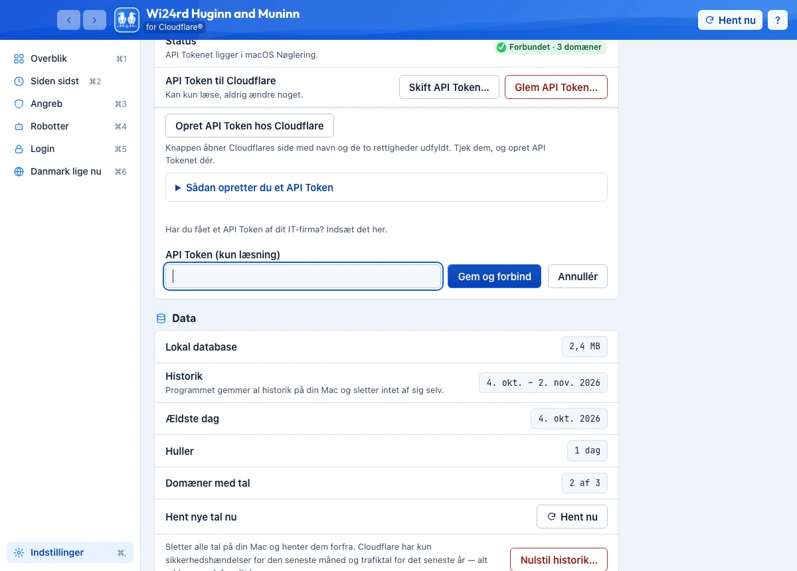

# Indstillinger

Genvej: ⌘, (Windows: Ctrl+,). Indstillinger kan også åbnes, før du har forbundet med Cloudflare.

Alle valg gemmes med det samme på din computer. Der er ingen Gem-knap, bortset fra ved API Tokenet.

## Generelt

| Felt | Valg | Standard | Hvad det gør |
|---|---|---|---|
| **Sprog** | Systemets sprog · Dansk · English | Systemets sprog | Sproget i hele programmet, i menuen ved ravne-ikonet og i notifikationerne. |
| **Datoformat** | Følg sproget · Følg systemet · ISO (2026-11-04) | Følg sproget | Gælder alle datoer i programmet og notifikationerne. |
| **Land** | Liste over lande, og evt. knappen **Skift til …** | Fra din tidszone, derefter systemets sprog | Bruges i **… lige nu**. **Skift til …** vises, når mindst halvdelen af dine besøgende tydeligt kommer fra et andet land. |
| **Udseende** | System · Lys · Mørk | System | Følger systemet, eller vælg selv. |
| **Tekststørrelse** | Lille · Normal · Stor | Normal | Gælder teksten i hele programmet. Også ⌘+ ⌘− ⌘0 (Windows: Ctrl). |
| **Start ved login** | Kontakt | Til (slås til første gang en færdigbygget udgave starter) | Programmet starter i menulinjen, når du logger ind, og henter i baggrunden. Slå det fra, før du sletter programmet. |

Er **Start ved login** slået fra, står der en gul linje øverst: "Programmet starter ikke ved login. Så henter Huginn kun, når programmet er åbent. Åbn det mindst hver tredje uge, ellers kommer der huller i historikken." Knappen **Slå Start ved login til** slår det til igen. Styresystemet er sandheden: slår du det fra i Systemindstillinger, slår det igennem her.

*Overblik i mørkt tema.*

## Domæner

| Felt | Hvad det gør |
|---|---|
| **Vis i Huginn** – én kontakt pr. domæne | Vælg de domæner, Huginn skal hente og vise. Et domæne, du fravælger, hentes ikke længere, vises ingen steder og giver ingen notifikationer; dets tal bliver liggende, og vælger du det igen, hentes det, der mangler, højst de seneste 30 dage. Et domæne, der er nyt på kontoen, er mærket **NY**. |
| **Vælg alle** / **Fravælg alle** | Alle kontakter på én gang. |
| Linjen "API Tokenet ser N domæner" | Hvor mange domæner API Tokenet kan se. Ser det præcis ét, er det valgt for dig. |
| **Teknologi pr. domæne →** | Åbner [Teknologi pr. domæne](40-visninger/teknologi.md). Linjen siger, hvor mange valg hvert domæne har. |
| **Nulstil for alle domæner** | Sletter alle teknologi-valg. Programmet spørger først: **Nulstil teknologi-valg?** |

## Notifikationer

| Felt | Valg | Standard | Hvad det gør |
|---|---|---|---|
| **Hvornår vil du have besked?** | Kun alvorligt, højst én gang om dagen · Ved alvorligt (anbefalet) · Også når et domæne skal holdes øje med | Ved alvorligt (anbefalet) | Det samlede niveau. Beskeden kommer fra din egen computer, aldrig fra en server. |
| **Giv besked, når et domæne kræver handling** | Kontakt | Til | Slår beskeden ved **Handl** fra, hvis du kun vil se det i programmet. |
| **Giv besked ved »Ligner rekognoscering«** | Kontakt | Fra | Fra som standard: de fleste er automatiske scannere. Gælder også »Ligner DNS-rekognoscering«. Mærket vises altid i Overblik og Siden sidst. |
| **Pr. domæne** – ét valg pr. domæne | Følg standard · Alvorligt og hold øje · Kun alvorligt · Aldrig | Følg standard | Overstyrer det samlede niveau for ét domæne. |
| **Login-stier pr. domæne** | Vælg domæne, og slå stier til | Ingen stier valgt | Samme liste som i [Login](40-visninger/login.md): startlisten, dine egne stier (højst 20 pr. domæne) og forslag fra dine data. |

Nederst står: "Du kan også slå notifikationerne helt fra i Systemindstillinger → Notifikationer → Huginn and Muninn." Hvad hver notifikation betyder, står i [Notifikationer og baggrund](60-notifikationer.md).

## Forbindelse

*Status, API Token med **Skift API Token…** og **Glem API Token…**, og afsnittet Data.*

| Felt | Hvad det gør |
|---|---|
| **Status** | Chippen viser fx **Forbundet · 3 domæner**. Linjen siger, at API Tokenet ligger i din computers nøglering (macOS Nøglering eller Windows Credential Manager). |
| **API Token til Cloudflare** – **Skift API Token…** | Åbner feltet, hvor du indsætter et nyt API Token og klikker **Gem og forbind**. **Annullér** lukker det igen. Det gamle erstattes. |
| **Glem API Token…** | Programmet spørger **Glem API Tokenet?** Vælger du **Glem**, holder programmet op med at hente, API Tokenet slettes fra nøgleringen, og dine valg pr. domæne slettes (domænevalg, notifikationer pr. domæne, login-stier, teknologi-valg). Historikken bliver. Du kan forbinde igen med et nyt API Token. |
| **Opret API Token hos Cloudflare** og **Sådan opretter du et API Token** | Samme hjælp som i opsætningen; se [Opsætning](30-opsaetning.md). |

*Dialogen, før API Tokenet glemmes.*

## Data

| Felt | Hvad det viser eller gør |
|---|---|
| **Lokal database** | Databasens størrelse på din computer. |
| **Historik** | Perioden, der er tal for. Klik åbner hele historikken for alle domæner i [Angreb](40-visninger/vaernet.md). |
| **Ældste dag** | Den første dag, der er tal for. |
| **Hvad der findes** | "Trafik fra … · sikkerhedshændelser fra …": hvor langt tilbage hver slags tal rækker. Vises, når der er tal. |
| **Kvote hos Cloudflare** | "Cloudflare tillader N kald pr. M minutter; Huginn brugte K i sidste runde." Vises, når Cloudflare har oplyst det. |
| **Huller** | Antal dage uden tal. Klik åbner listen **Huller i historikken** i hjælpen: dage, der aldrig er hentet. De er ikke 0. |
| **Domæner med tal** | Hvor mange af de valgte domæner der har tal. Klik åbner Overblik. |
| **Hent nye tal nu** – **Hent nu** | Samme som **Hent nu** i båndet. |
| **Nulstil historik…** | Sletter alle tal på din computer og henter dem forfra. Programmet spørger først og siger, hvilke datoer der forsvinder for altid, og hvor mange dage det er. Dine indstillinger, domænevalg, notifikationer og login-stier bliver. Se [Data og historik](70-data.md). |

## Om

Version, linjen "Apache-2.0-licens · Ingen telemetri · Intet sendes til Wi24rd", skrifter og kortdata (Outfit og JetBrains Mono under SIL Open Font License 1.1; world-countries under ODbL og Natural Earth, public domain), varemærkelinjen om Cloudflare og et link til kildekoden.
