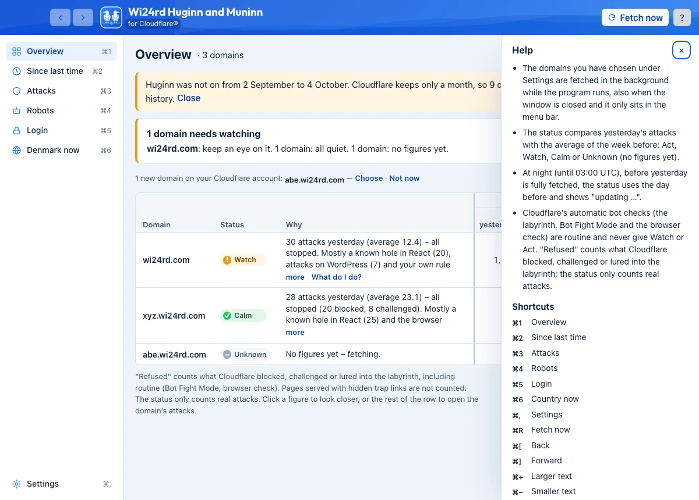

# Wi24rd Huginn and Muninn – user guide

*for Cloudflare®*

Huginn and Muninn is a program for your own computer that shows what is actually happening against **your own** Cloudflare domains: attacks, robots and login attempts, on one screen and explained in plain language. The program talks to Cloudflare only with an API Token that can only read, and keeps the figures on your computer, so the history outlives Cloudflare's month.

- **Huginn (thought)** is what is happening now: the attacks, what was stopped and how.
- **Muninn (memory)** is what has happened: every finished day is kept locally.

> **Status:** early prototype. Development builds on macOS. The program is not released yet, and this guide follows the version in the source code today.

## How the guide is organised

| Chapter | Read it when you … |
|---|---|
| [Before you start](10-foer-du-starter.md) | want to know what the program does, does not do, and what it needs |
| [Installation](20-installation.md) | need the program on your computer |
| [Setup](30-opsaetning.md) | need to connect the program to Cloudflare and choose domains |
| [Create an API Token at Cloudflare](31-cloudflare.md) | want to see step by step, with screenshots, what to do in Cloudflare's dashboard |
| [The views](40-visninger/overblik.md) | use the program day to day: Overview, Since last time, Attacks, Robots, Login, your country, Visitors, Technology |
| [Settings](50-indstillinger.md) | want to change language, appearance, domains, notifications or the API Token |
| [Notifications and background](60-notifikationer.md) | want to understand when the program speaks up, and what happens when the window is closed |
| [Data and history](70-data.md) | want to know where the figures live, for how long, and how to reset |
| [Troubleshooting](80-fejlfinding.md) | see an error text in the program |
| [Updating](85-opdatering.md) | want a newer version |
| [Uninstalling](90-afinstallation.md) | want to remove the program completely, without leftovers |
| [Keyboard shortcuts](95-genveje.md) | want to drive the program from the keyboard |
| [Glossary](99-ordliste.md) | meet a word you do not know |

## The short version

1. Install the program and open it.
2. Create an API Token at Cloudflare with the two read permissions the program asks for, and paste it.
3. Under **Settings → Domains**, choose which domains Huginn should fetch and show.
4. Close the window. The program stays in the menu bar, fetches in the background and tells you when a domain needs action.

The rest is for those who want to understand more. Everything in the program that has figures behind it can be clicked, so you can see what the figure is made of.

*The **?** button at the top right opens the help for the view you are in and lists the shortcuts. **Open the guide** at the top of the help opens this guide on wi24rd.com in your browser. Esc closes it again.*

## Licence and trademark

The program is open source under the Apache-2.0 licence. Cloudflare® is a registered trademark of Cloudflare, Inc. Wi24rd Huginn and Muninn is not affiliated with Cloudflare, Inc.
