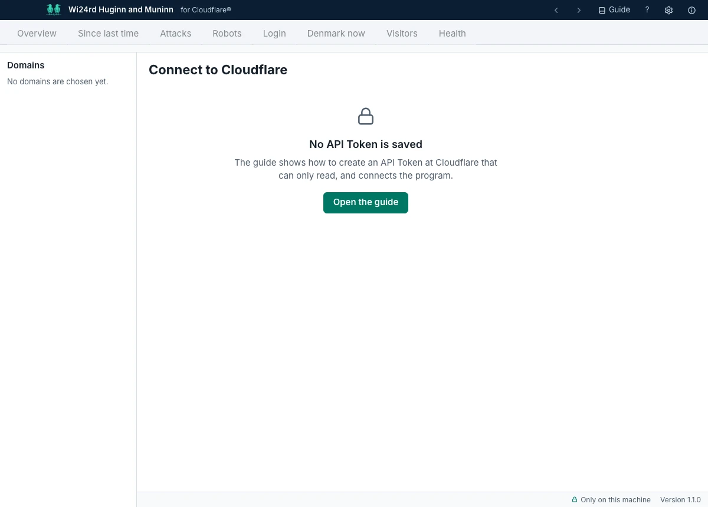
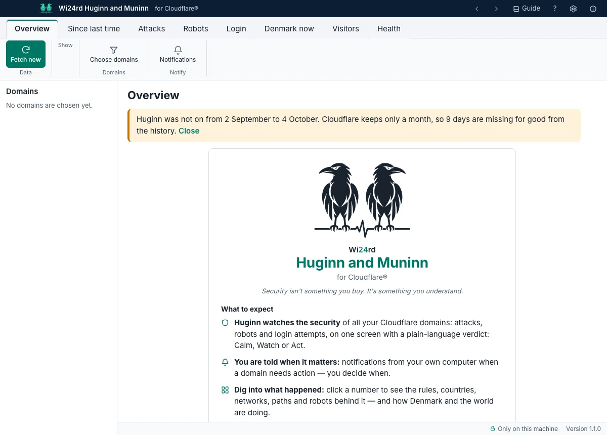

# Setup

Setup has three steps: create an API Token at Cloudflare, paste it into the program, and choose the domains Huginn should watch. It takes a few minutes.

*Setup is shown in the window until you have pasted an API Token. The button **Create API Token at Cloudflare** opens Cloudflare's page with the name and permissions filled in.*

## Step 1 – Create an API Token at Cloudflare

An **API Token** is a key you create in your Cloudflare account that lets a program do certain things. The program asks for exactly two permissions, and both can only read:

- `Zone › Analytics › Read` – may read the figures (attacks, traffic, robots).
- `Zone › Zone › Read` – may see which domains (zones) the account has.

That is all. Without write permissions the program cannot change anything at Cloudflare, whatever happens to your computer.

How to do it:

1. Click **Create API Token at Cloudflare** in the program. It opens Cloudflare's page **My Profile › API Tokens** in your browser with the name and the two permissions filled in. Check them. (If you are not logged in, log in first.)
2. If you prefer to create it by hand: choose **Create Token**, then **Get started** next to **Create Custom Token**.
3. Enter a name under **Token name**, for example *Huginn and Muninn*.
4. Choose under **Permissions**: **Zone › Analytics › Read** and **Zone › Zone › Read**. Give it no write permissions.
5. Choose under **Zone Resources**: **Include › All zones** if Huginn should be able to see all your domains, or **Include › Specific zone** and one domain if it should only see that one.
6. Choose **Continue to summary**, then **Create Token**.
7. Copy the API Token. Cloudflare shows it only once.

The same steps are in the program under **How to create an API Token**, both in setup and under **Settings → Connection**.

**Did your IT company give you an API Token?** Then skip step 1 and paste the one you were given. An API Token that only sees one domain gives a program that only shows that domain.

## Step 2 – Paste the API Token

1. Paste the API Token into the field **API Token (read only)**. The field hides the characters.
2. Under **Notifications**, choose when you want to be told. The default is **When serious (recommended)**. You can change it later under Settings; see [Notifications and background](60-notifikationer.md).
3. Click **Save and connect**.

The program checks the API Token with Cloudflare and stores it in your computer's keychain (macOS Keychain or Windows Credential Manager). It never leaves the program's Rust part, and the window cannot read it back.

If you get an error text, it is explained in [Troubleshooting](80-fejlfinding.md). The most common ones are that the API Token lacks one of the two permissions, or that the domain is not under **Zone Resources**.

## Step 3 – Choose domains

Once you have connected, **no domains are chosen** yet. There is one exception: if the API Token can see exactly one domain, it is chosen for you.

1. Open **Settings → Domains**.
2. Turn on the domains Huginn should fetch and show. **Choose all** and **Clear all** do it in one go.
3. Go back to **Overview**. The program starts fetching at once; the status pill in the blue band shows, for example, "Fetching 2 of 3".

*As long as no domains are chosen, the Overview shows the welcome and a pointer to Settings.*

A domain you clear is no longer fetched, is not shown anywhere and gives no notifications. Its figures stay, and if you choose it again, what is missing is fetched, at most the last 30 days.

If a new domain appears on your Cloudflare account later, it is not chosen by itself. The Overview shows a discreet line: "1 new domain on your Cloudflare account: … – **Choose** · **Not now**". There is no notification about it.

## The first fetch

The first time, the program fetches the last 30 days of security events and a year of daily traffic figures for each chosen domain. The days are stored as they arrive. The figures for **Login** and "stopped at the Edge" per robot are fetched afterwards at a slow pace; the first time it can take up to an hour for 30 days.

The program asks for today and yesterday one day at a time, at most two calls at a time and at least 1.1 seconds apart, for all domains together. If Cloudflare asks it to wait, it pauses and tries again.

## Your country

The country in **… now** (⌘6) is taken from your time zone the first time, then from the system language. You can change it in the blue band or under **Settings → General → Country**. If at least half of your visitors clearly come from another country, Settings offers **Switch to** that country.
