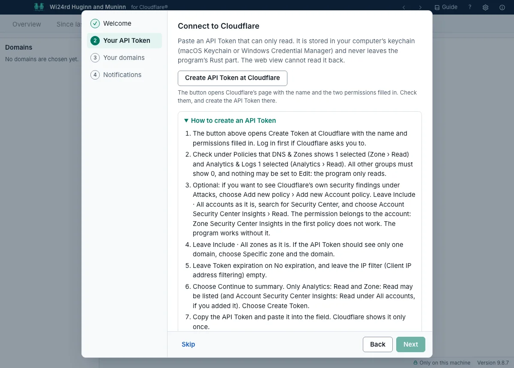
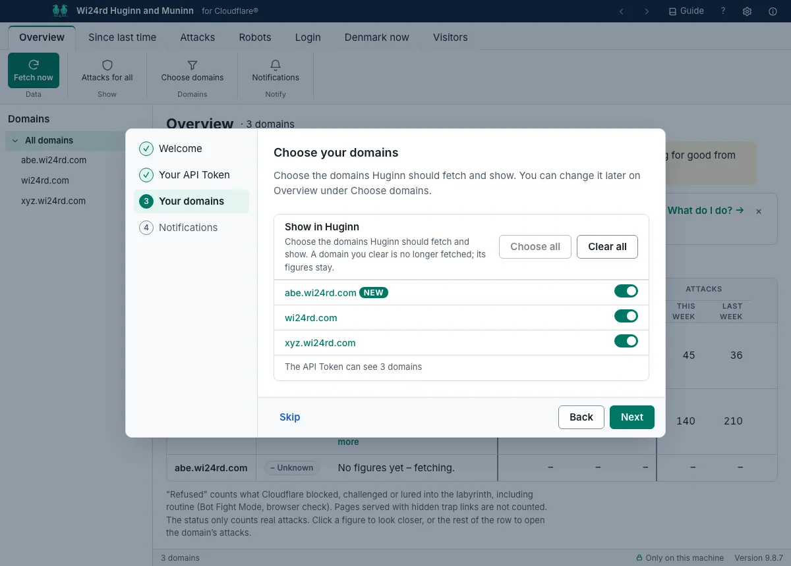
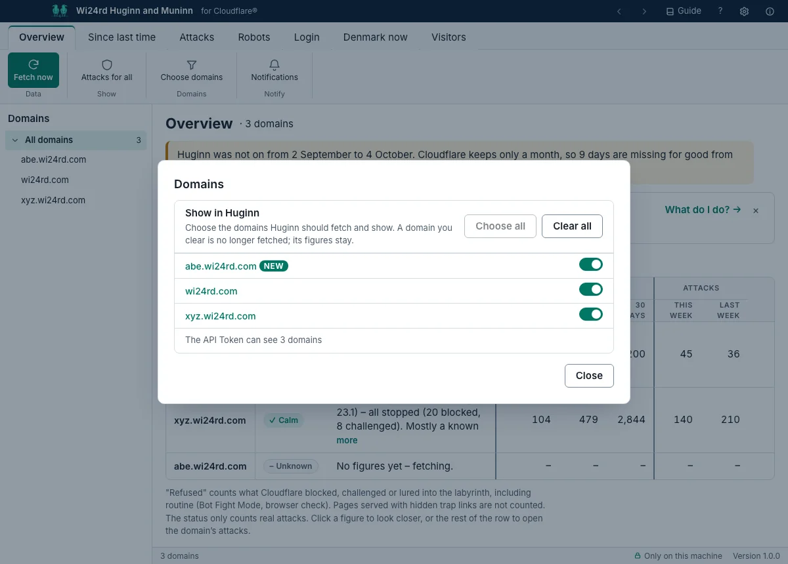
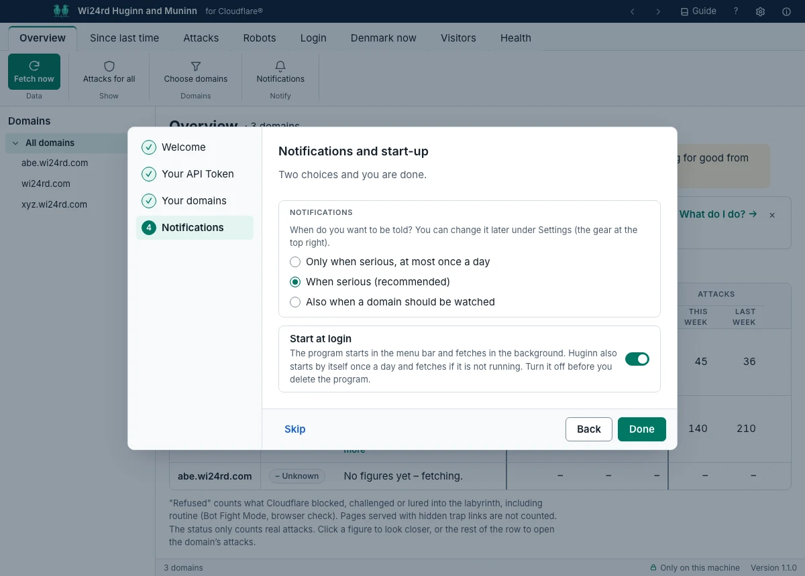

# Setup

The first time you open the program, a guide with four steps opens: **Welcome**, **Your API Token**, **Your domains** and **Notifications**. It takes a few minutes. The steps are listed on the left of the guide, and at the bottom are **Skip**, **Back** and **Next**.

*Step 1 tells you what to expect. Click **Next**.*

If you skip the guide, the window shows a calm page with the heading **Connect to Cloudflare** and the button **Open the guide**. You can also always open the guide again under **Settings** (the gear at the top right) in the group **First start** with **Show the guide again**.

*This is how the window looks when the guide has been skipped and no API Token is saved. The tabs cannot be used yet.*

## Step 1 – Create an API Token at Cloudflare

An **API Token** is a key you create in your Cloudflare account that lets a program do certain things. The program asks for exactly two permissions, and both can only read:

- **Analytics › Read** (under *Analytics & Logs*) – may read the figures (attacks, traffic, robots).
- **Zone › Read** (under *DNS & Zones*) – may see which domains (zones) the account has.

That is all. Without write permissions the program cannot change anything at Cloudflare, whatever happens to your computer.

**Optional:** if you want to see Cloudflare's own security findings under Attacks, add one more permission: **Account Security Center Insights › Read** in a new policy for the account (**Add new policy** › **Add new Account policy**), not the zone version. It can also only read. The program works without it. See [Create an API Token at Cloudflare](31-cloudflare.md).

How to do it:

1. Click **Create API Token at Cloudflare** in the program. It opens Cloudflare's page **Create Token** in your browser with the name *Huginn and Muninn* and the two permissions filled in. (If you are not logged in, log in first.)
2. Check under **Policies** that **DNS & Zones** shows 1 chosen (**Zone › Read**) and **Analytics & Logs** shows 1 chosen (**Analytics › Read**), and that all other groups are at 0. Give it no **Edit** permissions.
3. Leave **Include · All zones** if Huginn should be able to see all your domains. If the API Token should only see one domain, choose **Specific zone** and the domain.
4. Leave **Token expiration** at **No expiration**, and leave **Client IP address filtering** empty.
5. Click **Continue to summary**, check that only **Analytics: Read** and **Zone: Read** are listed (and **Account Security Center Insights: Read**, if you added it), and click **Create Token**.
6. Copy the API Token. Cloudflare shows it only once.

Each step is shown with screenshots in [Create an API Token at Cloudflare – step by step](31-cloudflare.md).

**Did your IT company give you an API Token?** Then skip step 1 and paste the one you were given. An API Token that only sees one domain gives a program that only shows that domain.

## Step 2 – Paste the API Token

*Step 2 with the button to Cloudflare and the instructions unfolded. The field for the API Token is below the instructions; scroll down.*

1. Paste the API Token into the field **API Token (read only)** in step 2 of the guide. The field hides the characters.
2. Click **Save and connect**.
3. Click **Next**. The button is grey, and it says "Save an API Token that works before you continue.", until the API Token is saved and works.

The program checks the API Token with Cloudflare and stores it in your computer's keychain (macOS Keychain or Windows Credential Manager). It never leaves the program's Rust part, and the window cannot read it back.

If you get an error text, it is explained in [Troubleshooting](80-fejlfinding.md). The most common ones are that the API Token lacks one of the two permissions, or that the domain is not included under **Include** (**All zones** or **Specific zone**).

## Step 3 – Choose domains

Once you have connected, **no domains are chosen** yet. There is one exception: if the API Token can see exactly one domain, it is chosen for you.

*Step 3: one switch per domain. A domain that is new on the account is marked **NEW**.*

1. Turn on the domains Huginn should fetch and show. **Choose all** and **Clear all** do it in one go.
2. Click **Next**.

Later you change the choice on **Overview** with the button **Choose domains** in the band. It opens the same list in the dialog **Domains**.

*Overview › **Choose domains**: the same list as in the guide.*

*As long as no domains are chosen, the Overview shows the welcome and the button **Choose domains**.*

A domain you clear is no longer fetched, is not shown anywhere and gives no notifications. Its figures stay, and if you choose it again, what is missing is fetched, at most the last 30 days.

If a new domain appears on your Cloudflare account later, it is not chosen by itself. The Overview shows a discreet line: "1 new domain on your Cloudflare account: … – **Choose** · **Not now**". There is no notification about it.

## Step 4 – Notifications and start-up

*Step 4: when you want to be told, and whether the program should start at login.*

1. Under **Notifications**, choose when you want to be told. The default is **When serious (recommended)**. See [Notifications and background](60-notifikationer.md).
2. Leave **Start at login** on if the program should fetch in the background.
3. Click **Done**. The guide closes, and the Overview opens. The program starts fetching at once; the footer at the bottom of the window shows, for example, "Fetching 2 of 3".

Both choices can be changed later under **Settings**.

## The first fetch

The first time, the program fetches the last 30 days of security events and a year of daily traffic figures for each chosen domain. The days are stored as they arrive. The figures for **Login** and "stopped at the Edge" per robot are fetched afterwards at a slow pace; the first time it can take up to an hour for 30 days.

The program asks for today and yesterday one day at a time, at most two calls at a time and at least 1.1 seconds apart, for all domains together. If Cloudflare asks it to wait, it pauses and tries again.

## Your country

The country in **… now** (⌘6) is taken from your time zone the first time, then from the system language. You can change it in the band on the tab **… now** (the group **Country**) or under **Settings** in the group **Date and country**. If at least half of your visitors clearly come from another country, Settings offers **Switch to** that country.
