# Create an API Token at Cloudflare – step by step

This chapter shows with screenshots how to create the API Token the program needs. The pictures are from Cloudflare's dashboard in November 2026 on an account with three example domains (`wi24rd.com`, `abe.wi24rd.com` and `xyz.wi24rd.com`). Cloudflare changes its dashboard now and then, so the buttons may have moved a little, but the fields are the same.

**What you should end up with:** an API Token named *Huginn and Muninn*, exactly two permissions (**Zone › Read** and **Analytics › Read**) and access to the domains Huginn should see. Nothing else.

## Step 1 – Open Cloudflare's page with the fields filled in

Click **Create API Token at Cloudflare** in the program (in setup or under **Settings → Connection**). It opens Cloudflare's page **My Profile › API Tokens** in your browser with the name and the two permissions filled in. If you are not logged in at Cloudflare, log in first; the page opens afterwards.

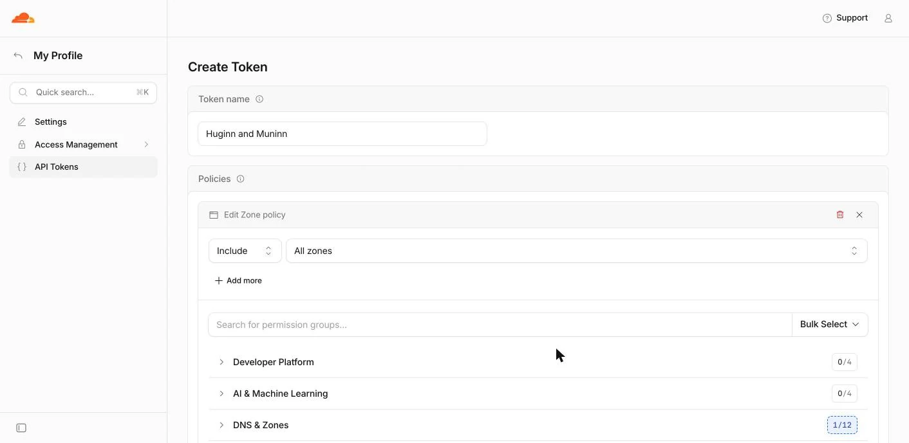
*The **Create Token** page. The name is under **Token name**, and under **Policies** there is one zone policy with **Include · All zones**. The numbers on the right show that 1 permission is chosen under DNS & Zones and 1 under Analytics & Logs.*

If you start from the **Create Token** button on the **API Tokens** page yourself instead, you fill in the name and permissions by hand. The fields are the same as in the pictures.

## Step 2 – Check the two permissions

Unfold **DNS & Zones**. Here **Zone** must be ticked under **Read** and nothing else.

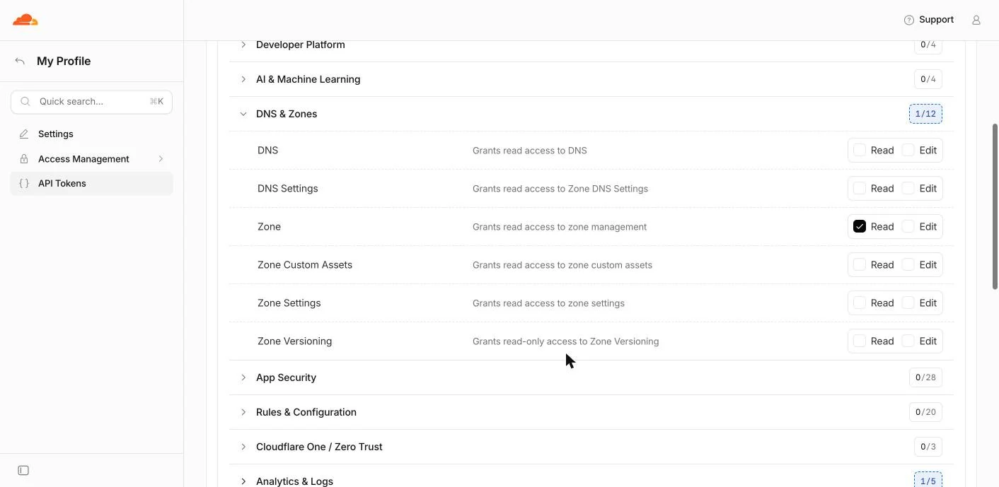
*Under **DNS & Zones** only **Zone › Read** is chosen. That lets the program see which domains the account has, and nothing more.*

Unfold **Analytics & Logs**. Here **Analytics** must be ticked under **Read**.

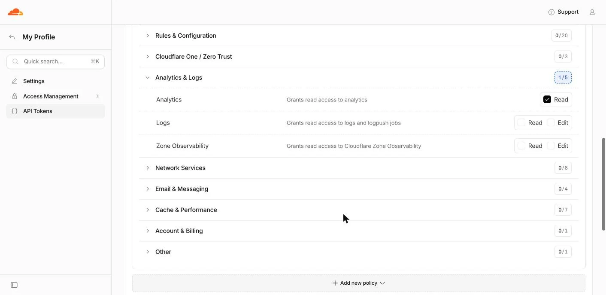
*Under **Analytics & Logs** only **Analytics › Read** is chosen. That lets the program read the figures.*

All other groups must stay at **0** (except the optional permission below, if you want it). Never give **Edit** to anything: the program only reads, and an API Token without write permissions cannot change anything at Cloudflare, whatever happens to your computer.

### Optional: Cloudflare's own findings

If you want to see Cloudflare's own security findings (Security Insights) under Attacks, give the token one more permission: **Account Security Center Insights › Read**. It belongs to the account, not to the domains, so it goes in a new policy for the account. It can only read. Without it the program works as before, and the section **Cloudflare's own findings** says the permission can be added.

1. Click **Add new policy** below the policy with the two permissions, and choose **Add new Account policy**.

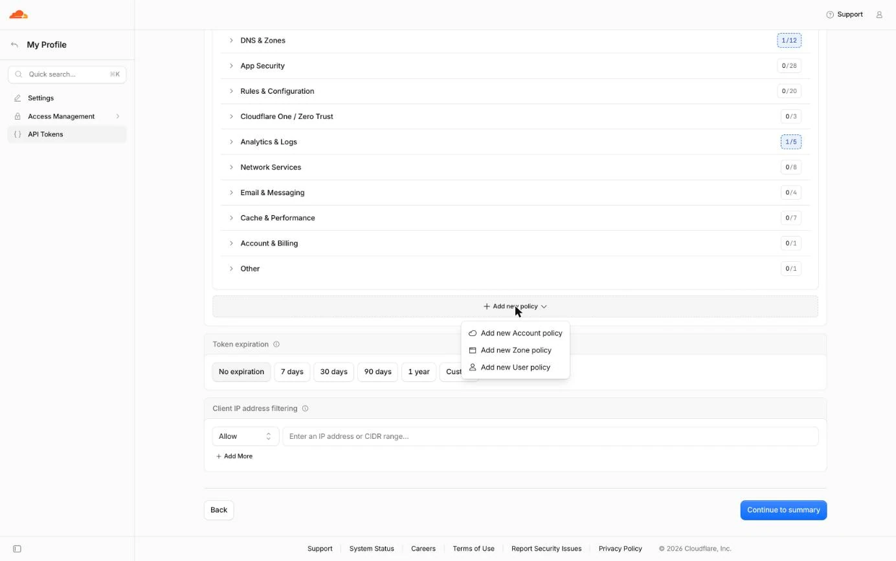
*The menu under **Add new policy**: choose **Add new Account policy**, not **Add new Zone policy**.*

2. Leave **Include** and **All accounts** as they are. Type `Security Center` in the search field, and tick **Read** next to **Account Security Center Insights**.

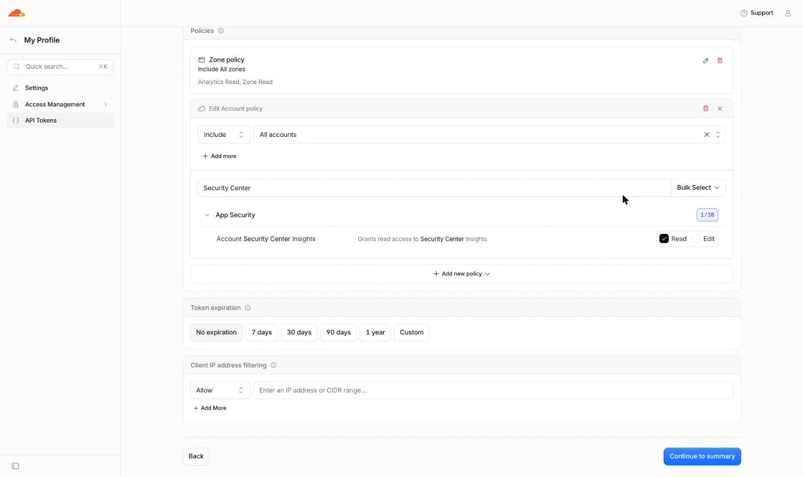
*The new account policy with **Account Security Center Insights › Read**. The first policy is folded above it with **Analytics Read, Zone Read**.*

If you search for `Security Center` in the first policy, you find **Zone Security Center Insights**. It does not work with the program: Cloudflare only answers with the account's findings. Use **Account Security Center Insights**.

## Step 3 – Choose which domains the API Token may see

At the top of the policy are **Include** and **All zones**. Click **All zones** to see the choices.

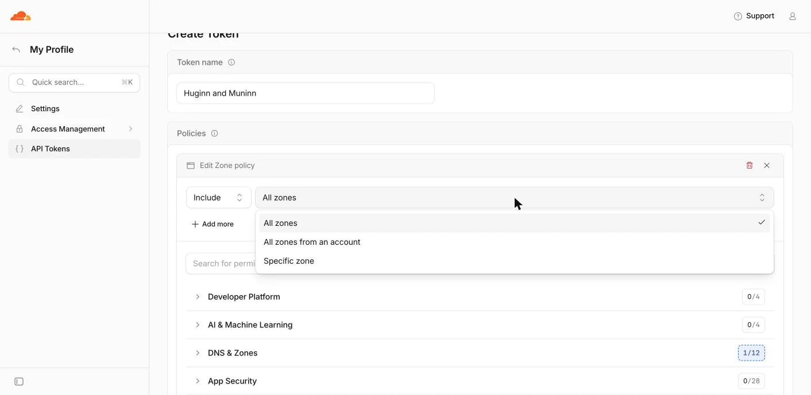
*Three choices: **All zones** (all domains on all your accounts), **All zones from an account** (all domains on one account) and **Specific zone** (one particular domain).*

- If Huginn should be able to see **all** your domains, leave **All zones**. You still choose in the program which of them are fetched.
- If the API Token should only see **one** domain, for example because you are making it for a customer, choose **Specific zone** and then the domain in the list that appears.

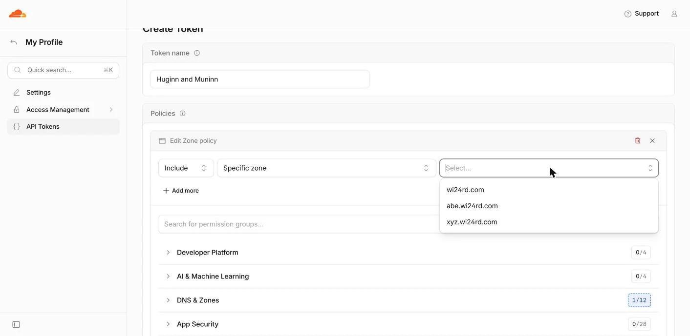
*With **Specific zone** chosen, a third field appears with the account's domains.*

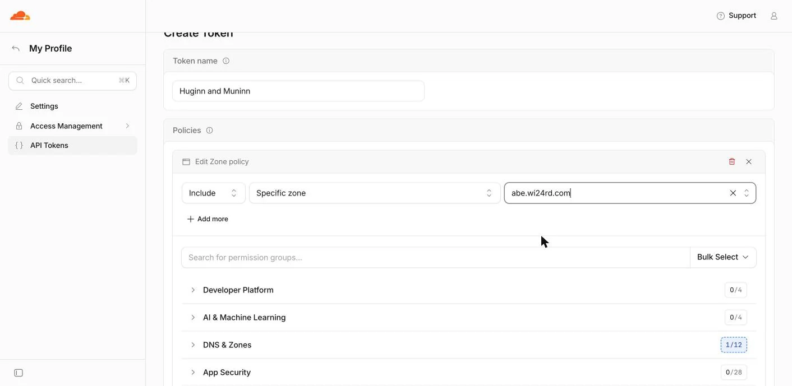
*Here `abe.wi24rd.com` is chosen. A program with this API Token sees only that domain.*

If you want to give access to several particular domains, click **Add more** and add one line per domain.

## Step 4 – Expiration and IP filter

Scroll down. **Token expiration** is at **No expiration**. If you choose an expiry, the program stops fetching on that day, and you have to create a new API Token. Leave **Client IP address filtering** empty; your computer's address changes, and a filter would lock the program out.

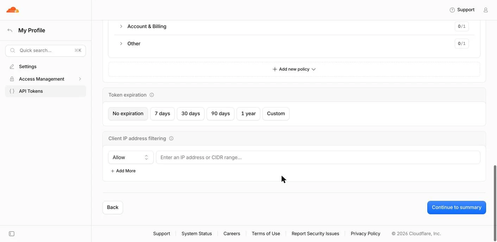
*At the bottom of the page: expiration, IP filter and the button **Continue to summary**.*

Click **Continue to summary**.

## Step 5 – Check the summary

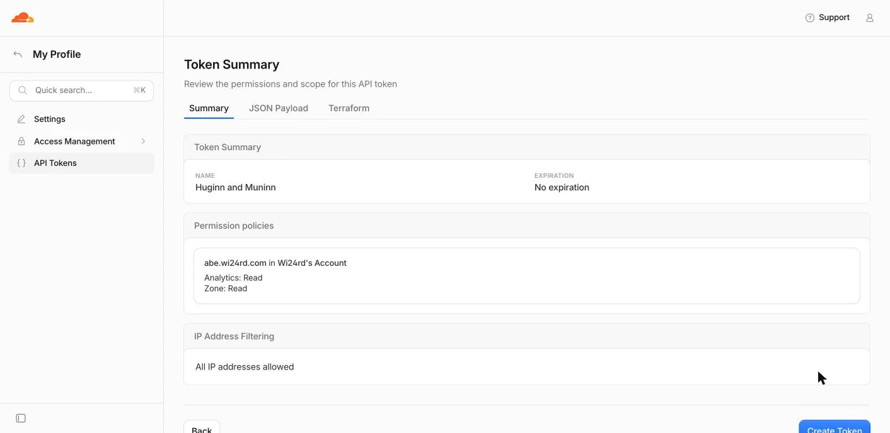
*The summary shows the name, the expiration, which domains the token applies to, and the two permissions **Analytics: Read** and **Zone: Read**.*

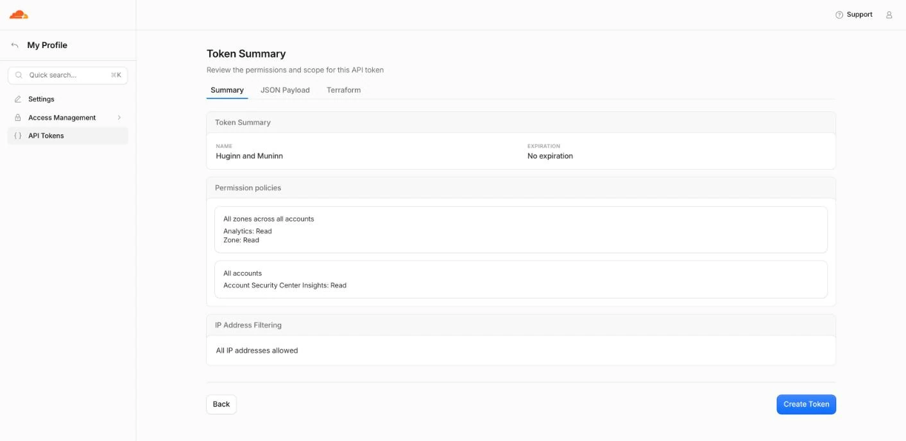
*With the optional permission there is one more policy: **All accounts** with **Account Security Center Insights: Read**.*

If anything other than **Analytics: Read** and **Zone: Read** (and **Account Security Center Insights: Read**, if you added it) is listed under **Permission policies**, click **Back** and fix it. Otherwise click **Create Token**.

## Step 6 – Copy the API Token

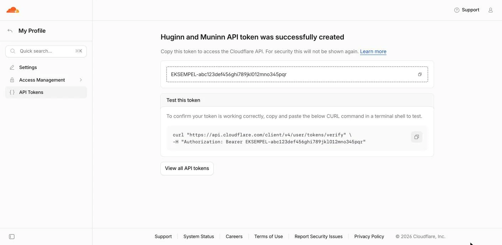
*Cloudflare shows the API Token exactly once. The token in the picture is an example and does not work.*

1. Click the copy icon to the right of the token, or select the whole text and copy it.
2. Go back to the program, paste it into the field **API Token (read only)**, and click **Save and connect**.
3. Close the browser tab. You cannot see the token again; if you lose it, you simply create a new one.

The command under **Test this token** is for people who want to try the token in a terminal. You do not need to use it.

## Afterwards: the token in the list

Under **My Profile › API Tokens** the token is now in the list with the two permissions.

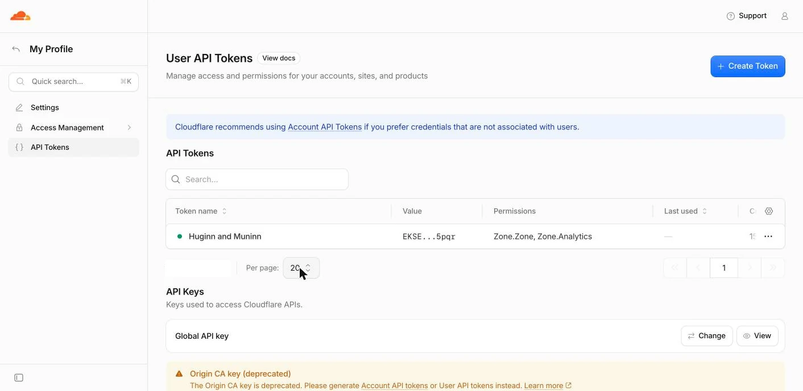
*The list shows the name, the first and last characters of the token, the permissions and when it was last used.*

## If you want to revoke the token

If you delete the program, or want to close the access for any other reason, delete the token here. Then it cannot be used by anyone, whatever happens.

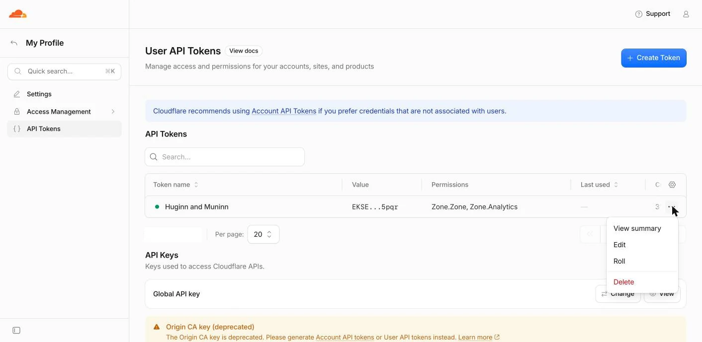
*Click **⋯** at the far right of the token's row and choose **Delete**. **Roll** gives a new token with the same permissions if you need to replace it.*

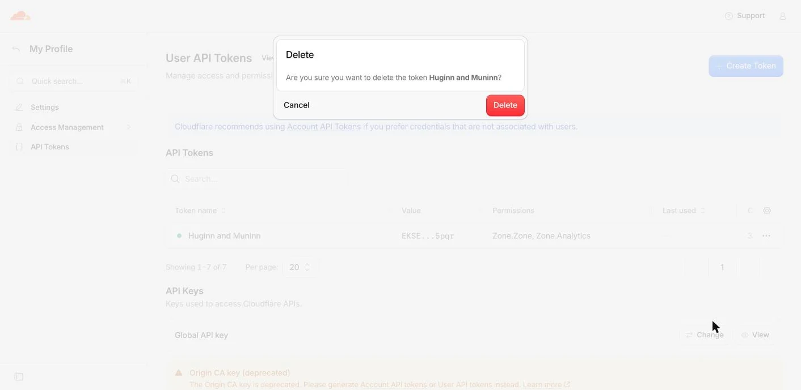
*Cloudflare asks whether you are sure. **Delete** removes the token at once; the program will then say that Cloudflare rejected the API Token.*

## For the IT company: one token per customer

If you manage customers' domains, make one API Token per customer with **Specific zone** and the customer's domain (step 3), give the customer the token, and the customer pastes it into their own program. The customer then sees only their own domain, and you can revoke the access again without touching anything else.
