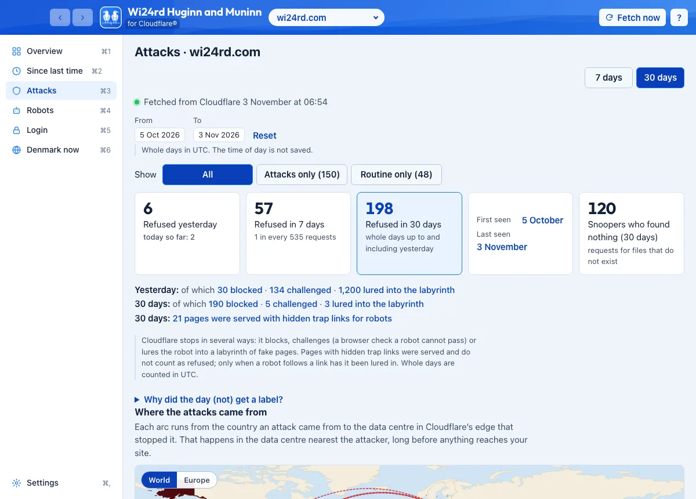
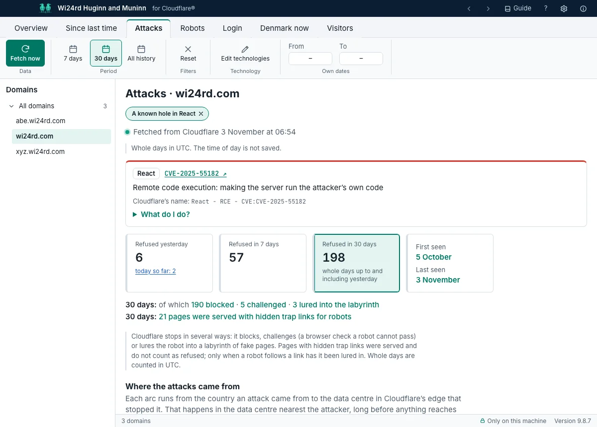
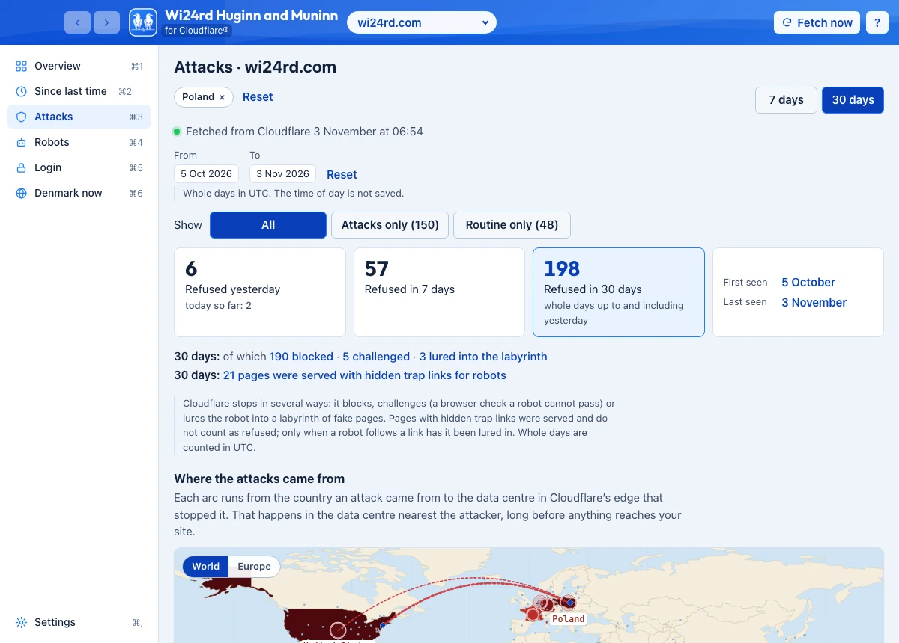
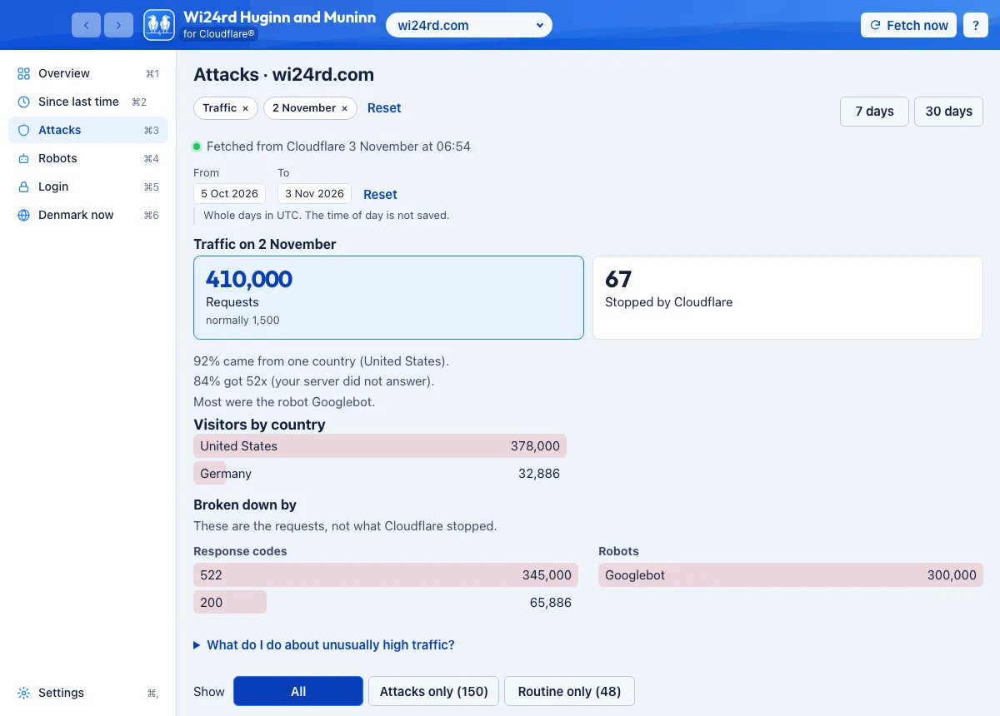

# Drill-down

A drill-down has no place of its own in the sidebar. You get there by clicking a figure, a country, a rule, a robot or a path in the other views.

## What does it show?

A drill-down shows the saved figures for exactly what you clicked: per day, by country, network, path, data centre and rule, and how it looks on your other domains. Nothing is fetched from Cloudflare to show it; everything comes from the figures on your computer, so it is fast and works without a connection.

*At the top the button back to the full overview, the date picker and the period. The tiles show only what matches the filters.*

At the top:

- **← The full overview of attacks on …**: back to [Attacks](vaernet.md).
- **Filtered view**: a label saying you are looking at part of the figures, not all of them.
- **The filters** as chips, for example "A known hole in React ×". Each click on a value adds one more filter on top; × removes it again. There can be at most one filter per kind (one country, one rule, one path …).
- **7 days** / **30 days** and the date picker **From** – **To** with **Reset** to all history. Traffic figures reach back a year; security events begin where Cloudflare begins, and it says so clearly.
- **Show**: **All**, **Attacks only** or **Routine only**, so you can see real attacks without Cloudflare's routine, or the other way round.

*A drill-down into one rule: the rule card at the top explains the hole in plain language, with Cloudflare's own name below and advice behind **What do I do?**.*

Then come the tiles (refused over 30 days, 7 days, yesterday, and when it was first and last seen), the split into blocked, challenged and the labyrinth, the map and the lists.

*A drill-down into one country: what the attacks from the country went for, and which data centres stopped them.*

## Traffic drill-down

If you click a day with **unusually much traffic** (from the Overview or a notification), a traffic drill-down opens: the requests that day, not what Cloudflare stopped. You see the number of requests against the normal, how many Cloudflare stopped, where they came from, which response codes your server gave, and which robots were behind them. **What do I do about unusually much traffic?** gives the advice.

*A day with 410,000 requests against a normal 1,500: 92% from one country, and most got response 522 because the server did not answer.*

## What do I do when …

- **… you want to know whether it is aimed at you?** Look at how it looks on your other domains. The label **Looks targeted** is set precisely when the attacks rose here but not on your other domains, and a large share came from one network.
- **… a path turns up again and again?** Click the path. If it is `wp-login.php` or the like, it is routine from scanners; see also [Login](login.md).
- **… one day stands out?** Choose the day in the date picker or click the bar, and unfold **Why did the day (not) get a label?**.

## Click on

Every value in a list, every bar, every country and every ring on the map adds one more filter. The filters are at the top, where × removes them. Back and forward in the blue band (⌘[ and ⌘]) go one step at a time, also through filters. The rule card's CVE number opens cve.org in your browser. **Edit technologies** opens [Technology by domain](teknologi.md).

## Figures and terms

- All periods are whole days in **UTC**; today stands apart until the day is over.
- Paths are shown without the query part, and long codes are hidden. IP addresses do not exist in the program.
- Figures over long periods may be sampled by Cloudflare and are therefore approximate.
