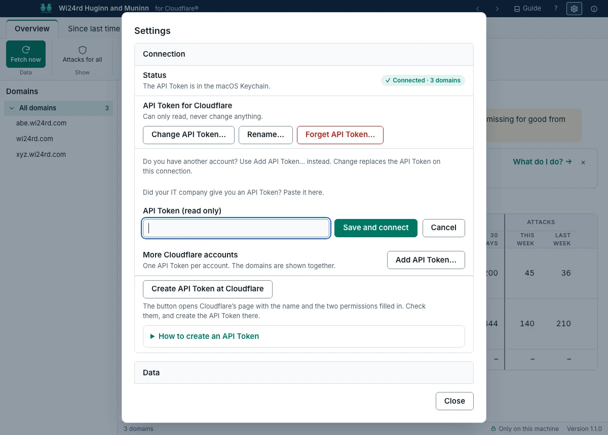

# Settings, Domains, Notifications and About

Settings is not a tab but a window on top of the view you are in. What you use while you work is placed as buttons where it is used:

| You want to | How to open it |
|---|---|
| Language, appearance, date, country, start at login, notifications, API Token, data | The gear at the top right, or ⌘, (Windows: Ctrl+,) |
| Choose domains | **Overview** › **Choose domains** in the band |
| Choose notifications per domain | **Overview** › **Notifications** (the bell) in the band |
| Say what your site uses | **Attacks** › **Edit technologies** in the band |
| Edit login paths | **Login** › **Edit paths** in the band |
| Version, licence and trademark | The **i** button next to the gear |

Settings can be opened before you have connected to Cloudflare. Every field and switch is described in [Settings](../50-indstillinger.md).

*At the top: Appearance and language, Date and country and Start-up. The content scrolls, and **Close** stays at the bottom.*

*Further down: Connection with **Change API Token…** unfolded.*
