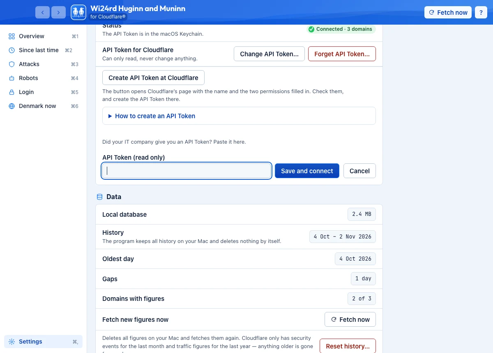

# Settings (the view)

Shortcut: ⌘, (Windows: Ctrl+,)

Settings is the only view that can be opened before you have connected to Cloudflare. It has six sections: **General**, **Domains**, **Notifications**, **Connection**, **Data** and **About**.

Every field and every switch is described in [Settings](../50-indstillinger.md).

*The Connection and Data sections.*
