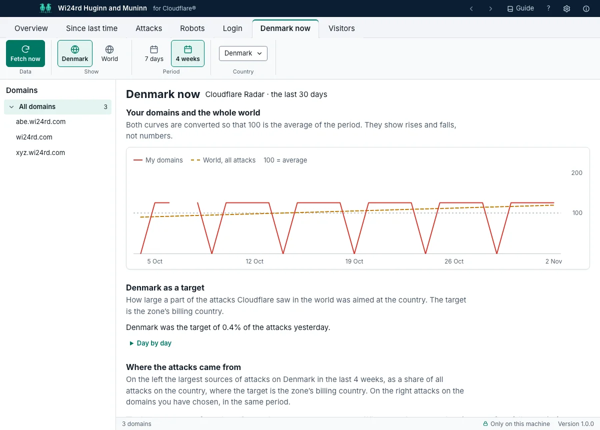
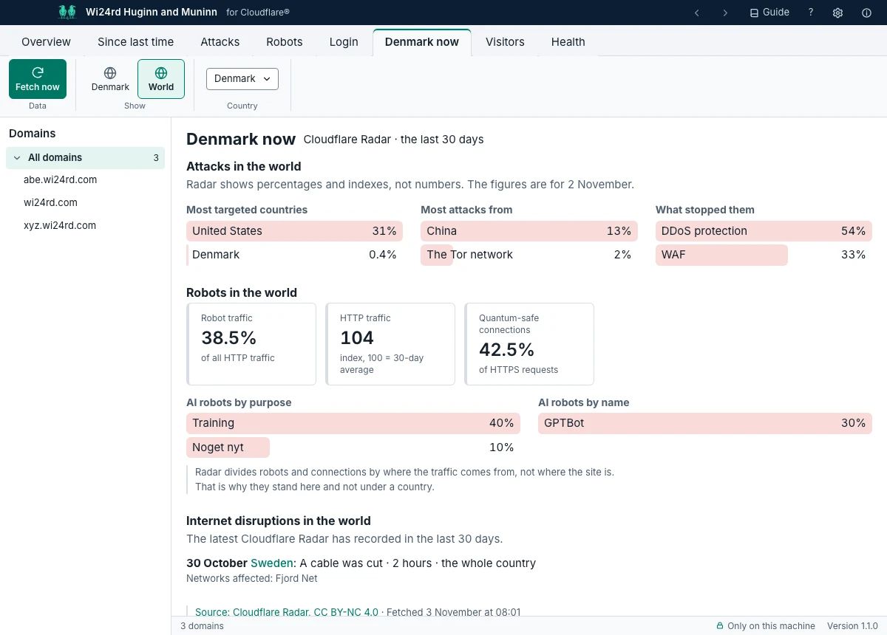

# Your country now and the World

Shortcut: ⌘6 (Windows: Ctrl+6). The name in the sidebar follows the country you have chosen, for example **Denmark now**.

## What does it show?

Here your own attacks stand next to the rest of your country and the world, with figures from **Cloudflare Radar** for the last 30 days. Radar shows percentages and indexes, not numbers, so the curves say something about rises and falls.

*The curve for your domains next to the world's, both converted so that 100 is the average of the period. Below, the country's share as a target, and where the attacks came from.*

The **Denmark** tab (your country):

- **My domains and the world**: two curves, both converted so that 100 is the average of the period. They show rises and falls, not numbers.
- **Denmark as a target**: how large a share of all the attacks Cloudflare saw in the world were aimed at the country. It is a measured share, not a number. **Day by day** unfolds the curve.
- **Where the attacks came from**: on the left the largest sources of attacks on the country as a share of the attacks on it, on the right where attacks on your domains came from in the same period (**7 days** or **4 weeks**). A country that weighs much more for you than for the country as a whole is marked **Especially you**.
- **Internet disruptions in Denmark**: what Radar has recorded in the country in the last 30 days, such as a cut cable or a power outage, with date, duration and the networks affected.

*The World tab: the most targeted countries, most attacks from, what stopped them, robot traffic, quantum-safe connections, AI robots and internet disruptions in the whole world.*

The **World** tab:

- **Attacks in the world**: most targeted countries, most attacks from, and what stopped them (DDoS protection, WAF …).
- **Robots in the world**: robot traffic as a share of all HTTP traffic, HTTP traffic as an index, and the share of quantum-safe connections.
- **AI robots by purpose and by name**.
- **Internet disruptions in the world**.

## Why are attacks shown from the target's side?

A source country alone cannot be trusted: the attack may come through a VPN or rented servers. So the program shows where attacks *on* the country came from, next to where attacks on your domains came from. Then you can compare your own pattern with the country's, and that is what says something.

## What do I do when …

- **… your curve rises, but the world's does not?** Then the rise is your own. The Overview says the same under Why ("The world was normal yesterday, so the rise is yours"). See [Attacks](vaernet.md) for what happened.
- **… your curve follows the world's?** Then you are following a global trend. It does not change the status, but it explains the figure.
- **… a country is marked "Especially you"?** The country weighs much more for you than for the country as a whole. Click it to see the attacks in a drill-down.
- **… it says "The figures from Cloudflare Radar are not up to date"?** Radar is not answering right now. Your own figures still work, and the program tries again.

## Changing country

The selector in the blue band and **Settings → General → Country** save your choice. The country is taken from your time zone the first time, then from the system language. If at least half of your visitors clearly come from another country, Settings offers **Switch to** that country; robots and traffic spikes do not count. If another view points at a country, the heading shows **Back to …**, and your saved country is not changed.

## Click on

A country in the list of where attacks on your domains came from opens a [drill-down](dyk.md) into the attacks from the country. **Day by day** unfolds the curve. **7 days** / **4 weeks** change the period in the comparison (Radar does not know 30 days here). **Denmark** / **World** switch tabs. A country in **Most targeted countries** opens a look at that country.

## Figures and terms

- Radar needs no extra permission in the API Token, and an error at Radar only affects these views.
- The world figures for attacks are WAF attacks in general, never a particular rule.
- Source: Cloudflare Radar, CC BY-NC 4.0. The figures from Radar are fetched when they are more than an hour old; the first time takes up to a minute.
