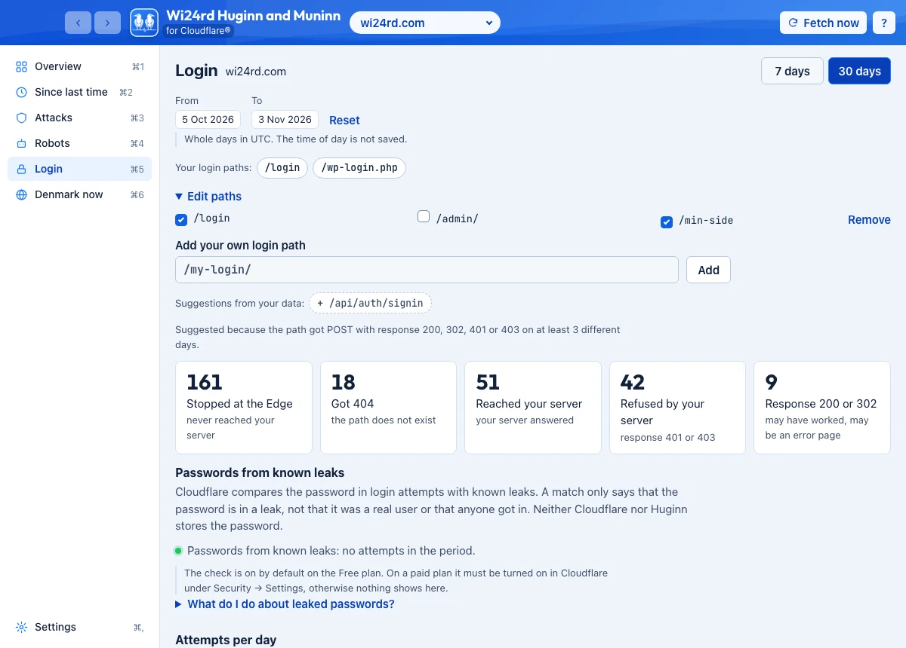

# Login

Shortcut: ⌘5 (Windows: Ctrl+5)

## What does it show?

Login shows what happened on your site's login pages: how many attempts Cloudflare stopped at the Edge, how many hit a page that does not exist, and how many reached your server. The program never guesses what your site runs; you turn on the paths that are logins on your own site.

*Your login paths at the top, **Edit paths** with the starting list and your own paths, suggestions from your own data, and the three figures that are never added up.*

The three figures come from separate sources and are never added up, not even in the drawing:

| Figure | Means |
|---|---|
| **Stopped at the Edge** | Attempts Cloudflare refused or challenged before they reached your server. |
| **Got 404** | Attempts on a path that does not exist on your site. Typically scanners looking for WordPress on a site without WordPress. |
| **Reached your server** | Attempts your server itself answered. Responses 401 or 403 are refused. Responses 200 or 302 *may* be a login, but may just as well be an error page. |

**Passwords from known leaks**: Cloudflare compares the password in login attempts with known leaks. The program shows per day and path how many attempts used a leaked password, and how many reached the server. A match only says that the password exists in a leak, not that it was a real user, or that anyone got in. Neither Cloudflare nor the program stores the password. A request without a password stands as "Not a login attempt (no password sent)" and never counts as a leak.

## Login paths

- **The starting list** can be turned on with one click: `/wp-login.php`, `/wp-admin/`, `/xmlrpc.php`, `/admin/`, `/administrator/`, `/user/login`, `/login` and `/signin`.
- **Your own paths**: enter the path under **Add your own login path**, for example `/my-login/`. At most 20 paths of your own per domain.
- **Suggestions from your data**: a path is suggested only if its name has a login word as a whole word (`login`, `oauth`, `password` and the like), or Cloudflare's check saw a password on it, and it got POST with response 200, 302, 401 or 403 on at least 3 different days. Paths that merely resemble a login, such as `admin-ajax.php`, are not suggested, and a path from a known rule's events is never suggested.

The paths can also be edited under **Settings → Notifications → Login paths per domain**.

## What do I do when …

- **… many attempts reached the server with response 200 or 302?** Check whether it was you or your colleagues. If not, make sure the login page requires strong passwords and preferably two steps (2FA), and consider a rule at Cloudflare that challenges the login page.
- **… leaked passwords reached the server?** That gives at least **Watch**, and **Act** if your server answered 2xx or 302. Change the password on the account it may concern, and turn on two steps.
- **… there are many "Got 404"?** That is routine: scanners trying known login pages. If your site does not use them, nothing happens.
- **… it says "not available"?** Your Cloudflare plan lacks the fields needed. The rest of the program works.

## Click on

Clicking a figure, a path, a country or a network stays in Login with one more filter. Only a path on which the Edge has stopped something opens [Attacks](vaernet.md), because Attacks only knows what the Edge stopped. **Show only …** under leaked passwords filters on a day or a path. **Edit paths** opens the list of paths.

## Figures and terms

- The program sees no IP addresses, and Cloudflare may use samples.
- The figures for Login are fetched separately, at a slow pace after the normal fetch and only for finished days. The first time takes up to an hour for 30 days.
- The path is never in a notification.
