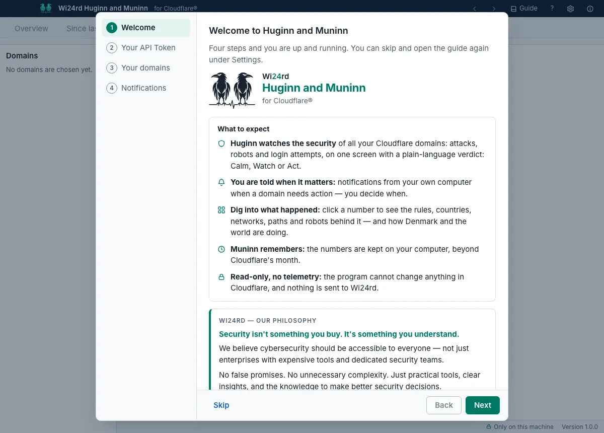
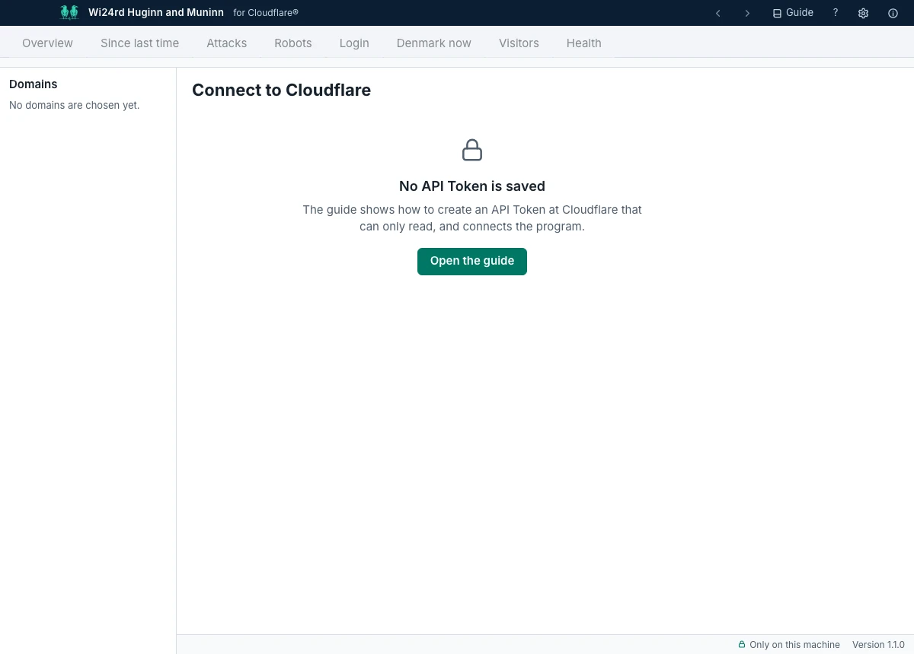

# Connect to Cloudflare (first start)

As long as no API Token is saved, the tabs cannot be used. The first time, the guide opens by itself; if it has been skipped, the window shows the page **Connect to Cloudflare** with the text "No API Token is saved" and the button **Open the guide**.

The guide has four steps:

- **Welcome**: the name, **What to expect** with five lines on what the program does, and **Wi24rd — our philosophy**.
- **Your API Token**: the button **Create API Token at Cloudflare**, which opens Cloudflare's page with the name and the two permissions filled in; **How to create an API Token** with the steps, folded; the field **API Token (read only)** and the button **Save and connect**. **Next** is only available once the API Token is saved and works.
- **Your domains**: one switch per domain.
- **Notifications**: your first choice of when you want to be told, and **Start at login**.

**Skip** closes the guide. **Show the guide again** under **Settings** › **First start** opens it again, also when you have connected.

The whole guide to setup is in [Setup](../30-opsaetning.md).

*The guide as it looks at first start.*

*The page behind the guide when it has been skipped.*
