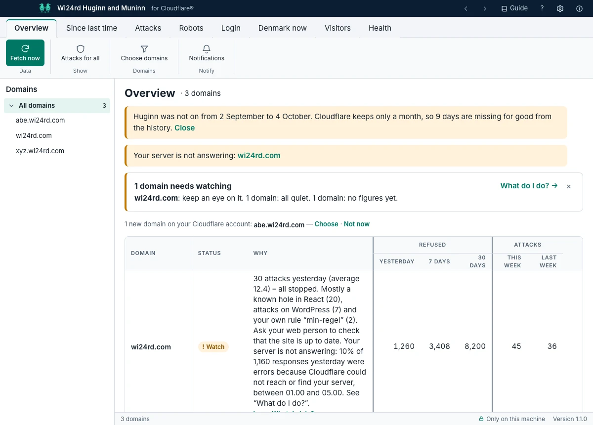

# Overview

Shortcut: ⌘1 (Windows: Ctrl+1)

## What does it show?

The Overview is the program's front page: one row per chosen domain with a status, an explanation and the figures for the last few days. At the top is a **verdict line** that sums it all up in one sentence, for example "1 domain should be watched" or "Nothing to do".

*The verdict line at the top, one row per domain, and the columns Refused and Attacks. The yellow line above the table tells of a gap in the history.*

The columns:

| Column | Means |
|---|---|
| **Domain** | The domain's name. |
| **Status** | **Act**, **Watch**, **Calm** or **Unknown** (no figures yet). The status compares yesterday's attacks with the average of the week before. |
| **Why** | The explanation in plain language: how many attacks, what they went for, and whether they were stopped. **more** unfolds the rest, and **What do I do?** opens advice. |
| **Refused** – yesterday · 7 days · 30 days | What Cloudflare blocked, challenged or lured into the labyrinth, including routine (Bot Fight Mode, browser check). |
| **Attacks** – this week · last week | Real attacks, without the routine. |

**Refused** and **Attacks** are not the same figure: Refused counts everything Cloudflare stopped, while the status and Attacks count only real attacks. Cloudflare's automatic bot checks (the labyrinth, Bot Fight Mode and the browser check) are routine and never give Watch or Act. Pages served with hidden trap links are not counted.

## What do I do when …

- **… the status is Calm?** Nothing. Cloudflare handles what comes.
- **… the status is Watch?** Read the explanation under Why. Typically everything was stopped, but the pattern is unusual. Click **What do I do?** for advice, such as "ask your web person to check that the site is up to date".
- **… the status is Act?** There were unusually many attacks yesterday compared with the week before, or something got through. Click the row to see the attacks, and follow the advice under **What do I do?**.
- **… the status is Unknown?** The program has no figures for the domain yet, typically because it was just chosen. Wait for the fetch; the footer at the bottom of the window shows how far it is.
- **… it says "updating …" next to the status?** At night (until 03:00 UTC), before yesterday is fully fetched, the status uses the day before.

## Labels on top of the status

Some domains get a label next to the status: **Looks targeted**, **Looks like reconnaissance** or **Looks like DNS reconnaissance**. The labels say something about the pattern, not the amount, and always as "looks", never as a certain verdict. In the overview the last two are shown short as **Recon** and **DNS recon**; elsewhere the name is written in full. What they mean is in the [Glossary](../99-ordliste.md) and in the advice behind **What does it mean? →**.

The Overview can also tell you that a domain is paused at Cloudflare, not active, suspected of phishing or in Development Mode, and that your server is not answering: a large part of yesterday's responses were errors because Cloudflare could not reach or find your server (errors 520–527 and 530). Those errors need a server: a website hosted at Cloudflare (Workers or Pages) has no server behind it and never gets the line; its errors are in [Health](drift.md) under **Your website answered with an error**. If three or more hours in a row had errors, the explanation names the time span in your local time, e.g. "between 01.00 and 05.00". A yellow line, **Your server is not answering:**, then stands above the table with the domain; a click on the domain opens [Health](drift.md) for the domain and the day, where the hours are shown. Under Why it may say "Follows the global trend" or "The world was normal yesterday, so the rise is yours" (only when your day is at least three times your average); that compares with the whole world and does not change the status.

*The line **Your server is not answering:** above the verdict line, and Why unfolded with **more**: the time span is in your local time, between 01.00 and 05.00.*

## Gaps in the history

If the program has not been running for a while, a yellow line appears at the top: "Huginn was not on from … to …". Cloudflare keeps only a month, so days older than that cannot be fetched afterwards and are missing for good. The line says how many. **Close** hides it. If the gap was shorter than a month, the program fetches the days itself, and the line says that nothing is missing.

## New domains

If a new domain appears on your Cloudflare account, the Overview shows a discreet line with **Choose** and **Not now**. It is not fetched until you choose it.

## Click on

| Click | Opens |
|---|---|
| The rest of a row (or Enter on the row) | [Attacks](vaernet.md) for the domain |
| A figure under Refused or Attacks | [Attacks](vaernet.md) with that very figure as filter |
| **Attacks for all** (in the band) | [Attacks](vaernet.md) for all chosen domains combined |
| **Choose domains** (in the band) | The dialog **Domains**; see [Settings](../50-indstillinger.md) |
| **Notifications** (the bell in the band) | The dialog **Notifications per domain** |
| **What do I do?** / **What does it mean? →** | Plain-language advice for that very situation |
| The domain in the line **Your server is not answering:** | [Health](drift.md) for the domain and the day |
| **more** | The rest of the explanation |
| A CVE number in the explanation | The CVE's page on cve.org in your browser |
| The line at the bottom about cleared domains | The dialog **Domains** |

Nothing without figures behind it looks clickable.

## Figures and terms

- All days are whole days in **UTC**. "Yesterday" is therefore yesterday in UTC, not in your local time.
- The number refused is **Cloudflare's estimate** from a sample: Cloudflare does not keep every event, but states for each how many it stands for, and the program adds that up. See [Sampling](../99-ordliste.md).
- **Fetch now** in the band (⌘R) fetches new figures at once. Otherwise the program fetches by itself in the background.
