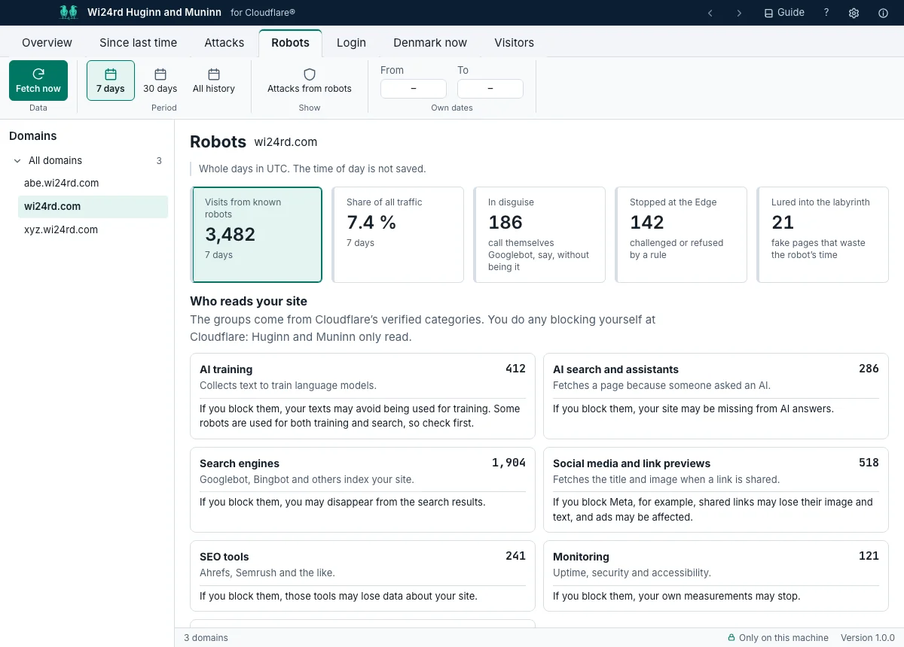

# Robots

Shortcut: ⌘4 (Windows: Ctrl+4)

## What does it show?

Robots shows who reads your site when it is not people: search engines, AI robots, social media, SEO tools and monitoring. The groups are Cloudflare's verified categories. You see one domain at a time or all combined, for 7 days, 30 days or a period you choose yourself.

*The tiles at the top and the seven groups. Each group says what it does, and what may happen if you block it.*

The tiles:

| Tile | Means |
|---|---|
| **Visits from known robots** | Requests from robots Cloudflare has verified, in the period. |
| **Share of all traffic** | How large a part of all requests the robots made. |
| **In disguise** | Something calling itself Googlebot, say, without being it. |
| **Stopped at the Edge** | Robots that were challenged or refused by a rule. |
| **Lured into the labyrinth** | Robots that got fake pages that waste their time. |

**Who reads your site** shows the seven groups with counts:

- **AI training**: collects text to train language models. If you block them, your texts may avoid being used for training; some robots are used for both training and search, so check first.
- **AI search and assistants**: fetches a page because someone asked an AI. If you block them, your site may be missing from AI answers.
- **Search engines**: Googlebot, Bingbot and others. If you block them, you may disappear from search results.
- **Social media and link previews**: fetches the title and image when a link is shared. If you block Meta, say, shared links may lose their image and text, and ads may be affected.
- **SEO tools**: Ahrefs, Semrush and the like.
- **Monitoring**: uptime, security and accessibility. If you block them, your own measurements may stop.
- **Unknown**: robots Cloudflare has not put in a group, and those that are not verified.

Below: the most read pages, those in disguise, which robots were stopped at the Edge, and which were lured into the labyrinth.

## What do I do when …

- **… an AI robot reads many pages?** Decide whether you want that. The program blocks nothing; you do that yourself at Cloudflare (AI Crawl Control or a rule, say). The note under the group says what may happen.
- **… there is a robot in disguise?** Something is pretending to be a known robot. Cloudflare can tell the difference, and it is typically already stopped or challenged. Click it to see what it went for.
- **… Since last time mentions a new AI robot?** It is the first time that robot has been seen on the domain. Here you see which group it belongs to.

## Click on

Each group, each robot and each page opens the same figures in [Attacks](vaernet.md), where you can add more filters. Robots can be combined with a path, but not with other filters. **7 days** / **30 days** and the date picker change the period.

## Figures and terms

- The groups are Cloudflare's verified categories. The notes about what a block may mean are the program's own and say "may".
- The labyrinth does not stop the robot; Cloudflare does not count it as a block, and neither does the program.
- The figures for "stopped at the Edge" per robot are fetched separately and slowly after the normal fetch, only for finished days. The first time takes up to an hour for 30 days. If your plan lacks the fields, it says "not available".
- User agents are only stored as a robot name, never in full.
