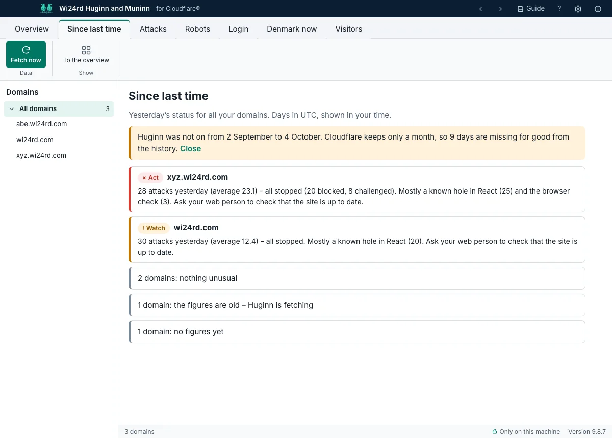

# Since last time

Shortcut: ⌘2 (Windows: Ctrl+2)

## What does it show?

Since last time is yesterday's status for all your domains, one line each, with the most important at the top: domains that need action (**Act**), then those that should be watched (**Watch**), and finally one combined line for those where everything is calm. The view also says when you last looked here, so you can see what is new since then.

*One card per domain that needs attention, with the explanation in plain language. Domains where everything is calm are gathered in one line.*

The view opens by itself when you click a notification or choose **Since last time** in the menu at the raven icon in the menu bar. The number on the tab **Since last time** shows how many domains are at Act.

At night (until 03:00 UTC), before yesterday is fully fetched, it shows the status for the day before yesterday and says so.

## What do I do when …

- **… a domain is at Act?** Read the line, and click the domain to see the attacks. The advice behind **What do I do?** in the Overview applies here too.
- **… a domain is at Watch?** Read the explanation. Most often everything was stopped; the line says what was unusual.
- **… it only says "All quiet"?** Nothing. Click **To the overview** if you want to see the figures anyway.
- **… there is a line about a new AI robot?** A robot the program has not seen on the domain before has read your site. See [Robots](robotter.md) for what it means, and what may happen if you block it.

## Click on

| Click | Opens |
|---|---|
| A domain card | [Attacks](vaernet.md) for the domain |
| The chip with the status or label ("Act", "Looks …") | The guide: what it means, and what you do |
| A combined line ("2 domains: nothing unusual") | [Overview](overblik.md) |
| **Your server did not answer: see the hours in Health** (on a domain whose server did not answer) | [Health](drift.md) for the domain and the day |
| The line about a new AI robot | The robot in [Attacks](vaernet.md) |
| **To the overview** | [Overview](overblik.md) |

## Figures and terms

- The status compares yesterday's attacks with the average of the week before. Whole days in UTC.
- Each domain is reported at most once a day in the notifications, but Since last time always shows the current status, whether or not you were notified.
