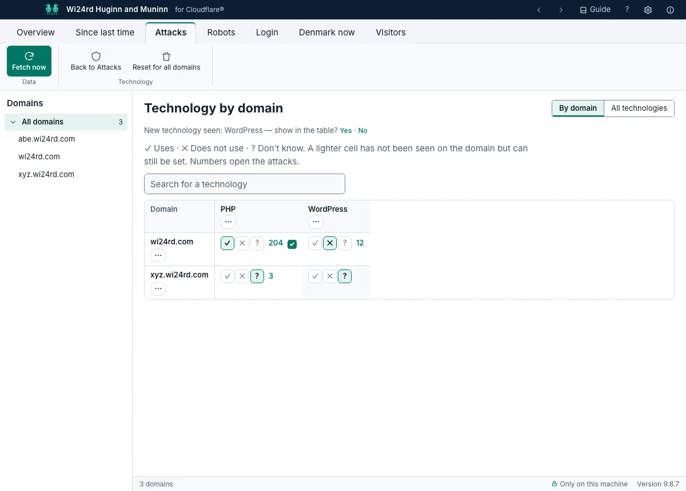

# Technology by domain

No shortcut and no tab. You get there with **Edit technologies** in the band on **Attacks**. **Back to Attacks** in the band takes you back.

## What does it show?

Attacks often go for particular technologies: WordPress, PHP, React and so on. The program does not know what your site runs, and does not guess. Here you tell it, and then the status can tell the difference between an attack on something you use and an attack on something you do not have.

*One row per chosen domain, one column per technology. The figure in the cell is the number of attacks on that technology on the domain and opens the attacks.*

The **By domain** tab: rows are your chosen domains, columns are the technologies ticked under **Show in the table**. Each cell has three choices:

| Choice | Means |
|---|---|
| ✓ **Uses** | The site uses the technology. Attacks on it weigh in the status. |
| ✗ **Does not use** | The site does not use it. Attacks on it are noise from scanners. |
| ? **Don't know** | No decision yet. A lighter field is not set on the domain but can still be set. |

The figure in the cell is the number of attacks on the technology on the domain. Each column and each domain has its actions behind one **⋯** button. You can search for a technology.

**Notify me** on a technology gives a notification when there are more attacks on it than usual, whatever the notification level. A domain set to **Never** under Notifications stays silent, though.

If the program sees a new technology in the attacks, it says at the top "New technology seen: … – show in the table? **Yes** · **No**".

The **All technologies** tab: the catalogue in groups with search and the number of attacks on the account. Here you choose what is shown in the table, and can add technologies in advance. Hiding a column changes none of your choices: they still apply in the status, and the attacks are still in the figures, lists and on the map.

## What do I do when …

- **… you do not know what the site runs?** Leave **Don't know**, or ask your web person. The program does not guess for you.
- **… the status says Watch because of a hole in something you do not use?** Set **Does not use**. It then weighs less in the status from now on.
- **… you want to reset everything?** **Reset for all domains** in the band. The program asks first: **Reset technology choices?**

## Click on

The figure in a cell opens the attacks on the technology on the domain in [Attacks](vaernet.md). **⋯** shows the column's or the domain's actions.

Keyboard: the table is one Tab stop. The arrow keys move between the cells, Space changes the choice, and Enter enters the group, where the arrow keys choose, until Esc.

## Figures and terms

- The technologies come from Cloudflare's rule names (for example "React – RCE – CVE-2025-55182"). The program translates them to plain language and shows Cloudflare's own name below.
- The choices are kept on your computer with the rest of your settings and are deleted if you forget the API Token.
