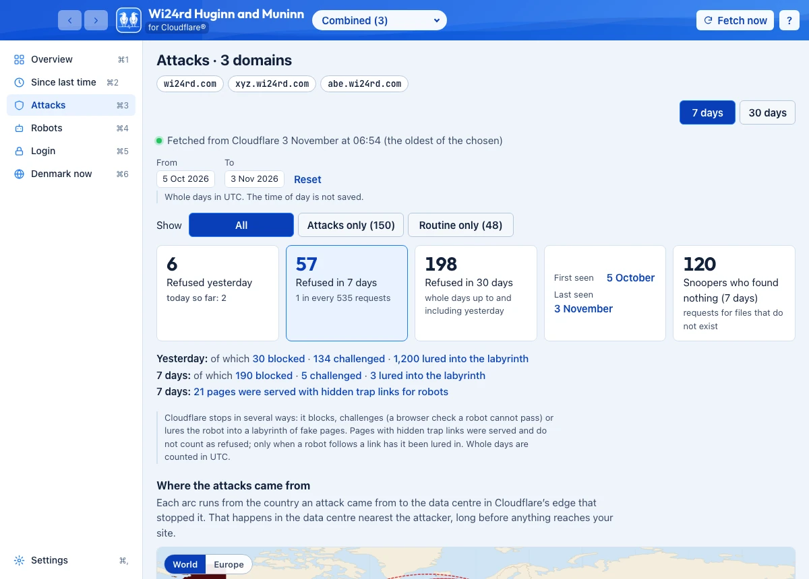

# Attacks

Shortcut: ⌘3 (Windows: Ctrl+3)

## What does it show?

Attacks shows what Cloudflare's **Edge – first line of defence** kept out of your domain: how much was refused yesterday, over 7 days and over 30 days, how it was stopped, which rules and holes the attacks went for, and where in the world they came from. You see one domain at a time (the domain selector in the blue band switches) or all chosen domains combined (**Attacks for all** in the Overview, or **Combined** in the selector).

*The four tiles at the top, the split into blocked, challenged and the labyrinth, and the world map with arcs from the attacker's country to the data centre that stopped the attack.*

*Combined: the chosen domains stand as chips under the heading, and the figures are added up. The green dot shows the oldest fetch time among the chosen ones.*

The tiles at the top:

| Tile | Means |
|---|---|
| **Refused yesterday** | Everything Cloudflare stopped yesterday (the whole UTC day), with "today so far" as a small line. |
| **Refused over 7 days** | The same for the last 7 whole days, with the share of all requests. |
| **Refused over 30 days** | The same for 30 whole days. |
| **Snoopers that found nothing (7 days)** | Requests for files that do not exist: scanners looking for known holes. |

Below the tiles is the split: **blocked**, **challenged** (a browser check a robot cannot pass) and **lured into the labyrinth** (fake pages that waste the robot's time). Pages served with hidden trap links stand on their own line and do not count as refused.

Further down the page:

- **Where the attacks came from**: the world map. Countries are filled in five steps by the number of attacks, with the scale under the map. An arc runs from the country to the data centre in Cloudflare's edge that stopped the attack; the other data centres are faint blue dots. **World** and **Europe** zoom. The country is the one Cloudflare saw the attack come from, which may be a VPN or proxy.
- **What the attacks were aimed at**: rules and known holes (CVE numbers) with counts, and which of them hit technology your site uses.
- **Your site's technology** (for one domain only): what you have told the program the site uses, with **Edit technologies**. See [Technology by domain](teknologi.md).
- **Mail sent in your domain's name** (for one domain only): how much mail was sent in the domain's name in the last 30 days, how much failed DMARC, and from which senders. Needs DMARC Management at Cloudflare.
- **Why did the day (not) get a label?** can be unfolded and shows, for each of the three labels (Looks targeted, Looks like reconnaissance, Looks like DNS reconnaissance), yes, no or "yes, preliminary", with each condition and its figure.
- **The latest**: the latest refused requests, cleaned of IP addresses and query parts.

The green dot at the top ("Fetched from Cloudflare …") says when the figures were last fetched. Days that have not been fetched are not drawn as 0: sums say "N of M days".

## What do I do when …

- **… the figures are large, but everything was stopped?** Nothing. That is what Cloudflare is for. Routine (Bot Fight Mode, browser check, the labyrinth) often makes up most of it.
- **… a known hole (CVE) is listed under "What the attacks were aimed at"?** Click it. The card explains the hole in plain language, and **What do I do?** gives advice, typically to ask your web person to check that that very technology is up to date. If your site does not use the technology, you can say so under **Edit technologies**, and it will weigh less in the status.
- **… most of it comes from one country?** Click the country or the arc to see the attacks behind it. Remember that the source country may be a VPN.
- **… your own rule has many hits?** Then it works. Click the rule to see what it stopped.

## Click on

Everything with figures behind it opens a [drill-down](dyk.md) into that very figure: the tiles, the split (blocked, challenged, the labyrinth), countries, rings and arcs on the map, bars, lists, the rule cards, "What they were looking for" and "The latest". Clicking a CVE number opens the CVE's page on cve.org in your browser; the program fetches nothing from there. **Edit technologies** opens [Technology by domain](teknologi.md).

Keyboard: the map is one Tab stop; the arrow keys move between the countries and rings, and Enter or Space opens the chosen one.

## Figures and terms

- All figures are whole days in **UTC**. Yesterday, 7 and 30 days are whole days up to and including yesterday.
- The edge is Cloudflare's network of data centres. Your site answers from all of them, so an attack is stopped in the data centre nearest the attacker, long before it reaches your server. This only applies to DNS records with the orange cloud. If an attacker knows your server's own IP address, they can go around the edge unless the server only accepts traffic from Cloudflare.
- The labyrinth does not stop the robot; it shows fake pages. Cloudflare does not count it as a block, and neither does the program.
- The figures come from Cloudflare's GraphQL Analytics API and may be sampled over long periods.
