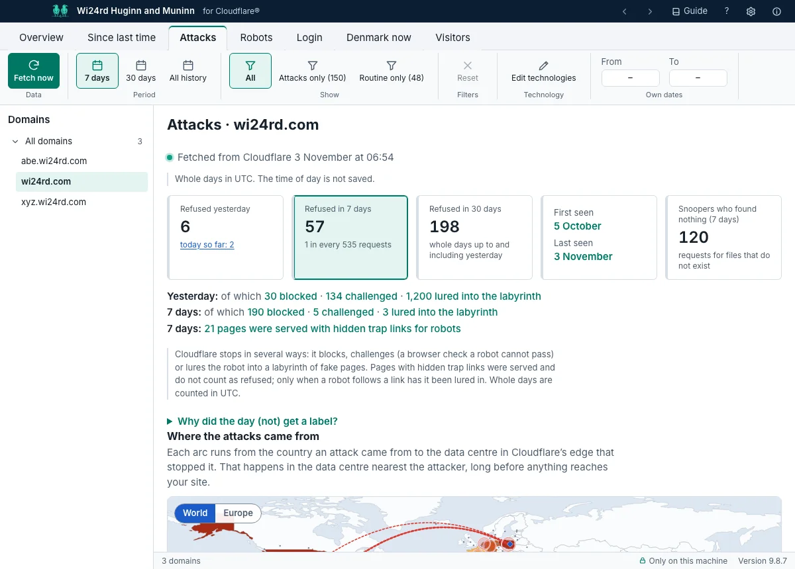
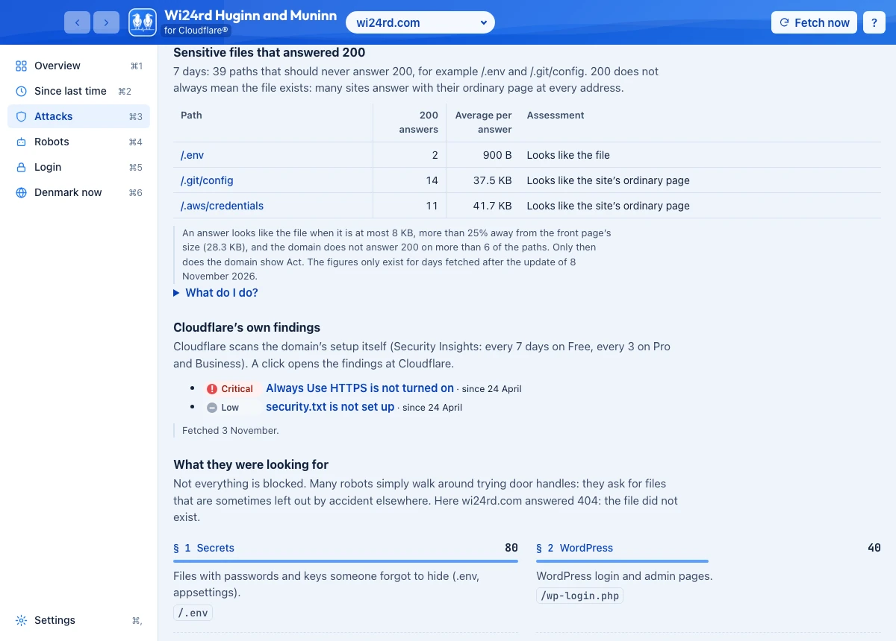
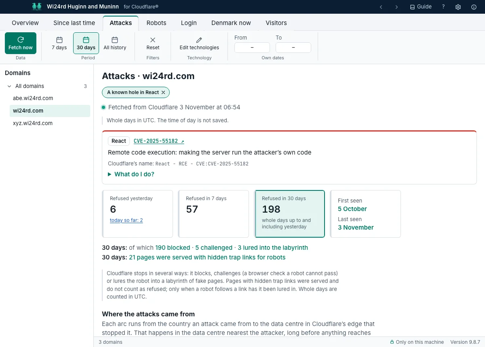
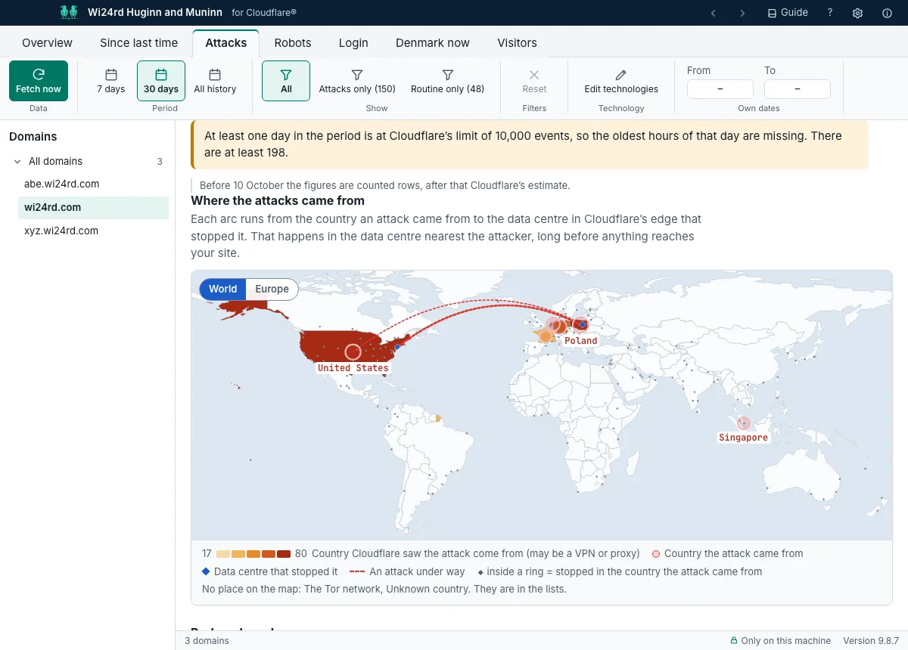

# Attacks

Shortcut: ⌘3 (Windows: Ctrl+3)

## What does it show?

Attacks shows on one page what Cloudflare's **Edge – first line of defence** kept away from your domain: how much was refused, how it was stopped, which rules and holes the attacks went for, and where in the world they came from. The heading says what you are looking at, for example **Attacks · wi24rd.com**. You see one domain at a time (the domain picker in the blue band switches) or all chosen domains together (**Attacks for all** in Overview, or **All** in the picker).

*The heading, 7 days and 30 days, the date picker, **Show** and the tiles. Below them is the breakdown, and further down the world map.*

*All together: the chosen domains are chips under the heading, and the figures are added up. The green dot shows the oldest fetch time among those chosen.*

The tiles at the top:

| Tile | Means |
|---|---|
| **Refused yesterday** | Everything Cloudflare stopped yesterday (the whole UTC day), with "today so far" as a small line. |
| **Refused in 7 days** | The same for the last 7 whole days, with the share of all requests. |
| **Refused in 30 days** | The same for 30 whole days. |
| **First seen** and **Last seen** | The first and last days with figures. |
| **Requests in total** | All requests in the period. A click opens **Traffic on …**. |
| **Snoopers who found nothing** | Requests for files that do not exist in the chosen period: scanners looking for known holes. |

Under the tiles is the breakdown: **blocked**, **challenged** (a browser check a robot cannot pass) and **lured into the labyrinth** (fake pages that waste the robot's time). Pages served with hidden trap links have their own line and do not count as refused.

Further down the page:

- **Why did the day (not) get a label?** can be unfolded and shows, for each of the three labels (Looks targeted, Looks like reconnaissance, Looks like DNS reconnaissance), yes, no or "yes, preliminary", with each condition and the figure. It applies to yesterday or the day you have chosen.
- **Where the attacks came from**: the world map. Countries are filled in five steps by the number of attacks, with the scale under the map. An arc runs from the country to the data centre in Cloudflare's edge that stopped the attack; the other data centres are faint blue dots. **World** and **Europe** zoom. The country is the one Cloudflare saw the attack come from, and it can be a VPN or proxy.
- **Broken down by**: countries, networks, paths, data centres, methods and action, the five largest first and the rest behind **Show top 20**.
- **Edge**: the bars per day, and **Show the figures** with the table. If the period goes further back than the security events, the traffic stands on its own.
- **The rules that fired**: rules and known holes (CVE numbers) with counts.
- **Your site's technology** (one domain only): what you have told the program the site uses, with **Edit technologies**. See [Technology by domain](teknologi.md).
- **What the attacks were aimed at**: the technologies the attacks went for, and whether your site uses them.
- **Mail sent in your domain's name** (one domain only): how many emails were sent in the domain's name in the period, how many failed DMARC, and from which senders. Requires DMARC Management at Cloudflare.
- **Sensitive files that answered 200** (one domain only): 39 fixed paths that should never answer 200, for example `/.env`, `/.git/config` and `/.aws/credentials`, with the number of answers, the answers' average size and an assessment. A click on a path shows the attacks on it. **Looks like the file** means the answer is at most 8 KB, more than 25% away from the front page's size, and the domain does not answer 200 on more than 6 of the paths; only then does the domain show **Act**. **Looks like the site's ordinary page** means the site answers with its ordinary page at addresses that do not exist (many sites do), and it does not change the status. The figures exist for days fetched after the update of 8 November 2026.
- **Cloudflare's own findings** (one domain only): what Cloudflare's own scan of the domain's setup has found (Security Insights), with severity, title and date. A click opens Security Insights at Cloudflare in your browser. Requires one more optional permission on the API Token, see [Create an API Token at Cloudflare](../31-cloudflare.md). Without it the section says it can be added, and the rest works. Cloudflare scans every 7 days on Free and every 3 days on Pro and Business. A critical finding gives **Watch**.
- **What they were looking for**: the paths the scanners asked for, sorted into categories.
- **On your other domains**: the same on your other chosen domains.
- **The latest**: the latest refused requests, cleaned of IP addresses and query strings. If there are several pages, **Previous** and **Next** change only the table: the page stays where you are, and a page change is not a step in back and forward.

*Only `/.env` looks like the file; the two other paths answer with the site's ordinary page. Under **Cloudflare's own findings** the critical finding is that Always Use HTTPS is not turned on.*

The green dot at the top ("Fetched from Cloudflare …") says when the figures were last fetched. Days that have not been fetched are not drawn as 0: sums say "N of M days".

## Period and filters

The page always has the same controls:

- **7 days** (the default) and **30 days** at the top right.
- The date picker **From** and **To**, and **Reset** for all history. Traffic figures reach a year back; security events begin where Cloudflare's begin, and that is stated clearly.
- **Show**: **All**, **Attacks only** or **Routine only**, so you can see real attacks without Cloudflare's routine, or the other way round.

Clicking a figure, a country, a rule or a path adds a filter on the same page. The filters are chips under the heading, for example "A known hole in React ×": × removes one, and **Reset** beside them removes all filters and the period. There can be at most one filter of each kind (one country, one rule, one path …).

*With a rule as filter, the card at the top explains the hole in plain language, with Cloudflare's own name below and advice behind **What do I do?**.*

*With a country as filter, the tiles and the map show only the attacks from there.*

All sections follow the period and the filters. A section that cannot follow the filter is left out, and a line at the bottom of the page says which. That applies to **Your site's technology**, **Mail sent in your domain's name**, **Sensitive files that answered 200**, **Cloudflare's own findings** and **What they were looking for**, for example, because those figures have neither country nor rule. With a filter or a chosen period the page shows the saved figures and fetches nothing from Cloudflare.

## Traffic on …

If you click a day with **unusually much traffic** (from Overview, a notification or the tile **Requests in total**), the section **Traffic on …** stands at the top of the page. It shows the requests that day, not what Cloudflare stopped: the count against the normal, how many Cloudflare stopped, where they came from, the status codes and the robots. The figures can say where the traffic came from, but not what it was. **Traffic** is a chip, and × removes the section.

*A day with 410,000 requests against a normal 1,500: 92% from one country, and most got status 522 because the server did not answer.*

## What do I do when …

- **… the figures are large, but everything is stopped?** Nothing. That is what Cloudflare is for. Routine (Bot Fight Mode, browser check, the labyrinth) often makes up the most.
- **… there is a known hole (CVE) under "The rules that fired"?** Click it. The card explains the hole in plain language, and **What do I do?** gives advice, typically to ask your web person to check that that very technology is up to date. If your site does not use the technology, you can say so under **Edit technologies**, and it weighs less in the status.
- **… most of it comes from one country?** Click the country or the arc to see the attacks behind it. Remember that the source country can be a VPN.
- **… your own rule has many hits?** Then it works. Click the rule to see what it stopped.
- **… you want to know whether it is aimed at you?** See **On your other domains**. The label **Looks targeted** is set exactly when the attacks rose here, but not on your other domains, and a large part came from one network.
- **… a path turns up again and again?** Click the path. If it is `wp-login.php` or similar, it is routine from scanners; see also [Login](login.md).
- **… a sensitive file answered 200?** See the section **Sensitive files that answered 200**. If it says **Looks like the file**, open the address in your browser and see what comes back; **What do I do?** gives the advice. If it says **Looks like the site's ordinary page**, the site answers with its front page at every address, and there is nothing to do.
- **… Cloudflare has a critical finding?** Click the finding under **Cloudflare's own findings**. Cloudflare explains it in Security Insights; most findings are advice about settings.
- **… a day stands out?** Choose the day in the date picker or click its bar, and unfold **Why did the day (not) get a label?**.

## Click on

Everything with data behind it adds a filter or a period on the same page: the tiles, the breakdown, countries, rings and arcs on the map, bars, lists, the rule cards, "What they were looking for" and "The latest". Back and forward in the blue band (⌘[ and ⌘]) go one step at a time, also through filters. Clicking a CVE number opens the CVE's page on cve.org in your browser; the program fetches nothing from there. **Edit technologies** opens [Technology by domain](teknologi.md).

Keyboard: the map is one Tab stop; the arrow keys move between the countries and rings, and Enter or Space opens the chosen one.

## Figures and terms

- All figures are whole days in **UTC**. Yesterday, 7 and 30 days are whole days up to and including yesterday; today stands apart until the day is over.
- The Edge is Cloudflare's network of data centres. Your site answers from all of them, so an attack is stopped in the data centre nearest the attacker, long before it reaches your server. This applies only to DNS records with the orange cloud. If an attacker knows the server's own IP address, it can go around the edge, unless the server only accepts traffic from Cloudflare.
- The labyrinth does not stop the robot; it shows fake pages. Cloudflare does not count it as a block, and neither does the program.
- Paths are shown without query strings, and long codes are hidden. IP addresses do not exist in the program.
- The figures come from Cloudflare's GraphQL Analytics API. The number refused is Cloudflare's estimate from a sample, so it can be higher than the number of single events. Days that Cloudflare no longer had when the program first fetched after the update are counted rows. If the period crosses the boundary, a note says so, for example "Before 10 October the figures are counted rows, after that Cloudflare's estimate."
- If a day is at Cloudflare's limit of 10,000 events, the oldest hours of that day are missing, and the page says "There are at least …".

*The yellow box says that at least one day is at Cloudflare's limit. The note below it says from which day the figures are Cloudflare's estimate.*
