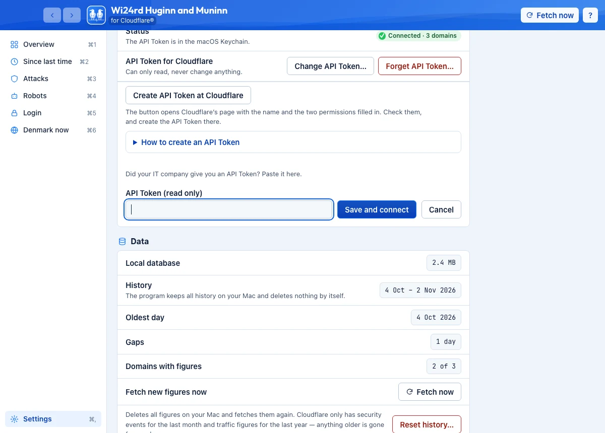
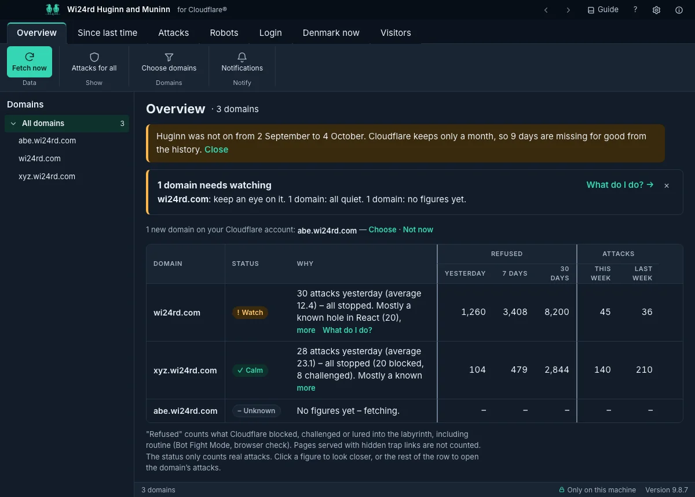
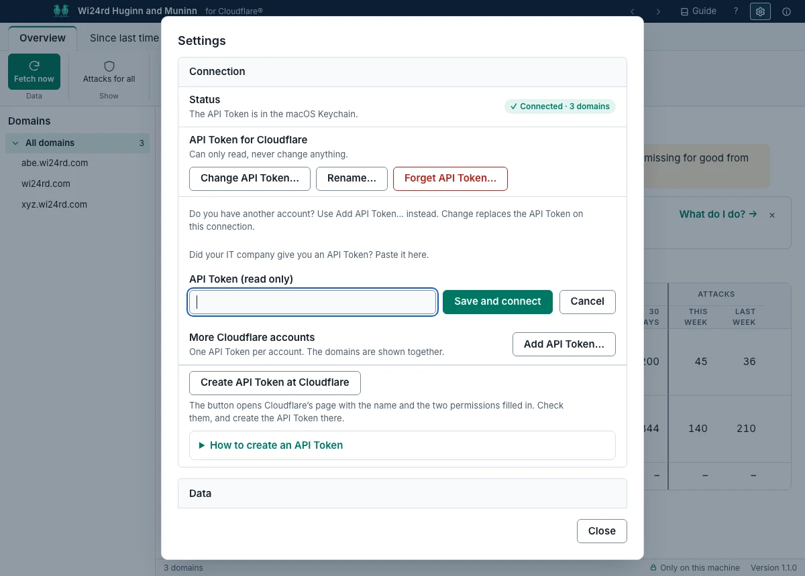
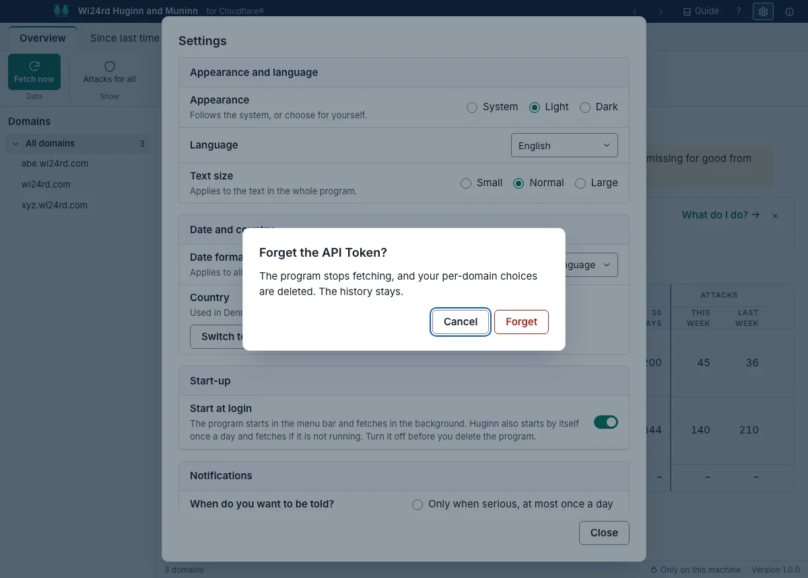
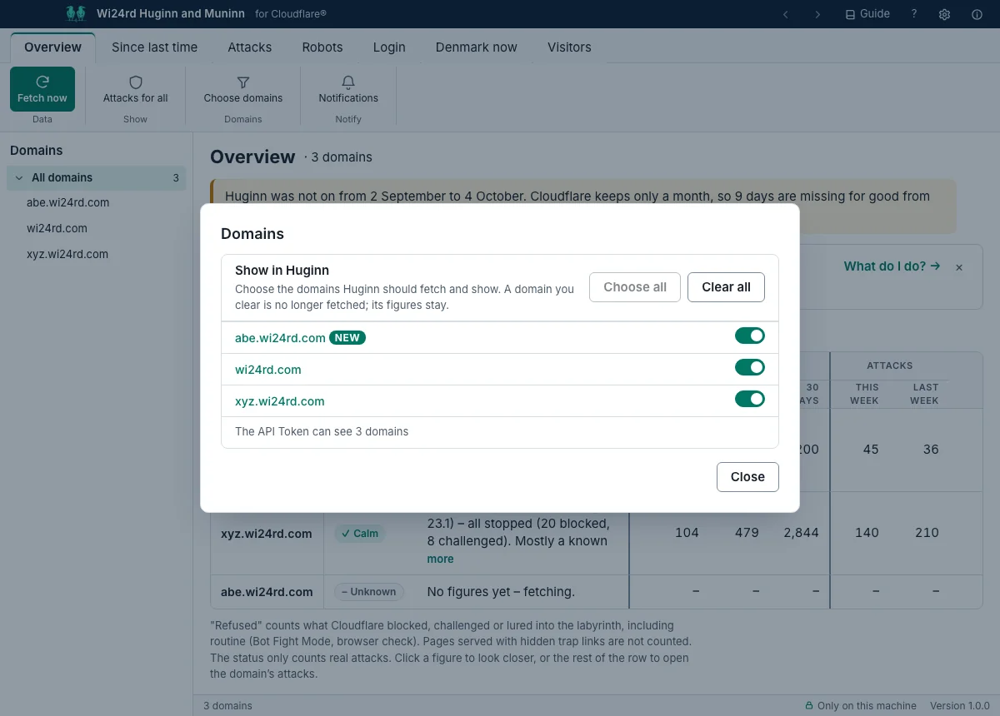
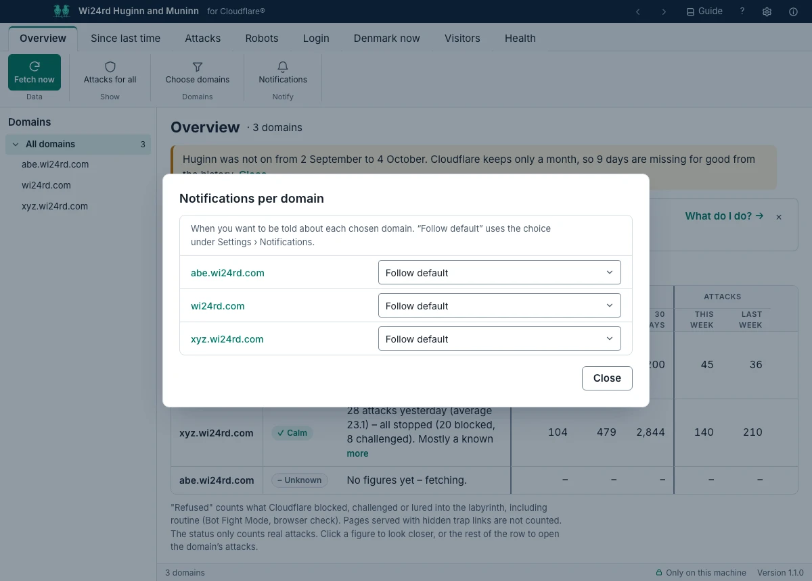
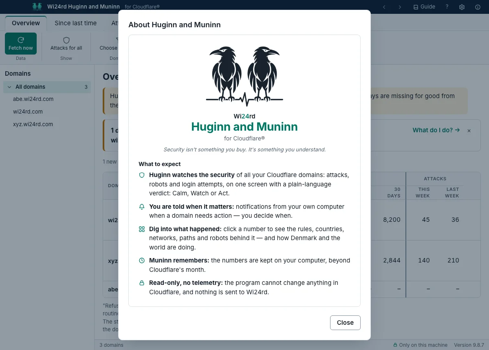

# Settings

Open Settings with the gear at the top right or with ⌘, (Windows: Ctrl+,). Settings is a window on top of the view you are in, and it can also be opened before you have connected to Cloudflare. **Close** stays at the bottom; Esc closes it too.

Every choice is saved at once on your computer. There is no Save button, except for the API Token.

The window has seven groups: **Appearance and language**, **Date and country**, **Start-up**, **Notifications**, **Connection**, **Data** and **First start**. Three things are not here but where you use them: [Domains](#domains), [Notifications per domain](#notifications-per-domain) and [About](#about).

## Appearance and language, Date and country, Start-up

| Field | Choices | Default | What it does |
|---|---|---|---|
| **Language** | System language · Dansk · English | System language | The language in the whole program, in the menu at the raven icon and in the notifications. |
| **Date format** | Follow the language · Follow the system · ISO (2026-11-04) | Follow the language | Applies to all dates in the program and the notifications. |
| **Country** | A list of countries, and possibly the button **Switch to …** | From your time zone, then the system language | Used in **… now**. **Switch to …** appears when at least half of your visitors clearly come from another country. |
| **Appearance** | System · Light · Dark | System | Follows the system, or choose for yourself. |
| **Text size** | Small · Normal · Large | Normal | Applies to the text in the whole program. Also ⌘+ ⌘− ⌘0 (Windows: Ctrl). |
| **Start at login** | Switch | On (turned on the first time a built version starts) | The program starts in the menu bar when you log in and fetches in the background. Huginn also starts by itself once a day and fetches if it is not running. The switch turns both on and off. Turn it off before you delete the program. |

If **Start at login** is off, a yellow line appears at the top: "The program does not start at login. Then Huginn only fetches while the program is open. Open it at least every three weeks, or gaps will appear in the history." The button **Turn on Start at login** turns it back on. Turn it on and off here in the program. If you turn Huginn off under Login Items in System Settings, the switch here may still show on.

*At the top of Settings: Appearance and language, Date and country and Start-up with **Start at login**.*

*The Overview in the dark theme.*

## Notifications

| Field | Choices | Default | What it does |
|---|---|---|---|
| **When do you want to be told?** | Only when serious, at most once a day · When serious (recommended) · Also when a domain should be watched | When serious (recommended) | The overall level. The message comes from your own computer, never from a server. |
| **Notify me when a domain needs action** | Switch | On | Turns off the message at **Act** if you only want to see it in the program. |
| **Notify me of “Looks like reconnaissance”** | Switch | Off | Off by default: most are automated scanners. Also applies to “Looks like DNS reconnaissance”. The label always shows in Overview and Since last time. |

At the bottom it says: "You can also turn notifications off completely in System Settings → Notifications → Huginn and Muninn." What each notification means is in [Notifications and background](60-notifikationer.md). You choose notifications for one particular domain under [Notifications per domain](#notifications-per-domain). You edit login paths in [Login](40-visninger/login.md) with **Edit paths**.

## Connection

*Status and the API Token with **Change API Token…** unfolded.*

| Field | What it does |
|---|---|
| **Status** | The chip shows, for example, **Connected · 3 domains**. The line says that the API Token is in your computer's keychain (macOS Keychain or Windows Credential Manager). |
| **API Token for Cloudflare** – **Change API Token…** | Opens the field where you paste a new API Token and click **Save and connect**. **Cancel** closes it again. The old one is replaced. |
| **Forget API Token…** | The program asks **Forget the API Token?** If you choose **Forget**, the program stops fetching, the API Token is deleted from the keychain, and your per-domain choices are deleted (domain choice, notifications per domain, login paths, technology choices). The history stays. You can connect again with a new API Token. |
| **Create API Token at Cloudflare** and **How to create an API Token** | The same help as in setup; see [Setup](30-opsaetning.md). |

*The dialog before the API Token is forgotten.*

## Data

| Field | What it shows or does |
|---|---|
| **Local database** | The size of the database on your computer. |
| **History** | The period there are figures for. Clicking opens all history for all domains in [Attacks](40-visninger/vaernet.md). |
| **Oldest day** | The first day there are figures for. |
| **What is available** | "Traffic from … · security events from …": how far back each kind of figure reaches. Shown when there are figures. |
| **Quota at Cloudflare** | "Cloudflare allows N calls per M minutes; Huginn used K in the last round." Shown when Cloudflare has reported it. |
| **Gaps** | The number of days without figures. Clicking opens the list **Gaps in the history** in the help: days that were never fetched. They are not 0. |
| **Domains with figures** | How many of the chosen domains have figures. Clicking opens the Overview. |
| **Fetch new figures now** – **Fetch now** | The same as **Fetch now** in the band. |
| **Reset history…** | Deletes all figures on your computer and fetches them again. The program asks first and says which dates are lost for good, and how many days that is. Your settings, domain choice, notifications and login paths stay. See [Data and history](70-data.md). |

## First start

| Field | What it does |
|---|---|
| **The guide** – **Show the guide again** | Opens the guide from the first start again. See [Setup](30-opsaetning.md). Opening it does not change your choices or your API Token. |

## Domains

Open the dialog with **Choose domains** in the band on **Overview**.

*One switch per domain.*

| Field | What it does |
|---|---|
| **Show in Huginn** – one switch per domain | Choose the domains Huginn should fetch and show. A domain you clear is no longer fetched, is not shown anywhere and gives no notifications; its figures stay, and if you choose it again, what is missing is fetched, at most the last 30 days. A domain that is new on the account is marked **NEW**. |
| **Choose all** / **Clear all** | All switches at once. |
| The line "The API Token sees N domains" | How many domains the API Token can see. If it sees exactly one, it is chosen for you. |

What technology your site uses, you say in [Technology by domain](40-visninger/teknologi.md), which you open with **Edit technologies** in the band on **Attacks**.

## Notifications per domain

Open the dialog with **Notifications** (the bell) in the band on **Overview**.

*One choice per chosen domain.*

| Field | Choices | Default | What it does |
|---|---|---|---|
| One choice per domain | Follow default · Serious and watch · Serious only · Never | Follow default | Overrides the overall level for one domain. **Follow default** uses the choice under Settings › Notifications. |

## About

Open the dialog with the **i** button next to the gear (**About Huginn and Muninn**).

*The dialog opens with the name and **What to expect**. The version, the licence and the button to this guide are further down.*

The version, the line "Apache-2.0 licence · No telemetry · Nothing is sent to Wi24rd", fonts and map data (Inter and JetBrains Mono under the SIL Open Font License 1.1; world-countries under ODbL and Natural Earth, public domain), the trademark line about Cloudflare and the button **Open the guide**, which opens the guide in your browser.
